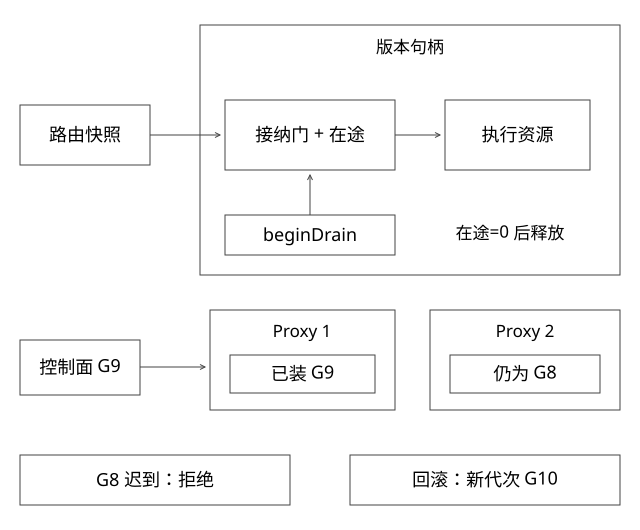

# 版本路由快照与在途排空

固定实现入口：[ReentrantLock.java · jdk-17.0.14+7](https://github.com/openjdk/jdk17u/blob/c5c90ffa45d0c14bcb013164f0992938eb4740ab/src/java.base/share/classes/java/util/concurrent/locks/ReentrantLock.java)。



## 结论：路由发布与资源销毁需要两个协议

不可变路由快照让一次请求看到一致规则；版本租约保证已取得的执行对象不会在请求中途被关闭。仅做AtomicReference替换Map，不能解决“请求刚取到句柄，还没加在途计数就被卸载”的竞态。

本地参考实现见[LeasedVersion.java](examples/source-level/LeasedVersion.java)；远程Pod场景还需实例接纳门、发现传播与连接排空配合。

## 完整推导：一个错误的关闭窗口

```text
T1：从Map取得V1，暂停
T2：删除V1，看到inFlight=0，关闭V1资源
T1：inFlight++，调用已经关闭的对象
```

先查Map、后加计数不是一个动作。正确做法是在版本门的同一把锁或等效CAS协议内，检查accepting并增加计数；beginDrain也在该同步域内把accepting改为false。

若T1先获得租约，T2排空必须等待它；若T2先停止接纳，T1必须失败/按允许策略重新选路。不存在“已拒新请求却仍成功取得新租约”的第三种情况。

## 路由快照包含什么

```text
generation
规则优先级与稳定分桶参数
版本 -> 经过验证的句柄/实例候选
允许回退策略与配置摘要
```

构建新快照、验证引用目标，再原子发布；一次请求在需要的作用域内持有generation。配置与地址异步到达时，不能只因一个字段出现就认为整个版本可服务。

控制面不可用可短时用最后有效快照，但必须定义过期、权限撤销和版本退役边界，不把缓存当永远可信。

## 排空状态机

ACTIVE接纳新请求；DRAINING不再接纳，等待已有租约释放；QUIESCENT确认在途为0后才能关闭资源。close应具备幂等保护，重复回调不能把计数减成负数。

流式请求、后台任务、延迟回调也可能持有版本资源。只统计RPC方法返回，不统计仍在发送的流或异步子任务，会过早销毁。

## 远程部署多了哪些窗口

注册中心摘除不立刻撤销所有客户端缓存和长连接。Pod本地也应进入拒新状态，并让上游按明确可重试/可回退语义处理；非幂等请求不能盲重试。

超时预算内排不空时，应明确继续等、强制隔离还是终止；Future.cancel不是任意Java死循环的安全终止保证。独立进程给出了最后终止边界，却仍需考虑已发生外部副作用。

## 回滚与版本候选

回滚可以先切回仍READY的旧版本，再排空坏版本；如果旧版本已清理或数据不兼容，就不能承诺瞬时回退。候选集合为空应显式失败或走获准兜底，不静默调用任意其他版本。

CoverageMechanics验证停止接纳、已有租约阻止立即释放、重复close安全；它验证单进程门，不是注册传播或无损下线集成证明。

## 多台Proxy怎样发布同一代配置

控制面原子发布G8，不表示P1/P2同时收到。可用不可变配置快照加带版本的发布指针：Proxy下载并校验完整G8、确认候选满足本地准入后，再一次切换自己的引用；记录desiredGeneration与appliedGeneration，不能边下载边修改在线Map。

时序例：P1已用G8，P2仍G7；随后G9撤销某版本，P1先收到G9，迟到的G8又到。若只按事件到达顺序覆盖，P1会回退错误规则。需要对配置来源身份和代次作单调判断；人工回滚应发布新的G10引用旧规则内容，而不是把代次倒写为G7。

代次不能随控制面重建随意归零。可靠存储的revision、epoch+序号或等效方案都要定义持久化与比较规则。不同来源的数字也不能直接比较，规则、地址和授权若分系统产生，需要一个能验证兼容的组合身份或明确拼装门禁。

## watch断连、全量重建与安全退化

watch是变化通知，不是唯一事实。断连后若还能从已确认revision继续，就按协议补事件；若历史已不可用，应重新获取完整快照，校验后替换，而不是假设漏掉的只有一个字段。重复通知应无害，乱序旧代不能覆盖新代。

控制面故障时，普通稳定路由可按约定短时使用最后有效快照；但权限撤销、紧急封禁和失效版本不能无限沿用旧缓存。若要求即时撤销，就需要有效在线核验、足够短的授权租约或拒绝相关操作，并接受相应可用性成本。不能同时无条件承诺离线继续服务和立刻知道尚未收到的撤销。

这是一套分布式配置参考协议，不是AtomicReference或Dubbo自动赋予的能力。应测试P1/P2不同代、旧事件迟到、快照损坏、断连恢复与来源epoch变化；单进程排空实验只验证其中的本地门。

补充算例验证：[depth_review_models.py](examples/source-level/depth_review_models.py) 中的 test_control_generation_and_dependency_dedup 核对本地安装器拒绝G8、接受回滚新代次G10，不模拟多Proxy网络一致性。

## 再向下推：规则完整，引用的实例就一定对吗

参考快照不仅有generation，还要能验证引用关系。例如规则G9指向ReleaseRef=(应用A,环境E,制品H2,配置K3)，地址集合必须属于这个ReleaseRef且满足契约准入，不能仅因地址都带r2标签就拼进来。规则与发现系统的revision属于不同序列时，不直接比较数值大小，而核对它们描述的对象是否兼容。

在单台Proxy中，先构造完整候选视图再原子安装，**安全不变量**是请求不越过获准的应用、环境和版本范围。允许部分Proxy暂留G8，是以保留旧视图换可用性的选择，不是全局一致发布。健康状态仍会变化：快照安装时可用的实例，发送前可能排空或故障，接纳失败后只在原允许范围和剩余deadline内重选。

| 时刻 | P1 | P2 | 能推出什么 |
|---|---|---|---|
| t0 | G8 | G8 | 两者使用旧规则 |
| t1 | G9且本地校验通过 | G8 | 不能宣布全局已切换 |
| t2 | G9 | 断连未知 | 不能只凭P1反馈销毁P2可能仍使用的对象 |

开源参照也有边界：[Envoy xDS协议](https://www.envoyproxy.io/docs/envoy/latest/api-docs/xds_protocol)区分资源更新与ACK/NACK；ACK表示资源被判为有效、客户端意图应用，不证明最终应用成功，更不证明所有Proxy或业务请求已使用新配置。这里不是在实现或认领Envoy。

## 无法等齐所有Proxy，旧版本怎样退役

“等所有ACK”容易被离线实例永久阻塞；“超时直接销毁”又可能让旧视图继续发请求。需要定义服务成员、视图/授权租约、旧代次请求如何被拒绝，以及离线Proxy恢复后的全量核对。把失联Proxy从入口隔离，或让旧授权到期后不再接纳相关操作，才可能形成可解释的退役边界。

这保护的是不再错误执行；若要求一个请求都不失败，还需有兼容容量、传播与接纳安排。拒绝旧请求可以保证安全，却降低可用性，不能偷换成“无损”。紧急封禁、普通滚动下线和指定版本评测可采用不同策略，但都要说明接受哪种失败。

不变量说明什么不能发生，活性条件说明何时能最终推进：在控制面恢复、有效成员可达且目标容量足够时完成收敛；永久分区或无容量时允许HOLD/失败。不能一句“最终一致”代替条件。

## 自测

请求取得快照后遇到旧句柄已DRAINING，可以按明确规则重新选路，但要保留原始deadline与次数上限；不能无限重读快照，也不能越过调用者获准的版本集合。

Map换成ConcurrentHashMap是否修复上面的窗口？没有，复合动作仍不原子。切流成功是否证明旧线程已停止？也没有，摘流与终止是不同事实。

[SVG](assets/deep-points/49.svg) · [PNG](assets/deep-points/49.png) · [返回知识点目录](实现详解_00_知识点目录.md)

