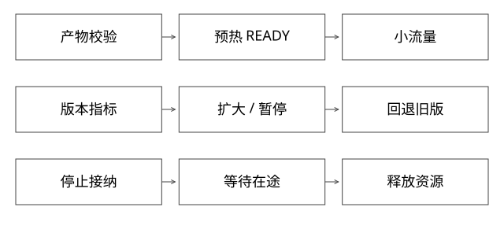

# 分批发布门禁与自动回退

固定实现入口：[sync.go · v1.29.0](https://github.com/kubernetes/kubernetes/blob/3f7a50f38688eb332e2a1b013678c6435d539ae6/pkg/controller/deployment/sync.go)。



## 结论：部署成功、允许接流、效果可接受是三个事实

灰度不是把100%流量拆成几个百分比。它是一个带验收条件和退出条件的状态机：产物校验→预热→小流量验证→逐步扩大→旧版本排空。部署完成只说明目标进程达到部署条件；是否可以接流、是否值得扩大，需要分别证明。

Kubernetes Deployment控制的是副本推进，不会自动理解业务badcase是否修复。业务门禁属于发布系统的额外协议，下面的状态机是参考设计，不是声称Deployment内置所有能力。

## 输入与控制记录

每次发布至少固定artifactDigest、配置摘要、目标版本、路由generation、验证集版本及操作者授权。一个批次记录目标比例、就绪容量、最短观察时间、最小请求量、错误/延迟/质量门槛和最长等待时间。

这里“请求量”不能替代有效样本：同一个测试账号反复调用，不等于覆盖真实用户分布；请求高度相关时，简单二项独立模型也不适用。

## 完整推导：一个新版本CPU开销翻倍

假设老版本每次请求耗10ms CPU，新版20ms。先分5%流量，新版也需要按20ms估算容量，并预留突发与预热余量，而不是直接把旧副本的5%划给新版。

发布器先准备新容量，验证READY与依赖；再发布路由generation=G8；观测数据必须标记实际版本和G8。若仍把所有实例聚合，新版错误可能被95%正常旧流量稀释。

```text
PREPARED --准入通过--> CANARY
CANARY --样本与门槛通过--> EXPANDING
EXPANDING --全部通过--> PROMOTED
任一验证阶段 --明确失败--> ROLLBACK_REQUESTED
信息不足/监控故障 --> HOLD，而非自动成功
```

门槛示例“错误率不高于对照+ε、P99不超预算、核心用例通过”只是策略形式，不是通用数值。低流量服务要结合可控回放、合成探针与更长观察期，不能等十分钟就断言安全。

## 回退为什么不等于杀进程

先把新请求切回仍可用的旧版本，再让坏版本拒新并排空。已发生的扣款、写库、发消息不会随切流自动撤销。数据库/配置不向后兼容时，代码回退可能使问题更大，必须提前设计兼容窗口或补偿。

实例卡死、线程不响应中断时，摘流只能减少新增影响；必要时由独立进程/容器边界终止，但终止不能消除外部副作用。发布控制器也要校验操作generation，避免迟到的上一轮“成功”覆盖当前回退状态。

## 失败诊断与自动化边界

CPU升高可能是新代码死循环、编译预热、缓存冷启动、依赖重试或流量结构变化。门禁可以按安全阈值先停止放量，但根因必须用版本维度的线程、调用、资源与依赖证据区分。

静态检查、单测、回归、隔离和灰度是多层防线，没有一层能证明任意业务代码绝不出故障。自动回退需要防抖和最大次数；反复切换会导致冷启动与容量抖动。

## 验证与取舍

演练三条路径：坏版本错误立即上升；监控丢数据；回退时仍有长流。分别应触发失败、暂停、等待排空，而不是得到同一个“发布失败”状态。还要验证控制器重启后能从持久化记录恢复，不重复扩大流量。

## 取消与放量同时到达，控制状态怎么仲裁

发布任务R7处于CANARY/G8，观察器准备根据旧窗口宣布通过；用户同时发出取消并进入ROLLBACK_REQUESTED。若成功回调只按任务ID写PROMOTED，就可能把取消覆盖掉。完成更新要检查预期状态、任务代次和观察窗口，旧回调不满足条件就拒绝或归档。

HOLD也不是永久卡住：应有最长等待、告警和人工决策入口。监控故障时停止扩大，不等于立即无条件回退；回退可能缺容量或触发状态不兼容。状态机必须把“不能证明安全”“证明失败”“人工取消”分别留下原因。

控制器重启后读取持久化阶段、路由实际代次和实例事实，再决定继续或回退；不能只按上次内存里的百分比补发命令。已切到30%但控制记录仍5%的未知窗口，也要靠操作身份和事实查询解决，而不是再扩大一次。

## 完整推导：取消与通过并发，原子的是哪一步

观察器读到发布R7处于CANARY、revision=7，随后得到好指标；此时用户取消，控制记录已经改为ROLLBACK_REQUESTED/revision=8。观察器不能只按R7覆盖状态。单库参考更新为：

```sql
UPDATE release_task
   SET state = 'PROMOTED', revision = revision + 1
 WHERE release_id = :id
   AND state = 'CANARY'
   AND revision = :observed_revision;
```

只有影响1行才产生对应的放量意图，并与outbox记录在本地同事务提交；影响0行则重新核对，不盲重试写成功。观察结果还需对应本次制品、路由与有效窗口，revision检查不能替代指标身份检查。

这保护**控制状态不被旧回调覆盖**，不自动保护外部路由。若“放量8”事件已经在路上，取消生成“回退9”，下游应对同一发布作用域按代次去重/拒旧，并核对操作权限。若8先到、9后到，仍可能短时执行8；若9先到、8后到，必须拒绝8。outbox保证可恢复交接，不是跨系统原子取消。

若要求取消确认后不再接受任何新放量，要把准入与取消放到同一个可仲裁边界，或者返回较弱的“取消处理中”，等待路由与在途状态核对。这里不能通过更换一个锁实现来跳过分布式窗口。

[事务模型](examples/source-level/expert_protocol_models.py)实际验证取消后旧观察CAS影响0行、乱序路由事件不倒退；也显式保留8先到时的窗口。它不验证真实Deployment或多Proxy传播。

## 灰度5%为什么也可能迅速烧预算

假设总1000请求/秒、请求成功率SLO为99.9%，按当前流量对应的预算速率是1个错误/秒；新版占5%流量且错误率10%，贡献1000×5%×10%=5个错误/秒，旧版假设无错，整体错误率已是0.5%，相对预算速率为5倍。

这不表示“一秒就耗尽整月预算”，也不是通用自动回退阈值；耗尽时间还取决于窗口、剩余预算与未来流量。例子说明小流量不能代替风险测量，要同时看版本指标、整体SLO、观察窗口与高风险动作的硬门禁。错误预算燃烧率原理参照[Google SRE](https://sre.google/workbook/alerting-on-slos/)。低流量、相关样本和监控缺失需要单独策略，不为了凑请求量无限等待或默认通过。

## 自测

问“发布耗时秒级”时，能否包括构建、排队、拉镜像、预热、切流、观察、排空的全部时间？必须说明计时边界；一个阶段秒级不能代表端到端秒级。

[SVG](assets/deep-points/50.svg) · [PNG](assets/deep-points/50.png) · [返回知识点目录](实现详解_00_知识点目录.md)

