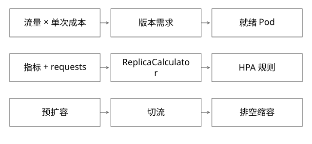

# HPA容量与多版本资源调度

固定实现入口：[replica_calculator.go · v1.29.0](https://github.com/kubernetes/kubernetes/blob/3f7a50f38688eb332e2a1b013678c6435d539ae6/pkg/controller/podautoscaler/replica_calculator.go)、[horizontal.go · v1.29.0](https://github.com/kubernetes/kubernetes/blob/3f7a50f38688eb332e2a1b013678c6435d539ae6/pkg/controller/podautoscaler/horizontal.go)。



## 结论：先按版本计算需求，再谈扩缩容

版本有多个Pod，Pod内worker数是业务运行时细节。平台需要掌握每个版本的资源请求、就绪容量、流量、耗时及饱和度；不能直接把“版本流量比例”当“Pod数量比例”。

共享资源池与版本独立进程并不矛盾：前者是资源组织，后者是故障与部署边界。独立容器也不意味着独占宿主机，cgroup不能消除所有共享内核和宿主资源影响。

## 源码入口：ReplicaCalculator实际算了什么

固定版本GetResourceReplicas会读取资源指标和Pod请求，分组识别未就绪及缺失指标，去掉不适用的样本，再计算利用率比例。在没有缺失/未就绪干扰等简化条件下：

```text
usageRatio = 当前平均利用率 / 目标利用率
desired = ceil(usageRatio × readyPodCount)
```

利用率的分母来自相关资源requests，不是limits。源码存在容忍区间：变化不足时不调整。缺失指标会用保守假设重新计算；若调整前后方向反转等情况出现，会保留当前副本，而不是机械套公式。最终还要经过HPA控制器的上下限、行为规则和稳定窗口处理。

因此排查“CPU超了却没扩”应先区分指标缺失、requests设置、采样时延、容忍区间、稳定窗口及最大副本，不能只看一张CPU图。

更具体地说，资源利用率由使用量和相关requests计算，requests不同不能简单平均每Pod百分比。假设4个Pod各请求1核、目标50%，只有2个有指标且各用0.9核：初算比例1.8；扩容方向将2个缺指标Pod按0用量补入后，整体变45%、比例0.9，方向反转，源码选择保持当前副本。缺指标不是直接把剩余两个Pod的高利用率外推到全部Pod。

## 完整推导：30%新流量不代表30%新容量

假设总流量1000请求/秒，每Pod可用1核，目标CPU利用率60%。旧版单请求CPU=10ms，新版=20ms：

```text
旧版：1000 × 70% × 0.010 / 0.6 = 11.67 → 至少12 Pod
新版：1000 × 30% × 0.020 / 0.6 = 10    → 至少10 Pod
```

新版只承担30%流量，却需要约45%的模型容量。这里是理想CPU瓶颈模型，不含系统开销、GC、突发和非均匀负载，不能直接作为生产配额。若瓶颈是连接池、外部限额或串行锁，增加CPU副本也未必提高吞吐。

[coverage_models.py](examples/source-level/coverage_models.py)校验这组容量计算，并明确向上取整边界。

## 扩容与切流的先后约束

扩大新版流量前，应确认新副本已就绪且完成必要预热。先切30%再等HPA反应，会在控制时延内把现有副本打满。缩容则先减少候选/停止接纳，等待在途排空，再回收实例；长流与后台任务要进入预算。

多个控制器同时操作时，应区分职责：发布器管理目标流量阶段，容量控制器满足阶段最低容量，调度器安排节点。若各自按不同代配置判断，会出现发布器加量、HPA缩容的对抗，需要统一generation或明确约束来源。

## 多版本的资源公平

每版本最小副本会积累空闲成本；过多常驻实验版本应定义有效期、唤醒成本、租户配额及回收规则。高优先级在线流量与离线构建宜有隔舱和优先级，避免构建尖峰挤压在线服务。

requests影响调度和利用率基准，limits限制使用上界；把request压得很小只能改善账面利用率，不会创造真实容量。CPU节流、内存OOM、节点驱逐要分开观测。

## 自测

为何平均CPU只有40%，P99却很差？可能有单热点分片、短周期节流、GC、锁等待或依赖变慢。先检查分布和瓶颈，不能直接调低目标利用率。

[SVG](assets/deep-points/51.svg) · [PNG](assets/deep-points/51.png) · [返回知识点目录](实现详解_00_知识点目录.md)

