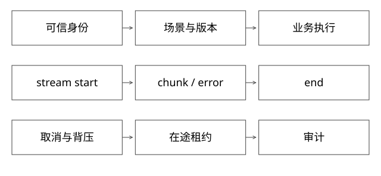

# 平台服务契约权限与流式接口

固定实现入口：[NioEventLoop.java · netty-4.1.108.Final](https://github.com/netty/netty/blob/3a3f9d13b129555802de5652667ca0af662f554e/transport/src/main/java/io/netty/channel/nio/NioEventLoop.java)、[ChannelOutboundBuffer.java · netty-4.1.108.Final](https://github.com/netty/netty/blob/3a3f9d13b129555802de5652667ca0af662f554e/transport/src/main/java/io/netty/channel/ChannelOutboundBuffer.java)。



## 结论：平台通用的是执行契约，不是业务语义

平台负责版本选择、服务接入、执行生命周期、资源和治理；业务负责查询理解、特征、策略、排序及业务对象。统一入口不等于把所有业务请求拍平成一个不可验证的JSON，也不要求业务放弃自己的SDK。

下面给出可讨论的参考契约，不代表任何公司的内部接口。

## 请求从哪里获得可信上下文

```json
{
  "scene": "catalog-search",
  "releaseHint": "experiment-a",
  "requestId": "r-17",
  "deadlineMs": 300,
  "payload": {"query": "轻便跑鞋", "limit": 20}
}
```

tenant、身份和允许操作来自经过验证的认证上下文；不能信任payload里自填的tenantId。releaseHint也只是意图，平台必须检查权限和规则，限定允许版本集合，再由服务调用层选具体实例。没有权限的版本不能因“调试方便”被任意调用。

requestId用于追踪，不天然是业务幂等键。会产生外部写入时，还需要稳定operationId、作用域和重放策略。

示例deadlineMs表示本次入口约定的剩余预算，不是绝对墙钟截止时间；真实协议应换成不含歧义的字段并说明跨节点扣减。每一层重新给足300ms，会延长总等待，详见[SDK契约](实现详解_69_SDK入口契约与跨版本兼容.md)。

## 完整推导：从入口到业务再返回

1. 网关/SDK校验身份、场景、结构、截止时间和配额。
2. 读取一次路由快照，得到允许版本及实例候选。
3. 取得版本请求租约，将取消和deadline传播给业务执行。
4. 业务返回类型化结果；平台附加实际版本、trace与耗时等诊断信息。
5. 请求真正结束后释放租约，记录失败类型而非只留一个异常字符串。

场景定义应有schema版本；公共字段的语义也要稳定，例如limit是否含置顶结果、空候选是成功还是降级。默认值变化同样可能是兼容性变更。

## 流式响应为何不能沿用普通RPC的完成定义

```text
start(requestId, actualVersion)
chunk(seq=0, data)
chunk(seq=1, data)
end(reason=completed)
或 error(code, retryable, lastSeq)
```

LLM场景的TTFT通常指首个输出token的等待时间；首字节TTFB、首个有效业务chunk、首个token以及整条流结束，是不同计时点。如果接口并非token流，应单独定义“首个有效业务输出”，不要都叫TTFT。连接断开时，服务器任务不一定自动停止，应将取消信号传到下游，但取消不能撤销已经完成的副作用。

seq能帮助识别重复和缺失，却不能单独实现断点续传。续传还需要服务端持久缓冲、有效期和读取权限。客户端重连重新执行整个Agent，可能再次部署或扣费，不能无条件自动重试。

Netty的EventLoop串行处理一组channel事件，阻塞工具调用不应直接压在事件循环；出站不可写时需要有界缓存、暂停生产或取消慢流。无限收集chunk会把下游背压变为进程内存泄漏。

## 三类权限不能混为一谈

代码仓库读取权限、构建/发布权限、运行时业务数据权限分别授权。用户可以读SDK文档，不代表可以向生产推全；Agent能调用CLI，也不代表CLI可以忽略操作人的身份。审计应记录主体、目标、参数摘要、授权结果与实际变更ID，不泄露密钥或完整敏感payload。

## 验证与取舍

设计契约测试：未授权releaseHint、过期deadline、重复写操作、流中断、迟到chunk、跨租户对象引用。需要断言拒绝时没有产生副作用，而不是仅验证HTTP返回403。

## 用一条任务链把指标、日志与结果关联起来

一次用户任务run7可以有多次模型调用、工具尝试、部署D17和评测E9，不能只靠一个requestId概括所有层。参考关系是run_id→step_id/tool_call_id→operation_id→deployment_id→evaluation_run_id；各次网络尝试另带trace/span及实际版本。

假设总任务耗时90秒，其中排队20、构建40、部署就绪15、评测10、模型与其余开销5。只有各段互不重叠时才可直接相加；并行工具应看关键路径，而非把每个span耗时累计成用户等待。重试次数与重复计费也要单独归属，不能把一次用户任务误记为十个成功任务。

## 可观测性不是把全部输入打进标签

指标适合有限维度聚合，例如环境、版本、阶段和错误类别；run_id、用户ID、完整query等高基数字段更适合受控日志/追踪，不能无上限加入时序指标标签。日志应保留对象身份、状态与证据引用，敏感正文按权限和必要性处理。

采样会影响看到哪些失败。只保留成功或短请求，会丢掉最需要的超时链路；故障任务可按策略保留诊断证据，但要定义成本与隐私边界。没有采到某次trace，不等于这次调用从未发生，应查平台权威业务状态。

## 一次故障演练应有可判定预期

注入“部署已提交、响应丢失”后，预期是按原operation_id发现D17，后续核验同一制品再评测；不是必须所有请求都返回200。注入“评测命中旧版本”时，预期停止接受该报告并标无效；注入“慢客户端断流”时，检查任务与缓冲是否在预算内回收。

每个演练记录注入点、允许副作用次数、应到状态、恢复时限与证据。没有这些判定，随机kill一次Pod后系统最后恢复，不足以证明恢复协议正确。

## 自测

一个流已经输出10个chunk然后失败，能否简单记为成功？不行；要同时记录部分输出、终止原因和业务完成状态。可见输出不等于任务已交付。

[SVG](assets/deep-points/52.svg) · [PNG](assets/deep-points/52.png) · [返回知识点目录](实现详解_00_知识点目录.md)

