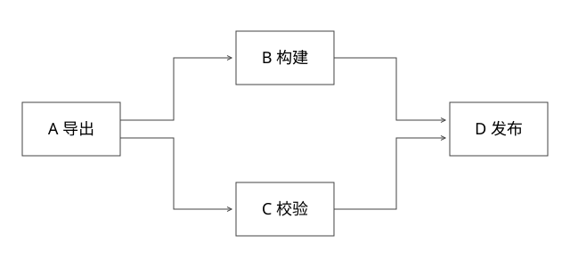

# DAG依赖调度与任务状态机

实现边界：以下为可验证的参考协议，不冒充任何内部平台或框架的完整实现。



## 结论：DAG调度要同时维护依赖事实与尝试状态

画出A→B→C不等于实现调度器。必须回答：谁判断可运行、输出何时可见、重复完成怎样处理、上游失败后下游是否永久等待、重试是否会重复副作用。以下是自主参考协议，不是某个框架源码的同名实现。

## 先定义节点和边

节点保存nodeId、输入引用、输出引用、状态、attemptId、deadline。边表示“需要哪份已提交输出”，不是线程必须按画图顺序运行。

```text
A 导出 → B 构建 → D 发布
       → C 校验 → D 发布
```

D默认all-success语义：B、C都成功后才READY。若业务允许C失败仍发布，必须把C明确标为可选依赖，并定义D收到缺失结果时如何处理。不能临时通过少减一次入度“跳过错误”。

## 完整推导：入度如何归零

初始A入度0，B/C入度1，D入度2。A输出写临时对象并完成校验，原子提交输出指针和A=SUCCEEDED；之后才解除B/C依赖。若先发完成事件、后写输出，B可能读取半份数据。

B成功，D剩余1；C成功，D变0进入READY。C的成功回调重复到达时，不能再次减到负数，需用已完成事实或attempt CAS去重。

```text
PENDING --依赖满足--> READY --领取attempt--> RUNNING
RUNNING --提交输出且attempt匹配--> SUCCEEDED
RUNNING --失败--> READY(可重试) 或 FAILED
上游终止失败 --无允许替代--> SKIPPED
```

RUNNING→SUCCEEDED必须检查当前attemptId。超时重试后，旧worker迟到的成功不能覆盖新attempt结果。输出可以先写不可变临时路径，再CAS发布引用；CAS失败者的孤儿文件由后续GC回收。

## 并行join的三个竞争

同一节点被两个调度器领取，需要原子状态转换；两个上游同时完成，需要原子检查全部依赖或事务维护剩余计数；同一完成事件重复投递，需要记录edge/attempt处理事实。单机锁只能证明单进程版本，多调度器要用存储事务/CAS和可靠事件恢复。

“先持久化成功，后发消息”会有消息未发窗口，可用事务outbox或周期性从状态重建READY；“消息已发”不能成为唯一事实来源。

## 失败、取消与循环

编译阶段用拓扑排序检测环：输出节点数少于总节点数说明存在环。正常DAG不允许靠运行时“多跑几轮”解决环；Agent循环应由显式有界迭代状态表达，每轮有独立预算和状态。

A失败后，依赖它的节点应标SKIPPED或进入明确替代路径，不能一直PENDING。取消并不意味着远程任务已停止，仍需租约、尝试身份与外部幂等保障。

## 验证与代价

[coverage_models.py](examples/source-level/coverage_models.py)检查无环、fork/join、重复完成不重复解锁、失败传播和旧attempt拒绝。它是确定性单进程参考模型，不包含消息队列事务或多机故障演练。

大图全量扫依赖简单但成本高；增量计数快却容易因漏事件产生漂移。常见取舍是事件驱动推进加周期性一致性核对，最终以持久化状态为事实。

## 并发join不要只用一个裸整数

D依赖B、C，remaining=2。B完成消息重复两次，若每次直接remaining--，D会在C尚未完成时误变READY。应先固定本次图运行的逻辑依赖边及其期望产物；同一逻辑边只能满足一次。输出revision用于校验，不允许通过换revision重新计作另一条边。输出引用和这次接收应一致提交。

B和C同时完成时，也不能各自读取remaining=2再写1，丢掉一次更新。可用事务内原子计数，或直接从已持久化依赖集合判断全部满足。计数更快，集合更接近可重建事实，二者需要有周期核对策略。

如果上游输出从B1变成B2，已经消费B1的旧下游不是简单再减一次入度，而应形成新的运行/输入版本。依赖边连接的是产物事实，不只是节点名字；这也解释为什么“把B手动重新置READY”可能破坏整个图的可追溯性。

补充算例验证：[depth_review_models.py](examples/source-level/depth_review_models.py) 中的 test_control_generation_and_dependency_dedup 核对集合式依赖对重复B事件不提前解锁D，不验证多机事务。

## 把join落到可检查的事务，不靠消息次数

参考表以(run_id, downstream, dependency_id)为主键，保存expected_output_revision、satisfied。D的两行分别是(B,B1,false)与(C,C1,false)。这里dependency_id表示逻辑输入槽位；若合法地依赖同一上游的两个产物，应明确建成两个不同槽位。

```text
BEGIN
  UPDATE dependency SET satisfied=true
   WHERE run=G1 AND downstream=D AND dependency=B
     AND expected_output_revision=B1 AND satisfied=false
  若首次满足：按存储事务/锁协议检查D是否还有未满足的依赖
  若全部满足：将D从PENDING改READY，写就绪通知outbox
COMMIT
```

为什么不只用(run,D,B,outputRevision)去重？B1与B2会成为两个不同唯一键，若不再校验固定输入槽，仍可能把同一逻辑依赖满足两次，让C未完成就放行。新输出需要新的运行或显式新输入绑定，不是多插一条成功消息。

上面的“检查全部满足”也要有并发协议：两个事务同时分别更新B/C后，若各自基于旧快照看不到另一方，就可能谁也不推进D。可在一致锁顺序下锁定D协调记录，或按目标数据库语义原子维护剩余数，再用条件转换生成唯一READY；若依赖周期核对修复，则必须承认短时漏推进并给出活性边界。不能把逻辑伪代码当作任意隔离级别都安全的完整SQL。

另外，完成依赖的前提是上游当前attempt成功提交了产物指针；worker旧attempt只写出了文件，不构成完成事实。join事务、产物提交和调度领取分别有自己的条件更新，不能混成一把全局锁。

[expert_protocol_models.py](examples/source-level/expert_protocol_models.py)使用SQLite BEGIN IMMEDIATE串行化本地写事务，两条连接重复完成B只生效一次、B2不占新槽、C1后D只READY一次。它没有验证MySQL MVCC下的所有交错，故不把SQLite的序列化方式照搬为生产实现。

## 自测

D已经READY后，B被人手工改成FAILED怎么办？成功产物应不可变；若要撤销或重跑，建立新的图运行/输出版本，而不是悄悄修改已被下游使用的事实。

[SVG](assets/deep-points/53.svg) · [PNG](assets/deep-points/53.png) · [返回知识点目录](实现详解_00_知识点目录.md)

