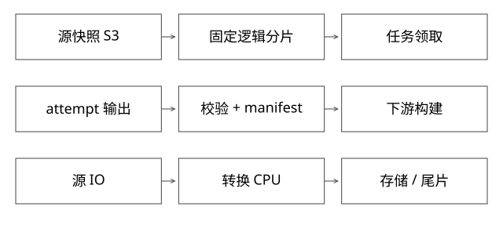

# 数据导出分片与瓶颈定位

实现边界：以下为数据导出与任务拆分的参考协议，配套确定性模型；不将部署控制器源码当作导出引擎实现。



## 结论：先固定数据集合，再优化并行度

数亿条数据拆任务，首先要定义“这一批到底包含哪些记录”。稳定源快照、稳定逻辑分片、可重试尝试和完整产物提交，比线程数更重要。没有快照，多个worker各读自己的最新数据，最后可能不是任何时刻的完整集合。

## 逻辑分片与worker不能绑死

假设固定P=64个逻辑分片，用稳定业务主键hash后映射到[0,63]。本次运行8个worker，每个领若干分片；扩为12个worker，只改变任务领取，不改变每条记录属于哪个逻辑分片。

直接以hash(key)%workerCount划分，扩容会重定义数据归属。若8与12节点的新旧任务混跑，可能漏读或重复写。若业务需要重新分片，应建立新partitionScheme版本和全新manifest，不能原地替换参数。

范围切分适合有序可裁剪数据；hash切分均匀但源端未必能高效过滤。必须确认ODPS/数据库/文件源实际支持哪种分区读取，不能设计出每个worker都全表扫描再丢弃大部分数据的方案。

## 完整推导：一份可恢复的导出

```text
run R7: snapshot=S3, schema=V2, partitionScheme=H64
shard 0: attempt A -> 写临时路径 -> 行数/字节/校验 -> 发布manifest项
shard 1: attempt B -> 失败；重试C写另一临时路径
run完成：64份同源、同schema、同分片方案产物全部齐备
```

复用的前提不是“文件存在”，而是输入快照、逻辑分片、转换代码、schema及校验契约均匹配。一个文件的字节checksum只能证明内容未变，不证明过滤条件正确、没有漏记录。

单片过大时可进一步细分稳定子范围；按预计字节或处理成本而不是单纯行数均衡。热点key、超大字段、慢源分区都可能制造尾任务。

## 真正瓶颈如何定位

对每阶段记录源扫描字节/行、反序列化CPU、转换CPU、压缩CPU、写出字节、OSS吞吐、重试和分片耗时分布。总耗时由关键路径决定，不是所有worker耗时求和。

例如需读1TB，源端总吞吐上限2GB/s，理想读取下界约500秒；增加worker无法突破源配额。若转换消耗4000核秒，使用20核理想需200秒；流水线并行时不能简单把500和200直接相加，也不能忽视无法重叠的阶段。

[coverage_models.py](examples/source-level/coverage_models.py)验证固定分片在8/12worker计划下归属不变与任务覆盖；这不证明真实源吞吐或hash分布。

## 优化必须带对照

先测少量代表分片，确认CPU/IO/网络瓶颈，再提高并行度并记录吞吐曲线与尾片。批量读取、减少重复扫描、避免逐条远程请求、合并小文件、列裁剪、流水线压缩，作用的瓶颈各不相同。

“天级到分钟级”要明确是否只统计DUMP、数据量/大小是否相当、是否包含排队和重试、源端缓存是否一致。不能把某次小表试跑结果当数亿数据端到端指标。

## 自测

失败到90%能否从第91%继续？只有输入可定位、转换可恢复、输出分块有提交边界时才能；任意流的百分比不是可恢复checkpoint。

[SVG](assets/deep-points/54.svg) · [PNG](assets/deep-points/54.png) · [返回知识点目录](实现详解_00_知识点目录.md)

