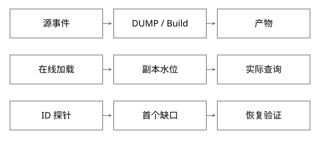

# 索引缺失与新鲜度排障

固定实现入口：[StandardDirectoryReader.java · releases/lucene/9.9.2](https://github.com/apache/lucene/blob/a2939784c4ca60bc28bf488b5479c02fc2e5e22c/lucene/core/src/java/org/apache/lucene/index/StandardDirectoryReader.java)、[SubscriptionState.java · 3.7.0](https://github.com/apache/kafka/blob/2ae524ed625438c5fee89e78648bd73e64a3ada0/clients/src/main/java/org/apache/kafka/clients/consumer/internals/SubscriptionState.java)。

## 结论：用同一个业务ID贯穿全链路，逐段证明存在性

“商品搜不到”并不等于“索引没构建好”。源数据未进入、增量没追上、构建过滤、实例加载旧版本、路由到旧副本、查询过滤或TopK截断都能产生相同表象。先确认影响范围与新鲜度承诺，再定位第一个不符合预期的边界。

下面是排障方法，不是对某次历史故障根因的猜测。

## 先固定一个能复现的探针

记录业务ID、预期字段、事件版本、首次可检索时限、查询、租户、过滤参数、实际请求trace、路由版本和落点实例。若是“最近创建”的对象，要先判断是否已超过增量延迟SLA。

用同一ID做原始索引查找与用户查询对比：原始ID查得到、用户query找不到，通常优先查分析器、过滤、评分与截断；连原始ID也没有，再向加载和构建链路追。

## 完整推导：订单式证据链

| 边界 | 要找的证据 | 能排除什么，仍不能证明什么 |
|---|---|---|
| 业务源 | ID存在且事件版本正确 | 排除源缺失；不能证明CDC已发 |
| 消息/快照 | 分区、offset或快照行 | 证明进入输入；不能证明消费者应用 |
| DUMP | 对应逻辑分片内的转换记录/拒绝原因 | 排除清洗漏数；不能证明build收录 |
| Build | ID到内部文档、删除标记、字段与产物generation | 证明产物存在；不能证明线上加载 |
| 实例 | 已加载generation、增量应用水位、健康状态 | 不能只看控制面“已下发” |
| 请求 | 实际实例、过滤与各层候选去向 | 区分不召回、被过滤、排名靠后 |

日志中“消费到offset=1000”也不一定代表索引持久化到1000，应用与checkpoint边界见[位点恢复](实现详解_26_Kafka位点与外部索引恢复.md)。同一版本号若允许覆盖产物，也不足以证明副本内容一致，应使用不可变摘要与来源水位。

## 一个可分叉的案例推演

假设ID=K17，源事件v9已出现，线上R0能查到而R1查不到：

1. 对比两副本实际加载generation。不同则查分发/下载/加载状态，不能先调查询逻辑。
2. generation相同但增量水位不同，查R1消费、应用失败及checkpoint，必要时在不丢恢复数据的前提下摘除落后副本。
3. generation和水位都一致，检查ID是否因重复/乱序事件被错误覆盖；事件版本比较比单纯“最后收到”可靠。
4. 直接ID均可查，而用户查询仅R1失败，继续比对查询配置、词典、过滤字段和运行代码摘要。

这组分支是假设推演，不作为真实公司事故陈述。若问题来自TopK截断，不能通过“把所有结果都召回”粗暴修复，应评估候选预算与相关性。

## 缺失、陈旧与不一致不是同一指标

缺失率衡量应存在对象未存在；新鲜度是源变更到可检索时间；副本差异是相同逻辑状态在副本之间的偏差。对齐source时间、事件时间、处理时间，避免把源晚到当消费者慢。

抽样可以发现问题但不能证明零漏数。全量校验需要定义预期集合、业务过滤规则、计数/分桶摘要与抽样ID；仅比较总文档数可能被“漏一条、重一条”抵消。

## 恢复与验收

先控制影响：隔离坏副本、回退已验证版本或暂停坏增量；再重放/重构。修复后验证原ID、同类ID、正常对照、所有候选副本及新增变更，观察至少覆盖原故障窗口。

## 自测

Build显示SUCCESS是否足以关闭工单？不够；还要确认目标在线实例已加载、实际路由可达、源至查询的探针通过，且没有把坏副本留在候选里。

[SVG](assets/deep-points/55.svg) · [PNG](assets/deep-points/55.png) · [返回知识点目录](实现详解_00_知识点目录.md)

