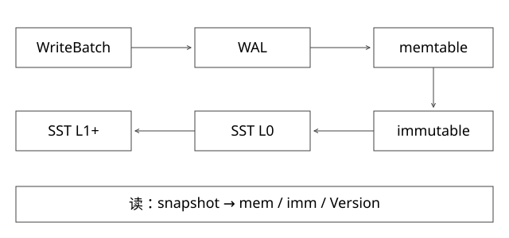

# 存储选型与LSM读写放大

固定实现入口：[db_impl.cc · 1.23](https://github.com/google/leveldb/blob/99b3c03b3284f5886f9ef9a4ef703d57373e61be/db/db_impl.cc)、[version_set.cc · 1.23](https://github.com/google/leveldb/blob/99b3c03b3284f5886f9ef9a4ef703d57373e61be/db/version_set.cc)。



## 结论：先比较访问模型，不按语言或名字选存储

缓存、主键存储、列族存储和检索引擎优化的路径不同。Redis内存访问、HBase按rowkey组织的分布式读写、Lucene倒排检索，不能仅凭“都能存数据”互相替换。Java不是不适合引擎的充分理由，是否满足延迟、内存布局、GC、生态和运维约束才是问题。

下面用LevelDB 1.23解释LSM的具体机制，不将它冒充HBase或所有RocksDB版本的实现。

## 结构：可写内存与不可变文件协作

WriteBatch带一组有序更新。DBImpl::Write把写者放入队列，可能通过BuildBatchGroup合并；为写批次分配序列号，写WAL，按sync要求同步日志，成功后插入memtable。WAL用于崩溃恢复；memtable提供当前读路径。仅有“内存写成功”不能概括持久化承诺。

memtable满后变为immutable memtable，后台落为SST；随后compaction整理文件。SST不可变意味着更新不是原地修改旧值，而是新增更高序列版本或删除标记。

## 源码走读：Get为何要保留三种引用

DBImpl::Get先在互斥区确定snapshot sequence，引用mem、imm和current Version，再解锁读取。依次尝试mem→imm→current.Get。读取期间引用计数保证后台版本替换不会提前回收它正在访问的结构，结束后再释放引用。

Version::Get在L0要处理可能重叠的文件并按新旧关系寻找；更高层的非重叠key范围可缩小候选文件。这里的“层”是LSM文件组织，不是每次读都扫全部层的所有文件。

## 完整推导：更新与快照

```text
seq10: K = A
seq20: K = B
seq30: DELETE K
snapshot=15 -> A
snapshot=25 -> B
当前读       -> 不存在
```

查询需要定位不高于snapshot的可见版本。删除标记不能见到旧文件就随意丢弃：如果下层还存在K=A，而删除标记被先清掉，旧值可能复活；快照也可能仍需要历史版本。compaction必须同时考虑可见性和更低层是否可能存在旧键。

## 三种放大的来源

写放大：用户写一次，WAL、flush及多轮compaction反复写数据。读放大：为判定一个键的最新可见状态，可能检查多个文件；Bloom filter可减少部分无谓查找，但不是“过滤后绝不读盘”。空间放大：旧版本、重叠文件和压实过程的临时文件占空间。

提高compaction并行度可能改善积压，却挤占在线IO并抬高尾延迟；降低写放大也可能增加读放大。吞吐压测必须把稳定期compaction算进去，只测写入前十分钟会把后台债务藏起来。

## 按需求做选择

需要低延迟热点读取且可接受缓存一致性，考虑内存缓存；需要主键/范围读及持续写入，比较LSM/B树体系；需要词项、布尔过滤、相关性及向量候选，选择对应检索能力，并明确它是否作为事实源。

一条业务可能组合事实库、消息流、索引和缓存，但每层都引入更新延迟与恢复协议。不要为“技术先进”增加一层，却没有说明解决的瓶颈。

## 放大要写清分子分母，不能只说LSM写得快

假设业务净写入10GiB，WAL写10GiB、初始SST写10GiB、后续compaction又写40GiB。若按总持久化写字节/用户写字节，写放大为60/10=6；若某报告只计算compaction，得到4。两个数字都可能来自明确口径，不能混比。

读放大同样有层次：要检查几个候选文件、解码几个块、触发几次真实设备IO，并不相等。Bloom filter会有假阳性，且需要内存与构建成本；“Bloom可能存在”后仍要查索引与数据，“一定不存在”也只在过滤器正确对应文件和key编码的前提下成立。

空间放大还包括旧版本、快照保留和压实新旧文件同时存在。磁盘刚好装得下当前SST，不代表有足够空间完成下一轮compaction；需要把后台债务、临时空间和恢复余量纳入容量。

## 为什么不能用刚开始几分钟的写入吞吐定型

空库写入主要追加内存与L0，暂时未充分经历层间重写；持续运行后compaction追不上，会触发写入减速或阻塞，查询尾延迟也可能上升。可靠比较应包含稳定期、热点与范围分布、删除、快照保留和读写混合，而不是只比较一次顺序导入峰值。

## 自测与验证

读源码时沿Write的错误分支检查：WAL失败后是否仍插入memtable？sync失败如何记录后台错误？不要把sync=false的返回当每次都已落稳定介质。

若用户删除K后又看到K，是一定缓存问题吗？不一定，也可能是索引乱序覆盖、快照选择或删除标记处理错误。需要相同版本/水位证据再判断。

[SVG](assets/deep-points/56.svg) · [PNG](assets/deep-points/56.png) · [返回知识点目录](实现详解_00_知识点目录.md)

