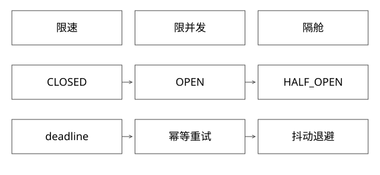

# 限流熔断隔舱与退避

固定实现入口：[CircuitBreakerStateMachine.java · v2.2.0](https://github.com/resilience4j/resilience4j/blob/e77f3536ac9b6c4764b1b8ac3dae0bca540768e4/resilience4j-circuitbreaker/src/main/java/io/github/resilience4j/circuitbreaker/internal/CircuitBreakerStateMachine.java)、[AtomicRateLimiter.java · v2.2.0](https://github.com/resilience4j/resilience4j/blob/e77f3536ac9b6c4764b1b8ac3dae0bca540768e4/resilience4j-ratelimiter/src/main/java/io/github/resilience4j/ratelimiter/internal/AtomicRateLimiter.java)。



## 结论：速率、在途数量和失败趋势要分别控制

限流约束进入速率，限并发约束同时占用资源的请求数，熔断根据失败/慢调用趋势暂时拒绝依赖调用，隔舱限制一个故障域消耗的线程/连接/容量。降级是明确的业务替代结果。它们相关但不能互相代替。

例如每秒100次，依赖耗时由10ms变成10秒，平均在途可由约1增至约1000。速率没变，但连接和内存会耗尽；Little定律L≈λW适用于稳定系统平均量，不是瞬时峰值保证。

## 源码入口：熔断不是一个失败计数器

Resilience4j固定版本CircuitBreakerStateMachine以stateReference保存状态，权限申请委派当前状态。CLOSED记录调用结果并在满足采样条件和阈值后OPEN；OPEN期间普通请求被拒绝，等待条件满足后进入HALF_OPEN，用有限探测判断是否恢复。

HalfOpenState的permittedNumberOfCalls使用原子减法分配探测权限。只有取得名额的调用可探测；结果更新指标，满足阈值后用一次性状态切换防止并发探测重复转换。

所以“半开一次只放一个请求”不是通用定义，名额可配置；“过了冷却时间就恢复正常”也不准确，通常还需探测。忽略异常/未实际执行时的permission释放与记录策略必须匹配，否则可能耗尽探测额度。

## AtomicRateLimiter不是任意令牌桶伪代码

它的不可变State包含activeCycle、activePermissions、nanosToWait等。calculateNextState按周期补充并计算可预约权限，CAS提交；竞争失败重新计算。预约后权限可能为负，用于表达将来周期的需求。

reservePermission按可等待预算返回立即可用、需等待时长或拒绝；acquirePermission可能park等待。不要因为API叫acquire就把阻塞实现直接放在Netty EventLoop，它会阻塞该线程负责的其他连接。

周期预约的突发和公平性要按该实现分析，不能套用“每毫秒匀速一枚令牌”的理想模型。

## 完整推导：重试如何放大一次故障

若入口、服务内部、SDK三层各允许最多尝试3次（含首试），最坏可形成3×3×3=27次下游尝试，而非3次。“重试3次”若不含首试，则每层是4次尝试，三层可达4³=64次；必须区分retries与总attempts。若每次都耗满超时，上层deadline早已失效。

```text
总deadline = D
每次尝试前：剩余预算足够？操作可重试？幂等身份稳定？
失败后：指数退避 + 随机抖动 + 最大次数/总预算
熔断拒绝：通常不立刻在同一层紧密重试
```

“超时”只说明调用方没确认，不证明下游没成功。部署、扣款等动作要先用operationId查询/去重，再决定重做。读接口也可能有计费或资源副作用，不能只按HTTP方法判断。

## 隔舱与降级的边界

为不同版本/租户设线程、队列、连接或并发配额，队列必须有界。共享池能提高利用率，但热点租户应有公平性与隔离；否则一个坏版本耗尽公共池，版本进程隔离也保护不了调用端。

降级要显式标记来源和质量，例如返回缓存旧值需说明新鲜度；营销资格判断不能随意“默认可用”，风控和金额类场景尤其要按业务安全约束失败。

## 自测与验证

注入依赖慢、全部失败、短暂抖动和恢复四种场景；检查被拒绝量、实际下游尝试数、在途上限、半开探测并发与恢复时间。参考源码并不意味着本文运行了Resilience4j集成压测。

如果CPU很低且线程全在等外部依赖，扩CPU副本一定能恢复吗？不一定，反而会增加下游压力；应先识别依赖容量、限并发及退避边界。

[SVG](assets/deep-points/57.svg) · [PNG](assets/deep-points/57.png) · [返回知识点目录](实现详解_00_知识点目录.md)

