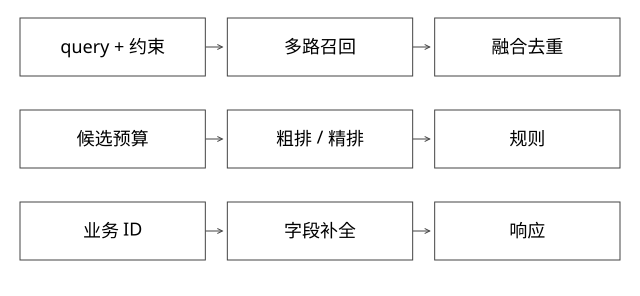

# 查询理解多路召回与结果组装

固定实现入口：[Analyzer.java · releases/lucene/9.9.2](https://github.com/apache/lucene/blob/a2939784c4ca60bc28bf488b5479c02fc2e5e22c/lucene/core/src/java/org/apache/lucene/analysis/Analyzer.java)。



## 结论：查询链路要能解释每个候选从哪来、为何消失

用户输入不应直接变成一个不透明的“召回→排序”箭头。至少区分查询理解、硬约束、各路候选、融合去重、排序与业务对象补全；每个阶段保留可观测的数量、规则版本与耗时。以下是参考流水线，不假设内部引擎实现与Lucene完全相同。

## 规范化、分词和改写各解决什么

规范化处理空白、大小写、字符形式等；分词把文本变为带位置等信息的token；改写可能做同义词、纠错、意图扩展。Lucene Analyzer的TokenStreamComponents及复用契约提供分析管道，具体tokenizer/filter由使用者配置。

“苹果14 256G”中的品牌、型号、容量若被泛化改写成“手机”，可能召回很多不满足需求的商品。硬实体约束与扩展词应保留原查询和置信度，不把模型猜测直接当唯一输入。索引分析器与查询分析器的差异也要有意设计，否则相同表面词可能根本匹配不上。

## 完整推导：三路候选如何汇合

```text
词项路: [A,B,C]     向量路: [B,D,E]     规则路: [F,A]
去重后: A,B,C,D,E,F，保留每路rank/score/provenance
硬约束: 例如地区不可售的D剔除
精排与业务规则: 输出K个业务ID
字段补全: 批量获取标题/价格/库存等，按ID对齐
```

去重键要用稳定业务ID，不能用各引擎内部docID；docID可能随merge变化。融合不能直接相加不同量纲的BM25与向量分数，可做经过验证的归一化、学习融合或RRF；RRF的常数与候选深度会改变结果，不是万能默认。

## 过滤放在哪里有何代价

召回前过滤能避免把候选预算花在不合法对象上，但向量近邻的过滤策略可能影响搜索效率与召回；召回后过滤简单，却可能剩不足K。补取候选需要总时限与最大轮数，不能无限扩大搜索。

售卖状态、权限、地域等硬约束在最终返回前还需校验，尤其依赖动态字段时。静态索引快照与实时库存不一致是业务事实，不应通过“全链路一个版本号”掩盖。

## 排序与字段补全的失败语义

粗排优先减少精排成本，但过早丢弃相关对象，后面再强的精排也恢复不了。要统计oracle候选在各层的保留率，而不只看最终平均分。

字段补全常见错误是批量返回顺序与请求顺序不同，按位置拼接导致商品A挂上B的价格；应按业务ID映射。缺字段、对象已删、超时应明确降级/剔除规则，不让模型补造真实交易字段。

## 性能与归因

各路并行召回的总时延接近关键路径加汇合开销，不是各路时延相加。可选慢路允许超时跳过，但响应必须记录缺了哪一路；同一AB实验不要让候选范围、词典、模型和库存快照同时无记录变化。

检查一个badcase时，保留标准化query、约束、各路候选rank、被过滤原因与最终排序。只保存最后自然语言答案，无法判断是没召回、排错还是补全错。

## 自测

最终结果不足K是不是召回算法差？可能是过滤淘汰、去重比例高、字段补全失败或下游超时。先按阶段计数和ID轨迹定位，不能直接更换embedding模型。

[SVG](assets/deep-points/58.svg) · [PNG](assets/deep-points/58.png) · [返回知识点目录](实现详解_00_知识点目录.md)

