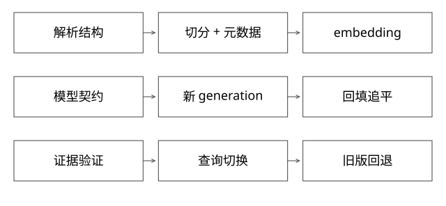

# RAG切分向量与索引升级

固定实现入口：[interface.go · v0.7.0](https://github.com/cloudwego/eino/blob/18427c201b3315586802260f8b20a97f6b008e8b/components/embedding/interface.go)。



## 结论：RAG数据工程决定“检索到了什么”，不只是选向量库

loader、切分、embedding、索引、权限、检索和答案引用是不同边界。解析错表格、切掉前置条件，后面相似度再高也会把错误证据送进模型。本文重点讲数据与向量空间，证据权限见[42](实现详解_42_RAG证据链与版本权限.md)。

## loader需要保留哪些结构

同一份发布说明含“版本3之后支持”与下一段“配置项A”。若按固定字数把两句拆开，检索到A的用法却没有版本条件，答案就可能在版本2执行错误操作。

解析结果应保留documentId、revision、sectionPath、页码/原始位置、表头与行关系、访问标签。扫描PDF还要区分OCR置信度，不能把识别不清的参数当精确API。表格按行切分时重复表头有成本，却可能比孤立数字更可靠。

## 完整推导：怎样评价切分

准备带标准证据位置的查询集，比较“按标题/段落”“固定token+重叠”“表格单独处理”等方案。每个方案统计证据Recall@K、带全必要条件的比例、重复上下文占比、总token与实际回答正确率。

chunk越小定位越准，但可能丢条件；越大上下文完整，却更容易稀释向量表达并挤占窗口。overlap能减少边界损失，也增加重复与索引成本；不存在不依赖语料的最佳固定值。

命中某段不代表足够回答。遇到跨段依赖，可以回取父章节或关联定义，再检查是否超过上下文预算。

## 源码接口没有替你保证模型兼容

Eino Embedder的EmbedStrings接收文本列表，返回二维浮点向量和error。接口层本身不保证各行维度相同、非空、有限数值，也不保证向量对应正确输入、采用何种归一化。

调用侧需验证批量数量/顺序契约、维度、NaN/Inf、模型标识与索引距离函数。并行批次归并时用稳定chunkId关联，不能按完成先后把向量配回输入。

## 同维度也不能混用：一个二维反例

旧模型中query=(1,0)，相关文档A=(1,0)，无关B=(0,1)，余弦搜索会选A。新模型把整个空间旋转90度，query变(0,1)，同一模型下A也应变(0,1)，语义关系不变。

但如果只更新query编码器，索引仍存旧A/B，新query会错误命中旧B。两者都是二维、都是单位向量，维度检查仍全部通过。[coverage_models.py](examples/source-level/coverage_models.py)执行这个反例。

因此modelRevision、预处理规则、维度、距离函数、归一化约定和索引generation应组成契约。模型同名但权重/提示前缀变化，也应审查是否改变空间。

## 索引升级的正确切换边界

```text
旧语料快照 + 增量水位 → 新切分/embedding → 新generation
回填完成 → 追平变更 → 离线检验 → 小流量对照 → 切换查询契约
保留旧generation和旧编码器 → 兼容窗口内回退
```

建索引期间文档仍会更新/删除，不能只回填一次。chunkId可由文档、结构位置和切分版本构造，contentHash判断内容；重切分要清理旧chunk集合，避免幽灵引用。删除/权限撤销比普通内容更新可能需要更短传播时间。

## 算一次overlap的真实代价

取一份恰好1000 token的文档，窗口200、重叠50，步长150。范围为[0,200)、[150,350)、…、[750,950)、[900,1000)，共7块。无重叠则5块；向量数增加40%，实际被编码的token从1000增到1300，增加30%，两个比例并不相同。

最后一块只有100 token，不能直接用7×200当真实编码长度；服务端还可能加入标题/元数据前缀和特殊token，因此计费量仍需按实际请求核对。中文字符数也不能直接当token数。

若一万份同类文档、每块768维float32，仅裸向量约10000×7×768×4=215040000字节，约205MiB，尚不含图边、元数据、原文、索引、对象头和构建临时内存。压缩向量会改变数字，但不能把裸向量大小当整个RAG系统成本。

## 批量embedding的乱序与部分失败

输入chunk A/B/C分到两个并发批次，后批C先返回，若按完成先后顺序直接zip回原文，会把C向量配给A。应携带稳定chunkId与输入摘要，按原批次/位置约定关联，检查返回数量与每行维度，再对失败项重试。

内容未变且模型/预处理契约相同，可按内容身份复用向量；仅文档标题相同或向量维度相同不够。若新切分版本改变块边界，旧chunk集合的引用要明确退役，不能只把新块追加后留下旧引用长期混搜。

补充算例验证：[depth_review_models.py](examples/source-level/depth_review_models.py) 中的 test_overlap_and_storage 核对7个token区间、1300个编码token及215040000字节向量载荷，不调用真实Embedding。

## 自测：失败与恢复

批量请求部分失败只重试缺失项，并用稳定身份归并；不要把失败项变成全零向量静默入库。超长文本截断要可见，必要条件被截掉应报质量问题。

为什么换了embedding模型只需改一个配置的方案危险？因为存量向量、查询编码、距离与回退必须一致，配置替换不等于完成迁移。

[SVG](assets/deep-points/59.svg) · [PNG](assets/deep-points/59.png) · [返回知识点目录](实现详解_00_知识点目录.md)

