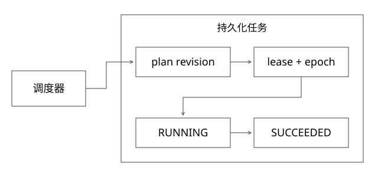

# PlanExecute多Agent与租约恢复

实现边界：以下为可验证的参考协议，不冒充任何内部平台或框架的完整实现。



## 结论：计划是可修订的控制状态，外部事实不能随计划重置

Plan-and-Execute先显式产出步骤，再执行、观察并决定是否修订；ReAct更强调模型与工具反馈的交替。实际系统可组合两者，不能仅凭一次Prompt写了“先规划”就宣称实现了可靠计划执行。

多Agent也不是“多开几个对话”就解决复杂任务。划分角色前，要明确共享事实、任务所有权、结果契约、冲突和失败恢复。本篇是可运行的任务租约参考协议，不声称是Eino、Codex的内部调度实现。

## 一份计划至少保存什么

```text
runId, planRevision
stepId, dependencies, inputArtifactRefs
state, attempt, owner, leaseUntil, epoch
stableOperationId, outputRef, errorClass
```

步骤由PENDING进入READY，再经原子领取变RUNNING。完成时检查stepId、planRevision、epoch和状态，迟到worker不能把新计划改回旧结果。输出引用和状态需要一致提交；大对象可先写不可变文件，再提交引用。

## 完整推导：扫表领取为什么要CAS

错误方案：两个调度器都SELECT到READY，然后各自执行。正确方案将状态前提写进更新条件，检查影响行数：

```sql
UPDATE tasks
SET owner=?, epoch=epoch+1, lease_until=?, state='RUNNING'
WHERE id=? AND plan_revision=?
  AND (state='READY' OR (state='RUNNING' AND lease_until<=?));
```

只有更新到一行者获得这次租约。epoch应作为本次更新的返回值，或在受保护事务内取得；不能随手再做一次无条件SELECT，因为这期间也可能到期被其他worker领取。具体SQL语法依数据库而定，配套SQLite模型采用UPDATE ... RETURNING epoch。

完成时也用owner、planRevision、epoch、RUNNING及有效租约作为条件更新。实际数据库还要分析事务隔离、锁、索引及以数据库为准的时间；[coverage_models.py](examples/source-level/coverage_models.py)验证顺序竞争与旧epoch拒绝，不冒充跨地域高并发测试。

## 租约到期并没有让旧worker停止

W1持epoch7访问外部服务时暂停；租约到期W2取得epoch8；W1恢复仍可能继续发请求。只在任务表拒绝W1最后一次提交，不能阻止其外部写入。

必须让真正受保护的下游检查fencing epoch，或用跨attempt稳定operationId做幂等、状态查询与对账。一个attempt换一个幂等键会让重试产生两次部署；反过来所有业务动作共用一个键又会误吞不同操作。

## 再规划如何保留已完成事实

假设“部署V2→评测→必要时修复”。评测发现失败，planRevision从3变4，应保留已部署V2的deploymentId和评测报告，再新增修复步骤；不能清空history重做所有已完成动作。

计划变更需要验证依赖、预算和授权；模型输出一个新计划不等于可以扩大生产权限。旧计划正在运行的分支应收到取消信号，同时保留迟到结果的归档/拒绝规则。

## 多Agent的收益与代价

独立只读检索可以并行，代码修改、部署、评测有依赖，应以产物身份连接。多个Agent写同一分支或同时发布同一版本会冲突；可用隔离工作区、串行提交门与不可变产物。

拆分增加模型调用、上下文同步和调度成本；若任务本就只有一个关键链路，多Agent可能更慢。验收应比较正确率、耗时、成本及失败恢复，而不只统计Agent数量。

## 自测

worker每30秒续租就能保证恰好执行一次吗？不能。续租可能因网络失败而失去所有权，外部效果仍可能已发生。需要把执行权、事实查询、幂等与恢复分别设计。

[SVG](assets/deep-points/60.svg) · [PNG](assets/deep-points/60.png) · [返回知识点目录](实现详解_00_知识点目录.md)

