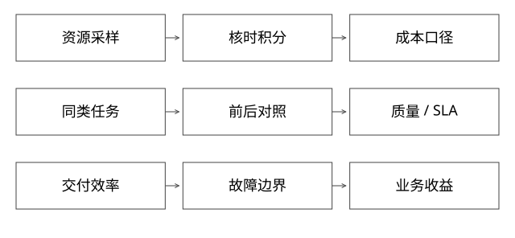

# 资源归因与平台价值验证

实现边界：以下为可验证的参考协议，不冒充任何内部平台或框架的完整实现。



## 结论：成本数字先定义单位、对象和时间窗口

预留核数、峰值使用核数、平均CPU利用率、核时和实际账单不是同一指标。资源从数千核到数百核，可能是常驻配额减少，不一定代表每次构建计算量降低；如果改为短时弹性占用大量核，墙钟变短与总核时变化也可能相反。

本文只提供核算方法，所有数字均为假设示例，不能作为真实项目业绩引用。

## 四个最容易混淆的量

```text
预留：某时刻配置的requests，例如3000核
使用：采样区间内消耗的CPU时间 / 区间时长
核时：CPU核数对时间的积分，单位core-hour
账单：按具体计价、承诺折扣、存储与网络等核算
```

内存也要区分request、limit、RSS、堆used/committed。把JVM堆降低等同于Pod内存账单下降，可能遗漏native、文件映射和计费档位。

## 完整推导：瞬时构建与常驻资源

假设原集群3000核常驻，每天只工作1小时，其余时间低使用。改造后500核常驻控制服务，构建时额外2500核用1小时。

按“预留可回收资源”比较，常驻减少2500核；按一天预留核时粗算，旧72000、新12000+2500=14500，下降约79.9%。但实际账单若按节点包年、不释放节点或空余资源没人使用，不一定立刻同比下降。

如果新构建采用5000核跑0.5小时，构建本身仍是2500核时，不是计算成本减半。还需核对数据量、CPU型号、IO性能、失败重试、峰值与调度等待。

[coverage_models.py](examples/source-level/coverage_models.py)计算这组口径。它是算术示例，没有读取真实监控或账单。

## 共享进程里如何归因

单请求wall time包含排队、等待IO、锁和实际CPU，不能用wall time×CPU核数简单计费。多线程异步、共享缓存、GC、公共线程池让精确到版本归因更难。

可按版本进程/cgroup直接度量一部分资源；共享部分则采用可解释的分摊政策，如调用量、CPU采样、保留容量或组合权重。分摊是管理规则，不要伪装成精确物理测量。评估误差与激励：按请求数计费可能让高成本请求搭便车。

## 平台价值不止降资源

比较交付周期、首次接入耗时、有效实验速度、故障影响范围、问题恢复时间和成本。每项都要固定起止点与样本，不把业务CTR提升全部归功于平台，也不把“使用了平台”直接等于“平台产生收益”。

对于工具/Agent，自动化步骤占比不是最终效果；应比较任务成功率、人工介入、误操作、实际耗时、模型/工具成本与回归风险。简单问题分钟级需给出问题类别与测量方式，不能泛化成所有问题。

## 如何做可信对照

优先用同类任务、相似数据量和相同资源条件；保留p50/p95、失败任务和尾部，不只挑最好一次。明确是否包含排队、构建、发布、预热、验证。并行度提高导致“更快但更贵”是合理取舍，不应硬说两者都优化。

业务增长时总成本上升而单位成本下降，或者资源配额下降却SLA恶化，都要一起呈现。没有可比历史数据时，可以说机制与观测方向，不能编造精确百分比。

## 完整推导：独立版本的隔离收益，值不值得多花内存

先固定同一逻辑工作量和副本目标。假设20个版本，每版状态100MiB、都需要两份承载。共享方案有两个进程，每个公共基础开销300MiB且各承载20份状态；独立方案每版两份进程，每进程基础开销200MiB加状态100MiB。

```text
共享：2 × (300 + 20 × 100) = 4600 MiB
独立：20 × 2 × (200 + 100) = 12000 MiB
额外基础开销：7400 MiB
```

这是自建内存模型，不是Java/Python真实测量，也不保证两份副本已满足可用性。没有计入连接、Proxy、文件缓存与发布双份预热；真实共享、去重和计算行为也需测量。模型说明隔离可能明显增加基础开销，不能用“都容器化了”推导更便宜。[本地算例](examples/source-level/expert_protocol_models.py)复算这些单位。

架构决策至少比较三种候选：共享运行时；每版本独立进程；按风险/负载分组隔离。比较同口径的版本密度、P99、发布等待、故障影响和运维成本。某些有冲突原生依赖或不可合作终止的版本可能必须独立，轻量低风险逻辑则未必值得完整常驻进程；分组隔离仍有组内相互影响。

## 决策门槛不是拍一个“省钱百分比”

先把必须满足的SLO与隔离要求设为硬约束，再在可行方案里比较成本。内存省一半但无法停止坏版本，是不同约束下的问题；独立进程稳定一些但发布峰值超过容量，也不能说已经可落地。列出迁移期间新旧资源重叠、最小健康容量、回退可用期和释放条件。

若估算经济收益，可用每月增量资源/维护成本，与故障频率×受影响请求×单次损失、人工恢复和研发等待等比较；其中事故概率与损失常不精确，需给区间和敏感性分析，不能把不同单位相加。价值还应包括谁负责运维、是否能被业务接纳和新增复杂度能否长期维护。

最终证据应能支持一个可反驳的决策：“在这些硬约束和负载下选B；若版本长期空闲或额外成本超过界限，收缩常驻或改分组；若隔离要求提高，则接受更高资源。”这比事后把所有指标都描述为提升更可信。

## 自测

系统资源利用率从20%升到80%就是成功吗？未必；可能是资源减少，也可能是饱和排队。需同时看吞吐、尾延迟、错误率和剩余容量，防止把风险当效率。

[SVG](assets/deep-points/62.svg) · [PNG](assets/deep-points/62.png) · [返回知识点目录](实现详解_00_知识点目录.md)

