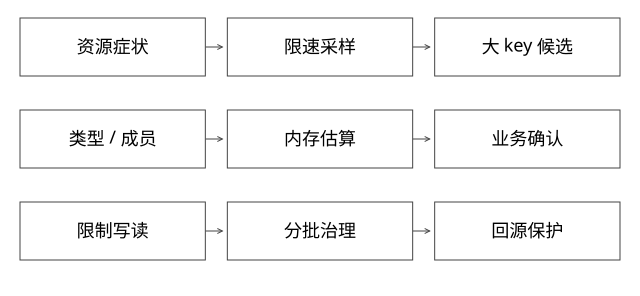

# Redis大key发现与安全回收

固定实现入口：[lazyfree.c · 7.2.4](https://github.com/redis/redis/blob/d2c8a4b91e8c0e6aefd1f5bc0bf582cddbe046b7/src/lazyfree.c)、[db.c · 7.2.4](https://github.com/redis/redis/blob/d2c8a4b91e8c0e6aefd1f5bc0bf582cddbe046b7/src/db.c)。



## 结论：大key有多种“大”，治理不能先从删除开始

按值字节大、集合成员多、单成员大、单次响应大，都会影响成本。大key不一定热，热key也可能只有几个字节。先确认所属业务、可重建性、访问与内存/延迟证据，未获授权不能把诊断变为线上删除。

本篇命令是操作示例，未连接真实Redis执行；CLI选项需按安装版本help核对。

## 如何发现，如何控制观察本身的风险

先看节点CPU、延迟、带宽、used_memory/RSS、连接输出缓冲、复制与持久化；再用限速扫描定位候选。不要使用KEYS全量阻塞主节点，也不要开长期MONITOR收集全部敏感请求。

```text
SCAN cursor MATCH pattern COUNT hint
TYPE candidate
STRLEN / HLEN / LLEN / SCARD / ZCARD candidate
MEMORY USAGE candidate SAMPLES small_count
```

这些命令的调用组合与竞态需要自己控制，不能把TYPE之后对象不变当保证。类型长度衡量成员/逻辑长度，MEMORY USAGE估算内存；一个Hash有十个巨大value，HLEN并不大。扫描结果应脱敏，只记录治理所需身份摘要。

SCAN的COUNT是工作量提示，不是严格返回数量，也不构成快照；迭代可能重复，变化中的对象不能据此证明全量准确。见[官方SCAN说明](https://redis.io/docs/latest/commands/scan/)。集群需要在各主分片明确范围，单节点一次扫描不代表全库。

MEMORY USAGE的采样成本随样本变化；对大聚合对象全量采样可能放大开销。应从限速小样本开始，而不是在事故中一次把所有成员读出。见[官方内存命令说明](https://redis.io/docs/latest/commands/memory-usage/)。

## 完整推导：一个百万字段Hash

HLEN显示100万字段、MEMORY采样提示明显超预算、HGETALL高峰造成网络和延迟尖峰。先限制整对象读取和异常写入，改为所需字段批量读取；若业务允许，按租户/业务范围分桶并定义跨桶一致性。

拆分降低单次操作与节点集中风险，但总字节不一定下降，还增加键和元数据开销。若存在原子更新整个对象的需求，拆分可能破坏事务语义，不能只按容量设计。

## 源码：UNLINK为什么不承诺全部释放都异步

lazyfreeGetFreeEffort按结构估计释放工作：quicklist按节点数量，Hash/Set的哈希表按成员数量，skiplist按长度；普通字符串等单分配结构返回1。

freeObjAsync只有free_effort超过阈值且refcount等条件满足时才交后台释放；本版阈值为64。它衡量释放工作而非纯字节大小，因此“一个100MB字符串必定走后台”不是从源码能得出的结论。

逻辑摘除后，后台释放仍需时间，RSS也受分配器与碎片影响；不能看到命令返回就宣称内存已归还OS。监控pending与进程内存，避免集中回收造成新的压力。

## 安全处置与回归

若确需回收，先确认授权、恢复路径和写入方是否会立刻重建，按批次执行并观察复制、后台释放和尾延迟。大key被删后集中回源可能打垮事实库，需合并请求和容量保护。

长期在写入端设成员数/字节/响应上限、异常增长告警和TTL策略；TTL集中到期可能制造同一时刻的回源和清理尖峰，应评估错峰而非只“都加过期”。

## 自测

SCAN能完成一轮是否证明扫描期间没有新大key？不能，它不是时间一致快照。UNLINK后used_memory下降而RSS不降是否就是泄漏？也不一定，应分解存活、后台释放与分配器保留。

[SVG](assets/deep-points/63.svg) · [PNG](assets/deep-points/63.png) · [返回知识点目录](实现详解_00_知识点目录.md)

