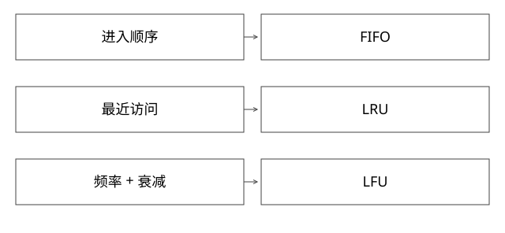

# FIFO_LRU_LFU淘汰策略与近似实现

固定实现入口：[evict.c · 7.2.4](https://github.com/redis/redis/blob/d2c8a4b91e8c0e6aefd1f5bc0bf582cddbe046b7/src/evict.c)。



## 结论：先说明策略语义，再说明实现是否近似

FIFO按进入缓存的先后淘汰，命中通常不改变顺序；LRU按最近访问顺序；LFU按访问频率，通常还需要衰减适应热点变化。TTL按有效期失效，和容量淘汰不是同一个维度。

严格策略可能需要全局状态；高吞吐实现常使用采样与近似。Redis采样LRU、InnoDB中点LRU不能直接当作手写双链表的逐步等价实现。

## 完整推导：同一输入为何答案不同

容量2，依次put A、put B、get A，再put C：

```text
FIFO：进入顺序仍A,B，淘汰A，保留B,C
LRU：访问顺序变B,A，淘汰B，保留A,C
LFU：若计数A=2、B=1，淘汰B；同频还需定义tie-break
```

随后扫描一万个只访问一次的新key，纯LRU可能淘汰旧热集；不衰减的LFU又可能永久保护早期热点。选型需要根据复用距离、热点稳定性、突发扫描与写入成本比较命中率和开销。

## Redis源码：不是给每次命中都挪双链表

evictionPoolPopulate从候选字典采样，为LRU计算空闲程度，为LFU利用频率衰减结果生成候选排序；淘汰时在候选池中寻找可用条目。候选来自样本，所以不能承诺每次都取全库绝对最旧/最低频条目。

采样数影响CPU与近似质量，候选也可能在稍后已经变化或消失，实际淘汰路径要再次查找。volatile与allkeys策略还决定候选范围，不能只比较LRU/LFU三个字母。

## LFU的概率计数和衰减条件

本版对象字段把时间与8位计数编码在有限空间。LFULogIncr在计数255时饱和；否则根据counter、初始值和lfu_log_factor计算递增概率。访问次数越多，下一次再递增的概率通常越小，因此counter不是原始请求次数。

LFUDecrAndReturn按距离上次记录的分钟数和lfu_decay_time计算periods，返回max(0,counter-periods)。要看实际代码，不要仅照抄附近历史注释中“折半”的文字。本版该函数也不直接更新对象字段，真实访问路径另行更新。

这种设计节省内存和更新成本，却引入概率近似、时间精度及参数依赖。用OBJECT FREQ一类观测值直接反推精确QPS是不成立的。

## BufferPool为什么又不同

InnoDB需要抵御大扫描污染，页面先进入old区，访问与时间条件决定能否晋升new区；页面是否能释放还受脏页、pin等状态约束。它不是“每次读就移到全局链头，满了删链尾”，详见[19](实现详解_19_BufferPool中点LRU与脏页淘汰.md)。

同样地，缓存条数与内存压力不同：保留100个巨大对象可能比100万小对象更贵。策略评估至少同时看命中收益、维护开销、字节预算与尾延迟。

## LFU计数为什么不能反推请求次数

按本版LFULogIncr，计数未饱和时的递增概率可写成1/(base×factor+1)，其中base由当前counter减初始值并截到非负。设初始值5、factor=10：counter=5时base=0，下一次递增概率为1；counter=15时base=10，概率约1/101，而不是每访问一次都加1。

因此从15到16等待的访问次数是随机量，101只是相应几何模型下的期望，不保证第101次一定发生。255时饱和，也不能知道它后来又被访问了多少次。

再算衰减：counter=20，按该函数得到15分钟间隔，decay_time=5分钟，则periods=3，返回17，而不是按每5分钟折半变成2或3。真实访问路径还会更新记录时间与计数；只调用返回函数却不写回，不能自动改变对象。

这组数字用于理解有限字段、概率与时间分辨率的取舍。LFU适合保留持续热点，但旧热度也需要衰减；factor、衰减周期与采样范围改变误差和响应速度，不能只看一次OBJECT FREQ判断精确流量。

补充算例验证：[depth_review_models.py](examples/source-level/depth_review_models.py) 中的 test_srm_and_lfu_arithmetic 复算指定LFU概率与衰减参数，不运行Redis命中率测试。

## 自测与验证

先用上面的A/B/C输入区分FIFO与LRU；LFU补充同频、热点迁移和衰减测试。真实库需固定参数、预热、负载轨迹和指标，不把理想策略模型的命中率当库性能。

为何不用严格LFU替代所有LRU？严格频率维护和排序有成本，历史频率也可能误导未来；没有脱离负载的最优通用策略。

[SVG](assets/deep-points/64.svg) · [PNG](assets/deep-points/64.png) · [返回知识点目录](实现详解_00_知识点目录.md)

