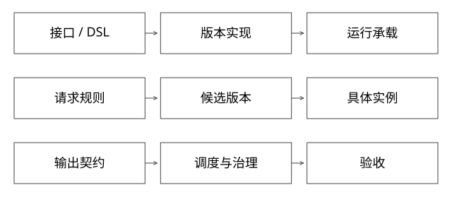

# 扩展点表达式与执行边界

固定实现入口：[ClassLoader.java · jdk-17.0.14+7](https://github.com/openjdk/jdk17u/blob/c5c90ffa45d0c14bcb013164f0992938eb4740ab/src/java.base/share/classes/java/lang/ClassLoader.java)。



## 结论：扩展机制、执行承载、流量实验是三个独立维度

SPI/扩展点回答“调用哪个实现”；表达式/DSL回答“受限逻辑怎样描述”；ClassLoader/独立进程回答“代码在哪执行、怎样隔离”；路由/AB回答“哪次请求进入哪个版本”。一个框架可以同时采用这些机制，不能把它们当相互排斥的完整平台。

本篇给出能力比较，不绑定某个商业产品，也不声称存在可公开核验的同名私有源码。

## 先定义扩展契约

```java
interface CandidateSource {
    Candidates recall(Query query, RequestContext ctx);
}
```

接口需要约定输入输出、deadline、取消、线程模型、错误分类和资源生命周期。只定义一个方法签名，不限制后台线程、外部访问与静态注册，不能保证插件可卸载或安全。

Java共享接口需由公共父加载器定义；私有实现可由版本加载器定义。同名接口各加载一份会造成类型不可赋值，见[类身份](实现详解_01_类加载委派与类身份.md)。SPI选择本身不会改变这条类型规则。

## 完整推导：四种实现同一个打分扩展

| 方式 | 适用的变化 | 成本与风险 |
|---|---|---|
| 固定SDK/组件 | 稳定通用算法或访问能力 | 升级要处理兼容与共同回归 |
| 表达式/DSL | 参数规则、字段组合、有限计算 | 要有类型、步数、函数白名单与数据边界 |
| JVM插件 | 用户自定义Java逻辑 | 依赖冲突、引用泄漏、共享CPU/堆等 |
| 独立服务/进程 | 跨语言、较强运行时隔离 | RPC、部署、预热、容量与故障治理 |

限制语法不自动保证终止：允许无限循环、递归或任意宿主方法调用的“表达式”，仍可能占满资源。即使语法有限，输入过大也可能造成昂贵计算，应有预算和可观测拒绝。

## 热更新如何穿过这些层

把实现绑定到不可变releaseId，准入校验后初始化并预热，最后将请求路由到新句柄。表达式变更也需要版本与回归；“无需重新编译整个应用”不等于“无需测试和发布”。

若插件改为独立服务，稳定的请求/响应契约可以保留，但本地对象引用必须转换为可序列化语义。取消、异常、deadline和重试从进程内方法调用变为分布式协议，不能只把函数名换成HTTP地址。

## 平台与业务的职责如何落地

平台可提供受管线程/客户端、准入、资源配额、发布流程与默认治理；业务定义效果目标、特征语义和允许降级。平台不能仅写文档就承诺约束任意代码，也不应把所有策略差异硬编码进基座。

图编排再把这些扩展组织成依赖，调度负责就绪和失败传播；Agent可以决定下一步动作，但仍需遵守相同工具权限和执行预算。AI没有消除调度和安全约束，只是改变了计划来源。

## 自测与验证

用“新增一个召回源”的完整变更检查：接口是否兼容、输入输出能否验证、运行资源如何限制、版本怎样选择、故障怎样回退、发布后怎样验收。若某方案只解决其中一项，不要将它包装成解决全部问题。

为什么普通DevOps也支持多版本？因为多版本不是专属能力。专用平台价值应来自业务契约、组件复用、细粒度变更与验证闭环的组合，以及可测接入与交付收益。

[SVG](assets/deep-points/65.svg) · [PNG](assets/deep-points/65.png) · [返回知识点目录](实现详解_00_知识点目录.md)

