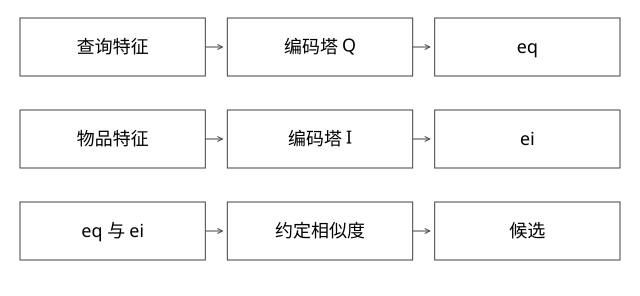

# 双塔召回的编码计算与向量版本



## 结论：两侧先各自编码，再用约定函数计算相似度

双塔不是“给每个物品输出一个CTR”。一侧把当前用户/查询上下文编码成向量，另一侧把候选物品编码成向量，两侧用点积、余弦等约定函数计算匹配分数。是用户塔还是查询塔取决于任务，不能把所有双塔都限定为用户画像输入。

本篇以可执行的二维参考模型解释计算路径，不声称复现某个私有训练模型或生产ANN库。

两侧编码与相似度计算也可对照[TensorFlow Recommenders官方双塔教程](https://www.tensorflow.org/recommenders/examples/basic_retrieval)中的query/candidate模型。本文不运行其训练或导出ANN的完整流程。

## 一次请求的输入输出

```text
用户/查询特征 xq → EncoderQ → eq[d]
物品特征       xi → EncoderI → ei[d]
score(q,i) = dot(eq,ei) 或符合训练契约的其他函数
```

特征可以包含离散ID、文本、类目、历史行为和上下文，编码器可能是embedding聚合、MLP或更复杂网络。塔内部结构与训练方式取决于业务，双塔这个名字只规定两侧独立编码的主要交互形式，不指定网络层数。

如果两侧必须读取对方的完整特征后才能算向量，就不能直接复用“物品向量预计算”的主要优势；后置交叉精排可补表达能力，但预算和模型不同。

## 完整推导：为什么能预计算物品

固定模型版本M7，在离线/近实时链路为物品A、B、C计算向量，建立向量索引。在线请求只计算一次eq，在索引中查近邻，不必逐个运行完整物品塔。

假设归一化后eq=(1,0)，A=(1,0)、B=(0,1)、C=(-1,0)，点积依次1、0、-1。只改用户上下文可能改变eq而无需重建全部物品；但物品内容、编码器权重或预处理变化，都可能使存量向量过期。

若不归一化，A=(2,0)、B=(100,100)，点积更偏向B，余弦更偏向A。范数是有意学到的信号还是不希望存在的偏差，要由训练目标和相似度契约决定，不能线上随手加归一化。

[coverage_models.py](examples/source-level/coverage_models.py)验证归一化前后排序，以及同维度但不同编码空间混用的反例；它没有训练真实神经网络。

## ANN和粗排分别省了什么

预计算省去在线物品塔重复推理；ANN省去与全部物品逐一打分；粗排再在召回候选上用更丰富但较便宜的特征缩小精排输入。三个优化作用不同，不能说“双塔天然只算TopK个物品”。

ANN返回近似候选，受图/量化参数、过滤和搜索预算影响；真实相关对象可能根本没进入候选。评估应看候选Recall、各层保留、时延及不同人群，不只看候选内精排分。

## 训练为什么不能只看正例相似度

常见对比目标希望正例分数高于负例，可能使用批内负例、采样负例或难负例。假设一个query对应正物品p和负物品集合N，可用示意损失：

```text
-log(exp(s(q,p)/T) / Σ[j in {p}∪N] exp(s(q,j)/T))
```

其中s是匹配打分，T>0是温度；降低T会让同一组分数形成更尖锐的softmax分布，也改变梯度尺度，不能把它当召回条数或概率阈值。实现要用稳定的log-sum-exp而非直接对巨大值求exp。负样本可能含未曝光但相关的物品，假负例、采样分布和曝光偏差都会影响结果；不能把“点过”之外的所有物品都当绝对不相关。该公式是常见参考目标，不认定真实项目使用它。

## 向量版本与特征时间

物品索引M7应配兼容的查询编码器M7及预处理。M8输出同样d维，也不代表能查M7空间。模型升级需回填、追平增量、质量验证和联动切换；只改在线模型会造成不可解释的召回下降。

训练时特征必须在样本时刻可用，离线补齐未来信息会产生穿越。线上空值、字典、归一化和ID映射与训练不一致也会造成偏差，不能把所有损失都归因ANN。

## 自测

问“双塔输出是什么”时，先答两侧向量，再答交互得到匹配分。问“为什么不用精排替代召回”时，要同时说明全库计算预算、候选损失与表达能力，而非只说“粗排快”。

[SVG](assets/deep-points/66.svg) · [PNG](assets/deep-points/66.png) · [返回知识点目录](实现详解_00_知识点目录.md)

