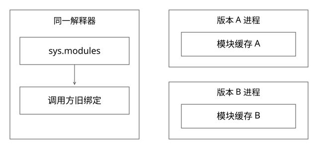

# Python模块缓存与进程隔离

为什么Python多版本服务不能简单照搬“每版本一个Java ClassLoader”？本文以CPython 3.12的导入机制说明差异；运行实验使用本机解释器，不声称已经运行3.12二进制或任何内部服务。



## 先分清文件、模块对象和绑定

磁盘上的strategy.py是代码文件；执行后创建的模块对象保存函数、类和全局变量；调用方的strategy或run只是指向对象的名称。改文件不等于替换模块，更不等于替换所有调用方已经拿到的函数和实例。

普通导入首先考虑sys.modules中的完整模块名。两个目录都存在strategy.py，先导入的模块已缓存时，仅调整sys.path再import同名模块，通常仍得到缓存对象。sys.path决定搜索位置，不是自动附带版本号的隔离域。[Python导入机制](https://docs.python.org/3.12/reference/import.html)

## 源码入口：缓存、锁与执行顺序

沿[CPython v3.12.10的_bootstrap.py](https://github.com/python/cpython/blob/v3.12.10/Lib/importlib/_bootstrap.py)读_find_and_load、_find_and_load_unlocked、_load_unlocked：检查模块缓存及初始化状态；必要时进入相应模块锁；定位spec；创建并登记模块；再执行模块代码，处理加载失败。

先登记再执行，有助于处理递归导入，但其他模块可能观察到尚未定义完的属性。“模块对象已经在缓存中”不等于模块初始化完成；导入失败的具体清理路径也不能推广为自动撤销模块顶层已经发起的外部操作。

加载时执行顶层代码，因此在顶层启动线程、连接远端、创建线程池都会引入资源所有权。即使后来删除sys.modules里的条目，线程和外部注册仍可能留着；再次导入又可能重复创建资源。

## 完整推导：reload之后为什么还有旧函数

初始文件定义run返回常量v1，并定义名为LEGACY的变量。调用方保存old_run = strategy.run。新文件改为run返回v2，且不再定义LEGACY，然后执行reload：

| 对象 | reload后可能观察到的状态 |
|---|---|
| strategy.run | 指向新函数，返回v2 |
| old_run | 仍指向旧函数，返回v1 |
| strategy.LEGACY | 旧模块字典保留时，旧名字可能仍在 |
| 旧类的已有实例 | 不自动变成新版类的实例 |

这不是所有旧函数都永远表现为旧版本：函数还通过自身globals读取模块字典，旧代码可能读到更新后的全局值，形成“旧代码＋新状态”的混合。常量例子刻意隔离这个变量，不能据其推断真实应用没有混合状态。

reload不会自动重绑外部的from import引用，也不是线程安全的通用热替换协议；执行中的请求、对象图和资源仍需单独管理。[importlib.reload说明](https://docs.python.org/3.12/library/importlib.html#importlib.reload)

## 改模块名、venv和进程分别解决什么

把业务包改成release_a.strategy与release_b.strategy，能区分业务模块名，但两者若都import同名第三方库，该依赖仍可能共享。包重命名还会影响绝对导入、资源查找、序列化类名和原生扩展，不能等同于任意依赖版本隔离。

venv主要隔离安装位置和解释器环境；在一个已经运行的解释器里切换目录，不会自动创建另一份完整运行时。只有分别启动配置正确的解释器进程，才能自然拥有独立地址空间和模块缓存。venv本身不是CPU、内存和安全沙箱。

子解释器是另一条技术路线，也需要评估扩展模块兼容、状态共享限制与故障边界。不能因为某些版本支持更独立的解释器锁，就声称本地崩溃、宿主资源和所有原生依赖完全隔离。

## GIL、worker与容量不能混成一句话

以传统带GIL的CPython构建为前提，多个线程不意味着Python字节码自动在多核并行；I/O等待和会释放GIL的扩展又有不同表现。其他版本和自由线程构建需另行核对，不给所有Python实现下同一结论。

一个版本可以部署多个Pod，Pod内可以有多个worker。平台若不管理worker，就通过Ready、并发、排队、超时和资源指标约定外部能力，不把Pod数直接当成Python可并行执行数。

独立进程避免共享一个解释器状态，但宿主CPU、内核、磁盘和下游仍可能共享。请求选择版本、版本进程启动就绪、实例内分发worker，是三个层次。

## 怎样验证

运行[project_contracts.py](examples/source-level/project_contracts.py)的模块实验：真实创建临时模块、导入并保存函数、改写后reload，检查新旧函数与遗留名字；两个独立子进程分别返回指定版本。它不验证多线程reload安全、原生扩展隔离或生产容量。

治理上优先把加载与资源启动分开，声明初始化/关闭钩子；新实例通过入口探针后才切流；旧实例先拒新再排空。进程退出也不会撤销已经发出的外部写操作，仍要遵守[幂等与恢复协议](实现详解_41_Checkpoint与外部副作用恢复.md)。

## async函数里阻塞，为什么仍会拖住整个worker

下面是教学伪代码，不调用真实网络：

```python
async def bad_handler():
    data = blocking_http_get()   # 没有因为写在async def里就让出事件循环
    return data

async def io_handler(client):
    data = await client.get()    # 前提是这个client确实提供协作式异步I/O
    return data
```

一个事件循环worker同时服务多请求，bad_handler在同步阻塞期间会拖延该循环的其他任务、超时回调与输出。换成线程池可以把某类阻塞移走，但池和队列仍需有界；对传统带GIL的纯Python CPU计算，不会仅因放进更多线程就获得任意多核并行。

取消同样不是强杀。协程要到可处理取消的位置才能清理；线程中的阻塞库、原生扩展或已经提交的远端动作，不保证随外层Task取消停止。finally负责本地资源释放，外部副作用仍要按operation_id核对，不能把超时异常当撤销证明。

平台不接管Pod内worker数时，更应定义实例入口的并发、排队、就绪与退出契约。排障分别观察事件循环延迟、业务队列、下游等待、进程CPU/内存和cgroup限制；Java的jcmd不能直接拿来解释Python进程。必要的Python栈/分配分析也要匹配实际解释器、扩展和现场开销。

## 自测

删除sys.modules再导入，为什么不能保证旧版本彻底消失？回答要包括外部绑定、旧实例、线程/注册与运行中请求。想让两个冲突的第三方依赖长期并存，应先明确解释器和进程边界，而不只修改sys.path。

[SVG](assets/deep-points/67.svg) · [PNG](assets/deep-points/67.png) · [目录](实现详解_00_知识点目录.md)
