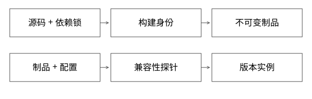

# Python制品依赖与可复现发布

同一份代码为什么昨天能运行、今天重新部署却失败？本篇解决发布身份和运行环境的关联，代码示例是参考模型，不指定任何企业实际使用的构建工具。



## 发布对象不是一个Git提交号

代码相同，依赖解析结果、Python版本、操作系统动态库、基础镜像和配置不同，执行结果仍可能不同。只记Git SHA不能充分解释一次线上行为。

参考发布描述可绑定：源码提交、构建定义、依赖锁及文件摘要、解释器与平台、基础镜像digest、SDK版本、业务制品digest。运行部署再绑定配置快照和必要的数据/模型版本。秘密值不应直接写入清单或被散列后公开；保存授权的秘密引用及其版本，限制访问。

这里要区分两个目标：重新取得同一批已保存制品；从源码重新构建出逐字节相同的制品。后者还受时间戳、路径、构建工具和非确定性过程影响，依赖锁定不自动证明位级可复现。

## 一层层拆开依赖锁

requirements中的lib>=1只约束可接受范围；锁为lib==1.4能固定一个版本名，但未必固定实际下载文件、传递依赖或平台选择。开发环境pip freeze有助记录已安装项，也不是跨操作系统、跨架构通用的环境证明。

对实际目标平台解析并固定传递依赖，保存可校验的包文件，使用受控仓库或wheelhouse，减少发布时再去解析可变远端。pip官方将固定版本、哈希校验和wheelhouse分别作为增强重复安装的手段；不能从其中任一项推出完整环境相同。[pip重复安装说明](https://pip.pypa.io/en/stable/topics/repeatable-installs/)

哈希回答“拿到的是不是预期字节”，不回答“这些字节有没有漏洞、是不是被授权来源发布、接口是否兼容”。完整性、来源可信、兼容性与业务正确是不同验收。

## wheel为什么不能跨所有机器复制

wheel文件名里的Python、ABI和平台标签限制适用环境。纯Python包与带本地扩展的包不同，后者还可能依赖操作系统库、架构和运行时约定。

例如一个针对CPython特定版本及x86_64平台的二进制包，不能因为业务代码仍是.py就直接用于另一解释器或ARM节点。即使安装成功，也要检查导入与代表性调用；包管理元数据匹配不是任意原生调用绝无崩溃的证明。[平台兼容标签规范](https://packaging.python.org/en/latest/specifications/platform-compatibility-tags/)

构建阶段隔离安装构建依赖，也不等于运行环境已经按业务所需隔离。要分别记录“生成wheel的环境”和“加载wheel的运行环境”。

## 完整推导：同代码、不同发布身份

假设提交C7配SDK2、依赖锁L1、运行镜像R1，制品为A1。只把SDK改为3，或者将镜像基础库改为R2，就不应仍在平台中无记录地称为完全相同的发布。

```text
构建身份：C7 + SDK2 + L1 + R1 + buildDefinition5 → A1
运行身份：A1 + config9 + model4 → deployment17
只变config9为config10 → 新的可追溯部署，不覆盖旧报告身份
```

内容摘要需要规范化：键顺序、编码、路径和默认值有明确规则；业务上敏感的差异不能被规范化吞掉。“两个JSON序列化文本不同”也不一定说明两个业务配置不同。

模型示例用排序键JSON计算摘要，只适用于定义好的有限字段。它没有实现任意浮点规范、完整供应链签名或容器构建。

## 兼容和发布顺序

先构建不可变产物，校验摘要与元数据，再在目标环境执行导入、SDK握手、业务探针和资源观察，最后开放流量。下载成功、import成功、Ready和正确执行业务，是逐步增加证据的四个节点。

热更新业务包时，要确认公共SDK契约是否兼容；独立进程能减少依赖冲突，不会自动解决客户端仍按旧字段解释新结果的问题。Java公共API的二进制兼容可对照[46](实现详解_46_依赖版本与Java二进制兼容.md)，跨语言服务则需要[69的契约兼容](实现详解_69_SDK入口契约与跨版本兼容.md)。

## 缓存复用为什么要带环境

以源码SHA单独缓存构建结果，会把为Python版本/架构A生成的wheel交给环境B。构建缓存至少依据实际影响输出的输入定义；业务数据变了则另按数据制品协议判断，不把代码包与索引文件的复用键混成一个。

镜像层、依赖缓存可以提高启动和构建速度，但冷缓存与热缓存收益要分开测。不可变产物复用减少重复构建，并不说明每次部署都省去下载、解包、初始化与预热。

## 回滚与验证边界

保留旧制品不等于可安全回滚。新版本若写入旧版不认识的状态，或者旧模型/配置已经不可取得，切回旧代码仍可能出错。明确兼容窗口、状态迁移和依赖保留期，再给回退承诺。

运行[project_contracts.py](examples/source-level/project_contracts.py)：相同定义的键顺序变化摘要不变；更换SDK或运行镜像会改变身份；未匹配的版本响应被拒绝。实验不调用pip、不生成wheel、不构建容器，也不验证真实ABI兼容。

## 自测

同一Git SHA和同一requirements文件，为什么还不能保证两次发布相同？请至少分别说明传递依赖/制品、平台ABI、基础镜像和运行配置；再说明“可重新安装”和“逐字节可复现构建”有什么差别。

[SVG](assets/deep-points/68.svg) · [PNG](assets/deep-points/68.png) · [目录](实现详解_00_知识点目录.md)
