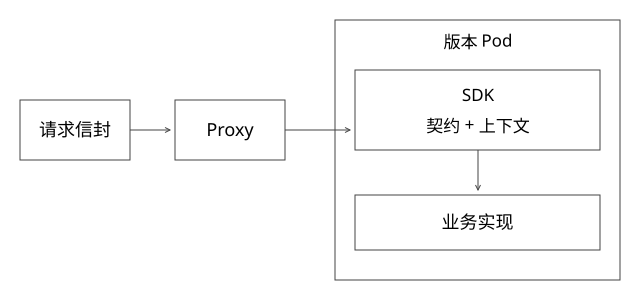

# SDK入口契约与跨版本兼容

一个统一执行入口如何同时服务不同业务与多个版本，又不变成“随意塞JSON”？这里定义一套教学契约；字段、状态和序列化协议不能当作某个实际SDK的接口。

## SDK真正统一什么

业务定义自己的输入输出和业务规则，SDK统一身份上下文、场景、发布身份、追踪、错误及生命周期。平台可以执行酒店搜索与商品推荐，但不因此拥有酒店库存与推荐策略。

一个请求拆成三部分：可信认证上下文，平台执行信封，业务payload。认证身份来自已经验证的连接或令牌；payload中的tenant_id不能替代它。release_hint是选择意图，不是跨环境访问任意版本的授权。

参考信封包含request_id、scene_id、contract_version、release_hint和剩余预算；响应附actual_release、artifact_digest、contract_version与trace_id。request_id用于关联，不自动承担写操作幂等身份。

## 从请求到一次业务执行

1. 验证主体、资源归属、输入大小与schema。
2. 选一次一致的版本路由视图，限定允许候选集合。
3. 校验服务契约兼容并取得在途租约，再调用对应实例。
4. 业务逻辑执行并返回结果，SDK验证输出形状与终止语义。
5. 将实际版本和结果一起返回，确认请求结束后释放租约。

入口校验与平台权限不能只留在某个客户端SDK中；其他调用方可以绕过SDK，服务端仍需执行关键约束。反过来，服务端有检查也不意味着客户端可以任意解释字段含义。

## 完整推导：字段增加也可能不兼容

v1接受query和limit，limit默认20；v2新增mode。若mode可省略且默认保持旧语义，旧请求可能兼容。若默认改为只返回促销结果，即使JSON仍能反序列化，行为已经变化。

| 变化 | 风险 | 验证 |
|---|---|---|
| 新增可选字段 | 默认值或严格解析器不兼容 | 旧客户端/新服务端对照 |
| 字段改名或类型变化 | 旧请求无法解释 | 明确版本转换或拒绝 |
| 增加枚举值 | 旧客户端不认识结果 | 未知值策略与契约测试 |
| 金额单位元改分 | 类型相同、语义错误 | 单位字段、边界样例 |
| 改变空结果语义 | 成功/失败判断变化 | 正常空、降级空和错误分开 |

Python类型标注与dataclass不会自动替所有反序列化路径做运行时校验。例如bool在Python中与int有继承关系，检查整数数量时若只用isinstance(x,int)，还可能接受True；字段契约要说明是否允许。

兼容矩阵至少包括旧SDK→新服务、新SDK→旧服务，以及新老数据和配置。无法兼容时显式拒绝，比静默丢字段后返回“成功”更可诊断。

## deadline如何穿过多层调用

总预算300ms，入口校验与排队已用80ms，则下游最多使用剩余220ms，还需留响应开销。每层重新给足300ms，会把局部超时叠成长尾。

单机计时优先用单调时钟计算剩余量；跨机器传绝对时刻需要处理时钟偏差，传剩余时长也需扣除本地等待。gRPC的deadline/传播是一个参考，不能据此假设任意HTTP或内部RPC自动支持同样行为。[gRPC deadline指南](https://grpc.io/docs/guides/deadlines/)

超时只说明调用方等待结束。已经提交的外部动作仍可能成功，仍需[稳定操作身份和查询](实现详解_41_Checkpoint与外部副作用恢复.md)。

## 流式接口：收到数据不等于收到完成

定义START声明实际版本；CHUNK携带递增seq；END包含明确完成原因；ERROR表示终止错误与最后已确认序号。参考协议不允许END之后继续输出CHUNK，也不允许同一条流中途改变actual_release。

例如收到START(r2)、CHUNK0、CHUNK1后连接断开，用户已经看到部分结果，但没有完整成功证据。记录“部分输出＋未确认终止”，不能自动记成功，也不能默认从头重做有副作用任务。

每条流只能有一个有效终止事件；重复事件如何去重、缺序号如何处理、是否允许续传，分别定义。seq只是标记，真正续传还需要持久事件、权限、保留期及重连游标。

## 取消与资源释放

异步生成器或Task要在finally中释放连接、在途租约和缓冲。取消是协作式信号，不应声称能强制停止所有阻塞调用或外部工作；吞掉CancelledError还可能破坏上层超时逻辑。[Python取消语义](https://docs.python.org/3.12/library/asyncio-task.html#task-cancellation)

慢客户端需要有界缓冲与反压，不能无限缓存chunk。背压、租约和版本排空接回[21](实现详解_21_Netty事件循环与出站背压.md)与[49](实现详解_49_版本路由快照与在途排空.md)。

## 流中断后能不能重试：先定义对用户可见的提交边界

请求还没收到chunk，不等于服务端没有执行；已经收到chunk，也不证明全部业务动作完成。必须分别记录业务副作用、可重放事件与用户已经观察到的输出，不能按“HTTP断了”选择统一重试。

| 断点 | 可能的安全动作 | 不能据此保证 |
|---|---|---|
| 尚未得到任何响应 | 按稳定操作ID查询，满足契约时同键重试 | 服务端尚未执行 |
| 已输出部分chunk、缺END | 标记部分完成；有持久事件与游标才续传 | 从头重试不会重复文本或动作 |
| END已产生、客户端未确认 | 查询原任务与事件结果，按协议重投终止 | 客户端一定已经看到END |
| 用户取消 | 传播取消并释放本地资源，核对远端状态 | 已发生副作用被撤销 |

续传必须绑定stream/task身份、实际版本、授权和可重放序号；进程重启后只有内存里的seq无法恢复事件。若事件保留已过期，返回明确不可续传，不静默起一个新任务。副作用幂等与chunk去重是两个协议，同一个operation避免重复创建任务，也不自动防止客户端重复展示chunk。

跨层预算同理：每次重试都消费原始deadline，不能每层重置。取消要沿调用链传播；后台工作若要继续，必须显式转为受管任务，不能变成无人追踪的孤儿。gRPC也要求应用处理自己衍生的工作，不能假设取消RPC会替应用清理所有子任务。[gRPC deadline与取消边界](https://grpc.io/docs/guides/deadlines/)

验证时人为断在START后、若干CHUNK后、END产生但返回丢失时，检查用户可见去重、资源释放与外部操作次数。现有顺序验证器不覆盖这些网络断点；这里给出要补的集成验证方案，不声称已经完成真实流式服务演练。

## 验证

[project_contracts.py](examples/source-level/project_contracts.py)检查有效事件序列、序号缺口、版本串流、缺终止、终止后仍输出，以及数量字段不接受bool。它是顺序协议验证器，不是实际HTTP/gRPC压测，也未验证跨进程取消。

## 自测

“新增字段向后兼容”为什么不是永远成立？一个流有20个chunk但没有END，为什么不能仅以HTTP曾返回200判成功？请同时说明格式、业务语义和执行生命周期。

[SVG](assets/deep-points/69.svg) · [PNG](assets/deep-points/69.png) · [目录](实现详解_00_知识点目录.md)
