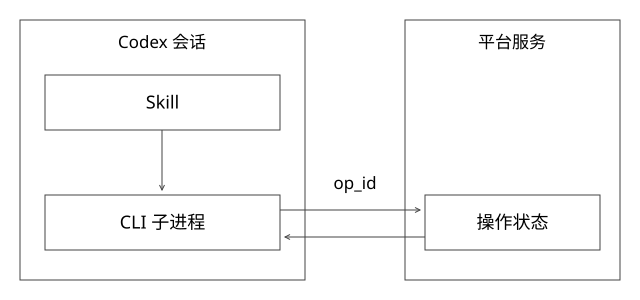

# Skill与CLI接入的执行契约

已有编码Agent，为什么还需要平台Skill？因为“知道怎样分析代码”与“能按内部平台契约完成一次发布验证”不是同一能力。本篇讲接入协议，不自研编码Agent，也不假设平台已具备下列全部能力。



## 四层对象要各自负责

用户任务定义本次目标；Skill沉淀可复用操作知识；CLI或其他工具执行具体动作；平台服务保存权威业务状态。Skill可以附脚本与参考资料，Codex按需读取它们；文件说明并不提供服务端事务、持久化或授权保证。[OpenAI：Build skills](https://learn.chatgpt.com/docs/build-skills)

例如Skill说“部署就绪后评测”，如果CLI只返回submitted，Agent仍需等待。反过来，工具已经返回部署失败，不能通过Prompt要求“务必成功”把它变成成功事实。

## CLI首先是机器接口，不只是人用的命令

人可以读颜色、进度条和提示文字，机器需要稳定的参数和输出协议。建议将结构化结果放stdout，诊断日志放stderr；一次响应有schema版本、操作ID、状态和目标身份，不混入下载进度等噪声。

命令返回0只能说明按CLI约定成功返回。例如submit成功意味着任务被接收，必须结合状态字段判断；不能从进程退出码推断部署已经可用。非0、无输出、输出损坏和本地超时也分别处理。

下列是教学参数，不是实际平台命令：

```text
platformctl release submit --application demo --environment test
    --artifact sha256:abc --operation-id op-7 --output json
platformctl release get --operation-id op-7 --output json
```

查询可以按状态决定下一步。每次网络尝试的request_id可变化，同一业务动作的operation_id保持稳定；同键异内容必须拒绝。密钥不得作为命令参数打印进日志或被模型回显，使用受控凭据链路并继承调用身份。

## 参数不能直接拼进Shell字符串

把用户输入拼成shell=True命令，会让分号、重定向或命令替换等内容获得程序语义。直接构造argv数组并使用shell=False，避免Shell再解释，并对应用、环境、制品等字段做业务校验。

“不用Shell”也不等于安全完成：程序仍可能把以短横线开头的值当作选项，或在内部访问任意URL/文件。参数解析、目标白名单、服务端权限和输出大小都要有限制。能执行任意终端不等于本次被授权发布生产版本。

## 完整推导：一次发布响应丢失

| 步骤 | 已知事实 | 正确后续 |
|---|---|---|
| 保存op-7及请求摘要 | 已形成稳定操作意图 | 提交同一个动作 |
| CLI超时退出 | 本地没拿到最终响应 | 按op-7查询，不换新键 |
| 查询返回RUNNING | 平台存在原任务 | 在总预算内等待 |
| 返回SUCCEEDED | 平台执行满足完成契约 | 核验实际制品与访问落点 |
| 业务评测FAIL | 新版未满足业务规则 | 记录差异，不假装是部署失败 |

若平台不支持幂等或可查询事实，未知结果就应核对或交给人工，不能在Skill中写一句“重试安全”替代它。可靠恢复机制见[41](实现详解_41_Checkpoint与外部副作用恢复.md)。

## Skill正文怎样避免隐含人工知识

按任务写清输入来源、前置检查、允许环境、工具顺序、等待条件、完成证据、异常分支和输出格式。把错误码、状态枚举与长接口文档放参考资料，把确定性校验放脚本；不要在主说明里重复粘贴所有平台文档。

错误反馈要让下一步可选择：输入缺失就补参数；鉴权失败就停止越权操作；构建失败查询对应阶段；结果未知先核对操作；目标版本不符则判验证无效。固定的构建/发布子流程仍适合交给程序或流水线。

工具不应把所有错误都包装成“可重试”。只读查询临时失败与生产发布超时有不同后果，重试还受总deadline、次数、退避与权限约束。

## 怎么测Skill，而不只测底层接口

准备用户任务的不同说法，检查是否选择合适Skill、是否补齐缺失输入、是否坚持完成证据、是否错误地把日志里的指令当授权。执行轨迹检查必要前后依赖，不要求每次轮询次数一模一样。

区分四类结果：工具接口本身正确；Skill确实被加载；Agent在这次执行中遵循了关键流程；最终业务任务达到目标。底层CLI单元测试通过不能证明后三项。

Skill和CLI升级时保存版本或可追溯内容，运行代表性任务回归。旧Skill配新CLI字段、模型没有读取关键参考、摘要丢失operation_id，都是与HTTP接口成功率不同的接入问题。

## 实验和边界

[project_contracts.py](examples/source-level/project_contracts.py)用本地子进程回显argv，恶意形态字符串被当作单个参数值，不运行Shell；另用合成CLI响应检查JSON与状态分类，区分提交中、已成功及未知结果，并拒绝损坏输出、错误schema和非对象结果。

没有实际调用Codex或内部平台，也没有据此声称真实Skill触发率、任务成功率或安全策略验证通过。真实接入仍需要有权限的隔离环境任务集与使用记录。

## 一份Skill怎样从口号变成可测试流程

下面是教学示例，不会安装为本地Skill，也不是内部平台原文件：

```yaml
---
name: release-and-evaluate
description: 发布指定测试制品并对固定用例集验证；不用于生产推全。
---
```

正文应明确：先取得应用、测试环境、不可变制品和用例集版本，缺输入则先补齐；按已有操作身份提交；ACCEPTED/RUNNING进入有预算等待；FAILED查询对应阶段证据；READY后核对实际制品和访问落点；通过目标核验才接受该轮评测；最终分别报告部署、测量有效性和业务结果。

`scripts/`可放确定性参数/响应校验，`references/`保存错误码和详细接口说明。渐进加载降低初始上下文负担，不保证模型一定正确执行；服务端授权、幂等与状态仍不能交给文字说明。

## 用五个任务检查Skill，而不是只读一遍觉得合理

| 输入或故障 | 预期行为 | 不合格行为 |
|---|---|---|
| 只说“发布这个”，未指定应用 | 补充最少必要输入 | 猜一个生产应用 |
| submit返回ACCEPTED | 等待同一任务并查状态 | 立即宣称部署完成 |
| READY但实际是旧制品 | 停止接受该次质量结论 | 用旧版通过率证明修好 |
| 构建失败 | 按任务阶段取证并说明 | 换新操作无上限重试 |
| badcase好转但正常集退化 | 同时报告改善与回归 | 只展示好看的汇总分 |

轨迹可以不同，但这些前后依赖与禁止动作必须满足。Skill升级需保存其内容身份、CLI契约与任务集版本，再和基线对照；工具单测通过和真实Agent任务通过是两套证据。

## 自测

CLI exit=0、status=SUBMITTED能否开始业务评测？不能，先取得就绪和目标核验。CLI本地超时能否换operation_id再发一次？不能凭超时判断原任务不存在；先核对原动作。

[SVG](assets/deep-points/70.svg) · [PNG](assets/deep-points/70.png) · [目录](实现详解_00_知识点目录.md)
