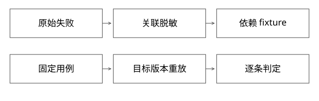

# badcase采集、脱敏与确定性重放

只保存用户一句话，为什么几天后重放已经复现不了？问题常在于数据、身份、时间和依赖改变。本篇从原始失败记录走到可比较用例，侧重采集与重放，不重复把所有评测指标列一遍。

## 原始记录、用例与运行结果是三个对象

原始记录保留当时观察到的现象；用例补齐合法输入、依赖与判定；一次运行记录被测制品、环境和实际输出。case_id不能替代run_id，同一用例可在多个候选版本上重复执行。

参考身份包括：来源事件、问题类型、租户/角色条件、业务请求、观察结果、期望或约束、依赖快照、时间语义、配置/模型/索引版本和评测器版本。原始敏感材料单独受控存放，可分享的用例只持有必要脱敏数据和引用。

收集线上失败不一定是平台全自动完成；用户反馈、人工挑选与自动异常采样都可以是来源。不要为了完整叙事，把采集渠道说成自己已经实现。

## 完整推导：库存变化如何制造假修复

线上t0查询跑鞋，商品A库存0，旧版本错误返回A。t1修代码后，用线上实时数据重放，但A此时已补货为5。返回A现在符合规则，于是“测试通过”无法证明缺货过滤已经修好。

固定fixture F1中A库存0、B库存5，并保留身份和配置，才能比较同一问题。依赖订单、时间、推荐特征或外部工具响应时，也需固定这些关键输入；否则注明运行不是严格对照。

| 保留方式 | 能回答的问题 | 局限 |
|---|---|---|
| 只有query | 当前这句话得到什么 | 不能还原当时数据 |
| query＋关键依赖fixture | 指定条件下版本行为差异 | 依赖边界可能遗漏 |
| 完整受控环境快照 | 更多内部条件可复现 | 存储、安全与维护成本高 |
| 线上抽样对照 | 真实环境表现 | 随机性与环境变化需分析 |

固定fixture不是全部质量目标。真实数据新鲜度、服务容量和权限更新要在另一组集成验证里测，不能用静态fixture掩盖实时链路故障。

## 脱敏不能破坏触发条件

同一用户ID在请求、依赖结果和预期中，应使用一致的替代身份，否则关联失败就变成新的问题。权限边界要保留：原本跨租户不可访问的资源，不能在脱敏后都归到同一个租户。

金额单位、边界大小、文本触发片段和事件顺序有时正是复现条件，盲目删除会抹掉问题。先建立允许字段白名单和敏感字段策略，再验证脱敏用例仍能触发原错误；不能稳定保留语义则标注限制，不造一个“等价”答案。

稳定替换映射或带秘密的确定性映射可保持关联，但它们不自动构成不可逆匿名化。低熵身份、映射表泄露和跨数据集关联仍有风险；控制映射的权限、保留与用途，不把普通hash当隐私保证。

## 重放不能重复真实业务副作用

把工具依赖替换为fixture provider，读请求从固定字典取得响应；写请求默认进入隔离的模拟适配器或被拒绝，不能让离线回放再次部署生产、发送消息或扣减预算。

fixture查找键应包括动作、规范化参数及必要的身份/版本；缺失依赖必须失败并记录原因，不能悄悄退回生产网络。对于要评测工具选择的任务，可以允许多条合法查询路径，但禁止动作仍由执行边界拦截。

模拟工具能测任务判定，不能证明真实工具可用性。故障注入另行覆盖超时、返回损坏、部分失败和响应丢失，保留所注入故障的版本与时刻。

## 时间、随机性与数据泄漏

时间相关规则需传入逻辑时钟或明确基准时刻，避免今天恰好过期导致旧用例变义。随机输出可以固定可控种子、重复采样并记录配置，但外部模型不一定因此逐字节可复现。

按同一来源事件或用户任务的关联组划分开发与保留集。原始请求放开发集、同义改写放测试集，仍可能泄漏。评测器修改后重跑基线，不把尺子变化解释为业务改进。

badcase被刻意富集，只能说明已知问题集合的表现；补正常、边界与代表性样本，再讨论整体质量。每条用例的授权与有效期也要可追踪，数据撤销后应处理其衍生fixture、索引、缓存和报告。

## 从采集到PASS/FAIL/INVALID

先确认环境和实际版本，再判断业务输出。缺fixture、目标版本不符或评测器不能运行，会让业务比较无效；若目标本身要求响应及时且被测服务超时，那是可靠性失败，不应丢入INVALID隐藏。

逐条保留原输出、判定理由与对比结果。业务没修好，但工具链正确报告FAIL，可以完成“验证并报告”；用户要求修复并通过时则尚未完成。完整判分机制接回[43](实现详解_43_badcase回归与Agent轨迹验收.md)。

## 实验

[project_contracts.py](examples/source-level/project_contracts.py)验证线上变化会改变结论，固定fixture保留缺货条件；稳定替代身份保留跨租户差异；缺失依赖及写操作被模拟provider拒绝。数据均为合成，不接收真实用户数据，不验证真实隐私合规或外部模型效果。

## 自测

旧版本在新数据上通过，能否证明bug修复？不能。脱敏后把两个租户合成一个，为什么也会让评测失真？因为改变了原始权限约束，测到的已经不是同一个问题。

[SVG](assets/deep-points/71.svg) · [PNG](assets/deep-points/71.png) · [目录](实现详解_00_知识点目录.md)
