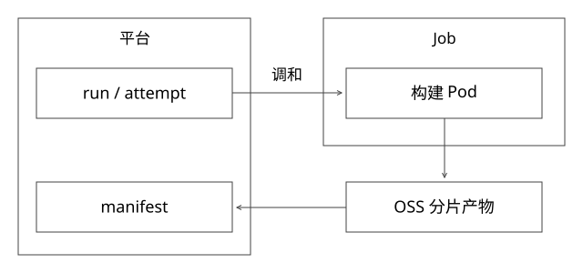

# 按需构建Job与控制器调和

把常驻构建集群改成任务容器以后，谁创建、谁重试、谁回收，任务成功究竟由谁判断？这里用Kubernetes Job作为开源实现参照，不代表任何内部构建平台实际采用相同API。

## 先分四种身份

业务run表示一次固定输入和构建定义；shard表示稳定逻辑切片；attempt表示本片的一次尝试；Job/Pod是承载执行的基础设施对象。Pod重建不应改变输入快照，也不应把旧attempt的完成通知当成新尝试结果。

平台元数据负责业务状态，Kubernetes负责其对象的期望/观察状态。Job结束与完整索引产物提交不是同一个事实；Pod成功退出只证明约定进程返回成功，不能证明所有分片无漏数且在线可查询。

## Controller是持续收敛，不是一条同步命令

参考[固定Kubernetes 1.29源码](https://github.com/kubernetes/kubernetes/blob/3f7a50f38688eb332e2a1b013678c6435d539ae6/pkg/controller/job/job_controller.go)：控制器读取Job与Pod状态，再决定是否创建/终止Pod和更新状态。API接收Job并不等于调度器已找到节点，调度成功也不等于镜像和业务启动成功。

因此平台调用创建API后保存对象身份，持续观察并调和。Watch用于及时驱动，但断线、重复事件或客户端重启后，还应能从持久对象和业务记录重建判断，不能把收到一次事件当作唯一事实源。

继续顺着同一固定文件读：processNextWorkItem取队列key，调用syncHandler，失败后限速重新入队；syncJob从缓存取Job并复制，计算Pod与完成状态，满足expectations后才进入manageJob。expectations记录尚待观察的创建/删除，避免缓存未追上API时反复补建；它不是平台业务幂等表。

manageJob按尚需完成的数量和parallelism计算补建，并采用分批慢启动，创建失败后不继续把整批请求打向API。trackJobStatusAndRemoveFinalizers先记录待计数的终止Pod，再处理finalizer与成功/失败计数，降低删除事件与状态写入交错造成的遗漏。这里统计的是Pod及完成索引，不会验证OSS文件或索引语义；业务产物提交仍需自己定义。

## 完整推导：提交成功，响应却丢了

平台已保存run7/shard2/attempt3，创建Job请求实际成功，但客户端超时。若直接改名再创建，可能同时跑两个构建。

可以用按操作身份生成的确定性名称并核对对象UID、标签及输入摘要，或等价幂等创建协议。AlreadyExists不能直接算成功：同名对象可能属于别的输入或旧生命周期。查询暂时失败时保持结果未知，不无限制造新Job。

即使基础设施正确，也可能在故障和重试过程中出现重复执行。构建输出写attempt隔离路径，最终提交由条件更新选择一次有效产物；旧尝试的成功通知不越过当前代次。需要约束的是结果生效，而不是承诺物理执行永远一次。

## parallelism和completions不是一个参数

假设需要64个固定任务索引，parallelism=8限制同一时刻的并行程度，completions=64描述完成目标；重试可能使实际创建的Pod超过64。Indexed模式可以用完成索引关联工作，但仍需处理同索引重复Pod及幂等输出。[Kubernetes Job说明](https://kubernetes.io/docs/concepts/workloads/controllers/job/)

一个Job承载全部分片，平台对象少，但单片恢复与业务进度映射要设计；每片独立Job更容易控制尝试和资源，却增加API对象及调度成本。平台已有队列＋长驻worker也是可选方案，不能为“容器化”强制改成每条记录一个Pod。

## 资源申请与失败预算

requests用于调度容量估计，limits用于相应资源约束，两者不是CPU实际用量。申请过大容易排队，过小可能频繁节流、OOM或影响邻居；构建阶段的峰值内存、磁盘、网络和临时空间都要有画像。

backoffLimit限制Job重试相关预算，activeDeadlineSeconds限制Job活动时长，完成后的TTL用于清理对象；它们不替代业务attempt、产物保留和超时核对。具体失败策略、终态条件与特性开关随Kubernetes版本变化，本篇不将当前文档的所有新特性套到1.29。

控制面要区分Pod Pending、拉镜像失败、执行失败、OOM、被驱逐和业务校验失败。相同报错不一定用同一种重试：缺制品不会靠重试自动变好，资源不足也不应毫无预算地重复申请。

## 退出码到产物可用还缺哪几步

参考顺序是：产物写完并完成校验 → 提交manifest → 标记业务分片成功 → 释放下游依赖。进程退出码只能是证据之一，不能先解锁下游再等文件上传。

如果产物已提交、Pod状态却丢失，应按完整身份核对复用；Pod说完成、manifest不完整则不能放行。日志/对象清理必须保留必要的任务、资源、产物和错误证据，否则TTL回收后难以解释成本和失败。

任务取消也不是删除一条数据库记录。停止新调度，禁止旧attempt提交，处理在途资源，核对外部副作用，最后回收；中止上传和过期临时文件也需纳入清理。

## 怎样证明“省资源”

原来2000核常驻24小时是48000预留核时；改成按需任务后，统计实际分配曲线、排队、启动、计算、重试和回收。常驻基线下降不等于峰值或总计算量相同比例下降，容量被别的业务复用也不同于账单立即下降。详细口径见[62](实现详解_62_资源归因与平台价值验证.md)。

## 实验

[project_contracts.py](examples/source-level/project_contracts.py)模拟同名提交摘要冲突、重复完成事件、旧attempt拒绝、Pod成功但产物未提交不能放行。它不启动Kubernetes、不验证Watch/调度/驱逐或容器持久性。

## 自测

Pod完成能否触发下一阶段？先核对产物提交与身份。任务容器失败后能否直接再创建一个名字不同的Job？要先判断原操作是否已存在、是否仍在执行及其产物状态。

[SVG](assets/deep-points/72.svg) · [PNG](assets/deep-points/72.png) · [目录](实现详解_00_知识点目录.md)
