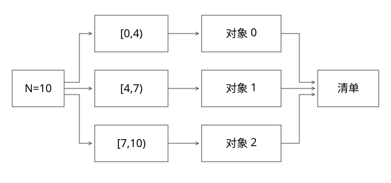

# ODPS区间读取与OSS分块提交

怎样把“按分片并行DUMP”落实为可验证的读取范围和上传结果？本篇用MaxCompute TableTunnel与OSS公开接口作参照；示例为设计与手算，不认领某个历史平台的实际协议或性能。



## 一次导出先绑定哪份数据

记录project/table/partition或查询结果身份、源数据版本、下载session、选择列、转换schema和分片方案。下载会话和业务全量快照是相关但不同对象：不能仅凭记录了session_id，就推出它与任意Kafka位置天然一致。

MaxCompute的TableTunnel多线程下载示例先创建DownloadSession，取得记录数，再为不同范围创建RecordReader。多进程重试需要核对会话是否仍有效、源数据版本是否变化以及SDK支持的会话复用方式，不只保存一个“已读百分比”。[MaxCompute多线程下载](https://help.aliyun.com/en/maxcompute/multi-threaded-download)

读取区间、业务哈希分片和在线引擎分片也不等同。范围可以只是高效扫描单元，转换后再按目标分片组织；每个worker全表扫描再按hash丢掉绝大部分数据，虽逻辑上能分组，却可能把读取成本放大。

## 完整推导：10条记录交给3个reader

把区间写成左闭右开，避免最后一条归谁不清楚：

```text
N=10，P=3
reader0：[0,4)  → start=0, count=4
reader1：[4,7)  → start=4, count=3
reader2：[7,10) → start=7, count=3
```

一种均分方法是q=N//P、r=N%P，前r片取q+1条，其余取q条；起点按前面各片长度累计。要求区间互不重叠，覆盖[0,N)，所有count之和等于N。

当N小于P时会有空片；应跳过空reader或显式登记空产物，不能把count=0直接套给要求非空范围的API。逻辑分片总数稳定，执行worker数量可以变化，不按当前worker数重新定义已执行一半的范围。

区间覆盖只证明“计划没漏行”，不证明源版本稳定、每个reader都完成或转换没有合法过滤/错误丢弃。还要记录实际读取、输出、过滤和拒绝数，并按转换语义对账。

## 流水线如何控制内存

reader批量读取，经转换/序列化/压缩后写上传缓冲；下游慢时使用有界缓冲，让读取受背压，而不是把数亿行全部攒在内存。

假设8个worker，每个允许4个8MiB缓冲，单算这部分上界约256MiB；还不含解码对象、压缩状态、SDK和引擎构建内存。并行度翻倍也会提高这些资源及源端请求压力，不能只算CPU。

列裁剪减少传输与转换，批读取减少调用开销，压缩用CPU换字节，调大并发可能只增加配额等待。测源扫描、转换CPU、写出字节、存储延迟与尾片，再判断哪项优化有效。

## OSS的分块完成与业务提交是两层

对单个大对象，MultipartUpload先取得upload_id，逐个上传part并保存其编号和返回信息，最后提交有效part清单形成对象。上传几个part成功不等于目标文件完成；并发重传也要明确part覆盖及最终选择。[CompleteMultipartUpload](https://help.aliyun.com/zh/oss/developer-reference/completemultipartupload/)

Complete请求超时可能仍在服务端处理中，不能立刻认为对象不存在并用另一个尝试覆盖同一路径。按run/shard/attempt隔离对象名，查询或核验该尝试的最终对象，再决定恢复。

完成对象的ETag不能普遍当作内容MD5，尤其分块上传不能直接这样校验；记录协议明确的校验信息，结合长度、受控内容摘要及适用的服务端校验。字节一致仍不能证明业务记录完整或格式可被引擎加载。

即使每个对象都完成，仍需确认这一版预期分片齐全、输入和schema一致，再发布全局manifest。不能把OSS目录改名想成天然的目录级原子事务，也不能让构建器扫描临时前缀后把半套文件当成有效输入。

## 三种重试分别处理

| 失败点 | 可复用对象 | 必须先核对 |
|---|---|---|
| reader中断 | 已提交的完整子块 | 原会话/数据版本和范围是否可定位 |
| part上传失败 | 同一上传尝试中可靠确认的part | upload_id、part内容与保留状态 |
| 对象已完成但manifest提交失败 | 身份匹配且校验完整的对象 | 当前attempt是否仍有提交资格 |

若源数据已变化或下载session无法安全继续，应重新建立稳定输入或重新执行受影响恢复单元，不能用新会话的第500万行接在旧会话后面，假设行序一定相同。

manifest采用什么存储与条件提交机制取决于平台。旧attempt恢复后必须被版本条件或fencing阻止提交；已有完整对象的字节可以保留，但不因存在就自动取得发布资格。

## 清理与实验

未完成的multipart、失败attempt对象、临时日志都需要带保留期和引用关系清理；先确认没有仍在运行或被有效manifest引用，再回收，不用宽前缀盲删正在使用的产物。

[project_contracts.py](examples/source-level/project_contracts.py)对多个N/P组合检查区间覆盖和不重叠，拒绝混用源session身份，并模拟分块齐全但全局manifest缺片时拒绝提交。不调用ODPS/OSS，也不验证其权限、吞吐或实际会话生命周期。

## 自测

读完90%为什么不等于可从91%恢复？需要稳定源、可定位区间、转换边界与已提交输出。一个对象的所有part都完成，为什么整版仍可能不可用？还有跨对象集合、schema、构建格式和发布资格需要校验。

[SVG](assets/deep-points/73.svg) · [PNG](assets/deep-points/73.png) · [目录](实现详解_00_知识点目录.md)
