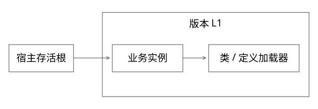

# 源码精读：JVM 类加载、初始化与卸载

本篇解决一个问题：同一进程里的业务版本怎样拥有不同的类身份，为什么撤掉版本后它仍可能占用 Metaspace？阅读基线是 OpenJDK 17.0.14+7，固定 commit 见[源码锁](sources/source-lock.json)。源码分析与本地 JDK 21 运行实验分别说明，不把两个版本的全部细节视为相同。

## 1. 先建立对象，再读调用链

类文件是字节；定义出来的类由 JVM 表示；Java 侧有 Class 镜像；定义加载器与这批元数据的生命周期相关。两个文件路径不同不必然产生两个类；同名类交给同一个定义加载器再次定义，可能遇到重复定义错误。

完整推演从一个共享父层接口开始：父加载器定义接口 Contract，版本加载器 L1/L2 分别定义业务实现。两个实现都能作为父层 Contract 使用。若接口也分别在 L1/L2 中定义，即使二进制名称相同，也未必能互相转换。身份由二进制名与定义加载器共同决定；发起加载与定义加载不是同一概念。

## 2. ClassLoader.loadClass：把每个分支说清楚

入口是[ClassLoader.java](https://github.com/openjdk/jdk17u/blob/c5c90ffa45d0c14bcb013164f0992938eb4740ab/src/java.base/share/classes/java/lang/ClassLoader.java#L569)。普通双亲委派路径在类加载锁中先 findLoadedClass，再向父加载器或 bootstrap 请求，父层未找到才进入自己的 findClass，最后按 resolve 参数调用 resolveClass。

这解释三个容易混淆的问题：

1. 不是“先在自己 jar 里找，找不到才问父层”。先检查本加载器已发起的加载结果，不能与先找自己的字节路径混为一谈。
2. 同名并发加载需要协调。getClassLoadingLock 与 parallel-capable 能力影响锁粒度；自定义加载器忽略这些机制可能重复定义或引发锁顺序问题。
3. loadClass 默认不等于执行静态初始化；resolve 也不能直接解释成 new 出业务对象。

如果重写 loadClass 做 child-first，要明确公共契约、JDK 类与隔离依赖的边界。盲目 child-first 可能让跨模块参数使用两份同名类型，产生 LinkageError 或 ClassCastException。

## 3. defineClass 到 HotSpot：加载、链接和初始化

Java 的 defineClass 路径将字节交给 VM，加载时解析类格式并建立元数据。链接包含验证、准备与解析；实现可按规范采用延迟解析，不能把五个阶段理解为每次按固定时刻全部执行完的流水线。

准备阶段处理静态字段所需存储与初始值等；初始化执行类或接口的初始化逻辑。构造实例执行的实例构造器与类初始化不同。仅仅得到 Class 对象，并不总意味着它已经初始化。

源码向下读[instanceKlass.cpp](https://github.com/openjdk/jdk17u/blob/c5c90ffa45d0c14bcb013164f0992938eb4740ab/src/hotspot/share/oops/instanceKlass.cpp)的 initialize_impl：它管理初始化锁、当前初始化线程、初始化状态，等待其他线程，处理递归初始化，初始化必要的父类型，执行类初始化方法，再发布成功或错误状态并唤醒等待方。

状态机的意义比背阶段名更重要。两个线程首次主动使用同一类，不应各执行一遍静态初始化；同一线程递归触发自己的初始化又不能简单自锁死。初始化失败后，后续使用也不能把这个类当作全新对象随意重试。

### 具体推演

L1 加载 Plugin，静态块读取环境参数并抛异常；L2 加载同名 Plugin，读取正常参数。两者类身份与初始化状态不同；但它们读取的环境、文件或外部服务仍可能共享。类隔离不能由此推导外部资源隔离。

ClassNotFoundException 通常涉及加载请求未找到类；NoClassDefFoundError 还可能涉及先前初始化失败或运行时依赖缺失。排查要保留最早的 cause，不能仅看到最后一个异常名就认定 jar 缺失。

## 4. 元数据属于谁，何时回收

继续读[ClassLoaderDataGraph.cpp](https://github.com/openjdk/jdk17u/blob/c5c90ffa45d0c14bcb013164f0992938eb4740ab/src/hotspot/share/classfile/classLoaderDataGraph.cpp)的 do_unloading，以及[MetaspaceArena.cpp](https://github.com/openjdk/jdk17u/blob/c5c90ffa45d0c14bcb013164f0992938eb4740ab/src/hotspot/share/memory/metaspace/metaspaceArena.cpp)的分配与 arena 管理。CLD/类卸载与 GC 的存活性判断衔接；arena 分配与释放有自己的粒度，并非每个 Java Class 镜像变成不可达就立刻向 OS 归还同样大小内存。

教学引用链：宿主线程 → ThreadLocalMap → 版本业务对象 → 其类与加载器。只从路由 Map 移除版本，仍可能保留这条路径。另一条常见线索是线程 context class loader、注册表、监听器、执行中的任务或父层静态缓存。

要分别观察 loaded/unloaded class 数量、旧加载器存活、Metaspace used/committed/reserved 和进程 RSS。used 降低但 RSS 没立刻下降，不能独立证明卸载失败；RSS 上升也不必然来自 Metaspace。

## 5. URLClassLoader.close 为什么不能当卸载

[URLClassLoader.java](https://github.com/openjdk/jdk17u/blob/c5c90ffa45d0c14bcb013164f0992938eb4740ab/src/java.base/share/classes/java/net/URLClassLoader.java)的 close 主要处理其打开的资源；已经加载的类与现有对象不会因为 close 立即失效或卸载。正在执行的代码也不是一个可以靠关闭 jar 文件终止的任务。

因此，版本退役协议通常需要先停止新流量、等待在途任务、释放线程和注册资源、移除长生命周期引用，再观察适当 GC/卸载行为。实际 GC、类卸载选项和运行负载会影响观察，不应承诺删除 Map 后内存立即下降。

公共依赖下沉可以降低重复元数据和包体，却增加父层契约兼容要求。它解决部分空间与加载成本，不会自动修好所有生命周期泄漏。

## 6. 完整推导：怎样验证一个“修复卸载”方案

先固定插件规模和负载，连续发布 N 个版本并退役；同时记录活动版本数、加载器数量、类加载/卸载事件与回收后元数据趋势。对仍存活的旧加载器分析到存活根的引用路径，而非只按对象大小排序。

可使用与运行版本匹配的 jcmd help 查看 VM.classloader_stats、VM.native_memory 等能力；NMT 需要相应启动配置。对堆、类元数据和线程做关联，不把一次 System.gc 调用作为卸载保证。

本地实验在[ExpertMechanics.java](examples/source-level/ExpertMechanics.java)中用两个 URLClassLoader 定义同名类，断言 Class 不相等、跨加载器 isInstance 为 false，而共享 Runnable 契约仍能使用。它验证类身份；没有把 GC 时机做成脆弱的必过断言。

## 7. 边界与设计取舍

类加载隔离主要控制命名空间、可见性和依赖关系。堆、GC、CPU、线程与进程命运仍共享。独立进程进一步改变故障边界，也引入网络调用、资源基础开销和发布治理。

讨论一个热加载平台时，至少说明父层 API、版本依赖、生命周期资源、流量与在途请求如何管理。仅回答“一个版本一个 ClassLoader”还没有解释运行正确性。

## 自测

父层缓存保存一个由版本加载器定义的 Class，路由已删除且加载器已 close，能承诺卸载吗？不能；缓存仍可让相关类和加载器存活。还要找到并清理正确的生命周期引用。

继续：[Java 集合与并发](源码精读_02_Java集合并发与算法.md)、[容器与路由](源码精读_05_容器Proxy与版本路由.md)。
