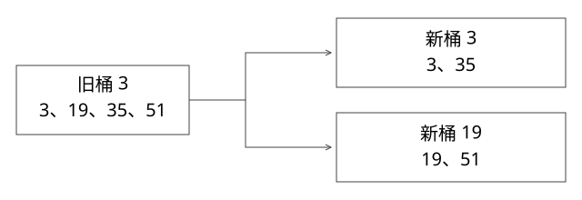

# 源码精读：Java 集合、并发缓存与算法不变量

本篇解决一个问题：容器内部怎样迁移和维护状态，为什么单个 API 线程安全仍不足以保证整个业务操作正确？源码固定 OpenJDK 17.0.14+7；本地实验实际运行版本由程序打印，当前已用 JDK 21 编译执行。

## 1. HashMap：先推导扩容，不背“重新哈希”

入口为[HashMap.java](https://github.com/openjdk/jdk17u/blob/c5c90ffa45d0c14bcb013164f0992938eb4740ab/src/java.base/share/classes/java/util/HashMap.java)的 hash、putVal、resize、treeifyBin 和 TreeNode.find。

数组长度为 2 的幂，桶号是 (n−1)&hash。容量从 16 变 32，掩码多覆盖值为 16 的那一位：同一旧桶的节点只可能留在 j，或去 j+16。resize 使用已经存下来的哈希，按 hash & oldCap 把链拆成低位链与高位链，并保持每条链的相对顺序。

取 hash 为 3、19、35、51：旧桶都是 3；扩容后 3、35 在桶 3，19、51 在桶 19。这不是所有 key 再调用一次 hashCode，也不是普通 HashMap 提供两张表双查的并发协议。table 赋新数组的时机更不能被当作线程安全发布保证。

### 树化条件要跟着分支读

常量 TREEIFY_THRESHOLD=8、MIN_TREEIFY_CAPACITY=64。putVal 的计数从链的第一个节点之后展开，达到触发条件调用 treeifyBin；数组较小时该方法优先 resize。不同修改路径的触发时点要看具体分支，不能机械地说“任意场景第 8 个元素立即变红黑树”。

平均 O(1) 依赖分布与代价假设；equals/hashCode 自身成本也属于查找成本。树形结构不保证所有 key 的查找都严格 O(log n)：TreeNode.find 在相同 hash 且无法有效比较 key 时，可能先递归搜索右子树，再搜索左边。

实验插入 32 个 hash 全相同、互不相等且不可 Comparable 的 key，确认桶已为 TreeNode，再查一个不存在的 key。本地观察 equals 调用 33 次，说明树化不能替代良好的哈希与可比较关系；精确调用次数是版本与数据相关观察，不是 API 承诺。

## 2. ConcurrentHashMap：找到线性化点，也找到组合边界

读[ConcurrentHashMap.java](https://github.com/openjdk/jdk17u/blob/c5c90ffa45d0c14bcb013164f0992938eb4740ab/src/java.base/share/classes/java/util/concurrent/ConcurrentHashMap.java)的 putVal、initTable、transfer、helpTransfer 和 computeIfAbsent。空桶插入使用 CAS，桶有内容时进入相应同步/树节点路径；扩容用转发表节点等机制让访问与迁移衔接。

这与 HashMap 的 resize 不是相同并发模型。访问遇到迁移标识可进入新表或参与帮助迁移，不能把任一容器的迁移解释套到另一个上。

### 沿一次竞争插入找提交位置

假设 T1、T2 算出同一空桶 i。二者都先看到 null，但只有一个 casTabAt 能把 null 换成新节点；失败方重新读表，不会在自己的旧观察上直接追加。这里的 CAS 是空桶插入对外生效的关键位置。

桶不空时，putVal 锁住当前首节点 f，但进入 synchronized 后还要验证 tabAt(tab,i)==f。为什么拿锁后仍要验证？等待期间桶可能已被迁移或替换，锁住旧 f 不代表仍锁住当前桶。验证失败就重新循环，不能继续修改已脱离表的链。已有 key 的更新落到 volatile val，新 key 的链接使用相应可见性字段；读侧的可见性依赖这些发布机制，不依赖自己也进入同一把锁。

### transfer：先准备新桶，最后把旧桶变为路标

transferIndex 用 CAS 分配一段段待迁移桶，避免所有线程争同一桶；sizeCtl 在扩容期间编码扩容标记和参与者状态，并非始终是普通容量阈值。链桶迁移取得桶锁、复核首节点，再按 hash & oldCap 拆低/高两组。

关键写入顺序是：先设置 nextTab[i] 与 nextTab[i+n]，再把 tab[i] 换成 ForwardingNode。读线程若已经拿到旧链，旧链需要仍可安全遍历；这解释了为何实现会复用可安全共享的 lastRun 后缀，并为前部构造节点，而不是随意破坏读者正在走的链。

| 读到的旧桶状态 | get 的处理 | 写入路径的处理 |
|---|---|---|
| 普通链/树 | 按现有节点结构查找 | 按桶同步，拿锁后复核 |
| ForwardingNode | 经 find 到 nextTable，可能继续跨迁移表 | helpTransfer 在满足条件时协助，再进入新表 |
| 空桶 | 本次读取可返回未找到 | CAS 插入，与迁移该空桶的 CAS 竞争 |

get 本身不必帮助搬桶；“所有访问都参与扩容”并不准确。最后的参与者还会确认迁移完成，再将 table 切到新表。以上协议使并发迁移可解释，但不承诺遍历是某个瞬间的完整快照；size 与多个 key 的读取也不是天然的跨 key 事务。

单次 putIfAbsent 能协调同一个 key 的插入，但“读缓存 → 外部请求 → 写缓存”包含多个动作。两个线程仍可能同时调用昂贵外部服务。computeIfAbsent 可减少某些重复初始化，但回调可能阻塞相关更新、递归更新也有约束；执行慢 I/O 前要考虑缓存 Future/任务占位、失败清理与取消语义。

一个线程在 CHM 放入节点、另一个线程同时淘汰链表尾部，若复合结构没有共同同步约束，就不能保证 Map 与链表一致。容器级可见性不自动覆盖业务级不变量。

## 3. LinkedHashMap 与线程安全 LRU

[LinkedHashMap.java](https://github.com/openjdk/jdk17u/blob/c5c90ffa45d0c14bcb013164f0992938eb4740ab/src/java.base/share/classes/java/util/LinkedHashMap.java)为节点增加 before/after，并通过 afterNodeAccess、afterNodeInsertion 等钩子维护顺序。accessOrder=true 时，get 也可能移动节点，因此不能把它当只读路径。

固定序列：put A，put B，get A，put C，容量 2，应淘汰 B。更新现有 A 也要正确维护顺序。需要保证 Map 查找、链表摘挂、容量判断和淘汰的整体一致性。

教学实现用一把 ReentrantLock 包住访问顺序 LinkedHashMap 的 get/put/size。它有清晰的同步边界，但争用大时可能影响吞吐。分段 LRU、近似访问记录或专用缓存库改变的是性能与精确性取舍，不能称它们与严格全局 LRU 完全等价。

容量 0、重复 put、访问提升与并发淘汰都应验证。并发压力测试能发现部分错误，却不能单独证明线性化；正确性仍需锁范围与状态不变量推理。

## 4. AQS 与锁：为什么释放之后还要竞争

[AbstractQueuedSynchronizer.java](https://github.com/openjdk/jdk17u/blob/c5c90ffa45d0c14bcb013164f0992938eb4740ab/src/java.base/share/classes/java/util/concurrent/locks/AbstractQueuedSynchronizer.java)管理同步状态与等待队列；[ReentrantLock.java](https://github.com/openjdk/jdk17u/blob/c5c90ffa45d0c14bcb013164f0992938eb4740ab/src/java.base/share/classes/java/util/concurrent/locks/ReentrantLock.java)定义具体独占获取、重入计数和释放条件。

线程获取失败后可能入队并 park；前驱释放或状态变化提供唤醒条件，但 unpark 不直接把锁所有权交给被唤醒线程。它仍需重新尝试获取。中断、超时与取消节点会影响队列维护。

公平锁倾向遵循排队约束，非公平锁允许部分插队机会；这不意味着公平锁保证操作系统调度的绝对公平。讨论吞吐和等待时间时，要把锁算法、调度、临界区长度分别看。

### state、owner、等待队列分别记录什么

在 ReentrantLock 中，state 为持有计数，owner 记录独占线程。state 为 0 时尝试 CAS 获取；当前 owner 再次获取则递增计数。unlock 需要检查持有者并递减；只有计数归零，tryRelease 才报告完整释放，AQS.release 才推进后继唤醒。重入两次只 unlock 一次不会把锁交出去。

本版 AQS.acquire 会处理前驱状态、尝试获取、CAS 入队、设置 WAITING、重检后 park，以及取消节点清理。先声明等待再重检的循环很重要：释放可能发生在排队与真正 park 之间，不能使用“先检查锁忙，然后无条件睡眠”的有丢信号窗口的写法。LockSupport 的 permit 也不累计为任意次数的唤醒计数，唤醒后仍需循环检查条件。

FairSync 的排队获取检查 hasQueuedPredecessors；但无参 tryLock 走的非公平即时尝试是单独边界。因此“构造 fair=true 后所有获取 API 都严格 FIFO”不成立。读源码时要说明讨论的是 lock、可中断/定时获取，还是即时 tryLock。

### Condition 为什么有第二条队列

ConditionObject 的等待链用于等业务条件；AQS 同步队列用于竞争锁。await 保存重入计数、加入条件等待并完整释放锁；signal 在持锁前提下把相应条件节点转入同步队列，并不让它立刻越过当前持有者执行。await 返回前仍需重新取得锁并恢复相应持有状态。

例如消费者等“队列非空”，被 signal 后，另一个消费者可能先拿锁取走最后一项；或者出现其他允许的唤醒。因此应在持锁区使用 while 检查业务谓词，而不是 if。信号只改变等待机会，不代替业务状态本身。中断与 signal 并发还涉及节点已转移还是仍在条件队列，本版 await 明确区分取消后抛出与重新设置中断状态等路径。

volatile 主要提供相应可见性与顺序约束，不能把 count++ 的读取、计算和写回变成一个原子操作。CAS 能实现单个状态更新，多个状态组成的不变量仍要设计共同提交点。

## 5. ThreadLocal：弱 key 不代表 value 自动回收

[ThreadLocal.java](https://github.com/openjdk/jdk17u/blob/c5c90ffa45d0c14bcb013164f0992938eb4740ab/src/java.base/share/classes/java/lang/ThreadLocal.java)的 ThreadLocalMap 使用开放寻址。Entry 对 key 的引用是弱的，value 仍由存活线程中的表强持有；expungeStaleEntry 会清理并重排受影响探测簇，set/get 的相关路径会触发部分清理。

因此它不是一个有 ReferenceQueue 后台持续回收所有 value 的普通弱映射。线程长期不再执行触发清理的操作，失效 Entry 的 value 仍可能暂存。key 仍活着却未 remove，则更直接地保留旧上下文。

线程池中任务 A 设置租户但未清理，任务 B 复用同线程可以读到 A 的值。实验无需强制 GC 就能稳定重现；随后用 finally/remove 说明正确生命周期。异步换线程时，传递与清理上下文是另一个问题，不能假定 ThreadLocal 自动跨任务传播。

## 6. ThreadPoolExecutor：执行顺序由源码决定

沿[ThreadPoolExecutor.java](https://github.com/openjdk/jdk17u/blob/c5c90ffa45d0c14bcb013164f0992938eb4740ab/src/java.base/share/classes/java/util/concurrent/ThreadPoolExecutor.java#L1328)的 execute 读：未到 core 尝试 addWorker；否则先 offer 队列；入队后再检查运行状态与 worker 数；队列失败才尝试按 maximum 扩 worker，仍失败再 reject。

为什么入队后重检？任务加入队列与 shutdown 可并发发生，需要处理不再接收新任务的状态，也要防止队列有任务却没有 worker。

core=1、max=2、queue=1 的实验先阻塞首 worker，第二个任务入队，第三个启动第二 worker，第四个拒绝。无界队列常使 maximum 在正常饱和路径上不起预期作用；加 max 不等于自然增加并发。

还要读 runWorker/processWorkerExit：异常结束、线程替换与池状态会影响执行；submit 的 Future 如何封装异常与 execute 任务直接抛错也不同。CallerRunsPolicy 会把工作推给调用方，若调用方是 Netty EventLoop，就可能把阻塞传播到整个事件循环。

## 7. 完整推导：最大连续子数组的两个状态

这是算法不变量，不需要为它捏造 JVM 内核实现。定义 ending(i) 为必须以 i 结尾的最大连续和，只有从 i 重新开始或接在 ending(i−1) 后面两种情况。best(i) 则是到 i 为止任意结束位置的最大值。

递推为 ending=max(x,ending+x)，best=max(best,ending)。初始化为首元素，处理全负数组；约定输入非空；用 long 累加，避免两个 Integer.MAX_VALUE 的和溢出。不要只把“负数就清零”背成模板，却默认空子数组也合法。

实验枚举长度 1–7、元素 −2 到 2 的 97,655 个数组，与 O(n²) 暴力结果对照，再校验大整数边界。穷举验证补强实现，不替代上述状态推导。

## 8. 实验与版本边界

运行完整命令见[总览](源码精读_00_总览与版本锁定.md)。反射查看 JDK 容器内部需要显式 add-opens；这只是观察工具，不是应用依赖私有字段的建议。实验使用现有 JDK 21，源码基线为 17；文中核心路径逐文件核对，不推断所有版本相同。

源码：[ExpertMechanics.java](examples/source-level/ExpertMechanics.java)。

## 自测

树化后一定对所有 key 都 O(log n) 吗？get 在访问顺序 LRU 中是纯读吗？ThreadLocal 的弱 key 会自动让所有 value 即时回收吗？答案分别是否、否、否，理由要落到 find 分支、afterNodeAccess 与 Entry 清理路径。
