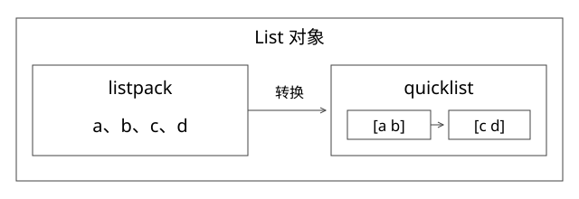

# 源码精读：Redis 编码、字典、热点与故障治理

本篇回答：逻辑 List/ZSet 怎样落到内存结构，为什么一个 key 就能把某个节点打满，删除与扩容又各自可能做什么？固定 Redis 7.2.4，commit 为 d2c8a4b91e8c0e6aefd1f5bc0bf582cddbe046b7；不把其他 7.x 或 8.x 的实现自动套进来。

## 1. List：先看编码分支，再解释容器

[t_list.c](https://github.com/redis/redis/blob/d2c8a4b91e8c0e6aefd1f5bc0bf582cddbe046b7/src/t_list.c)中 listTypeTryConvertListpack、listTypeTryConvertQuicklist、listTypePush 等按编码分支处理。该版本已经支持小 List 直接使用 listpack，并非所有 List 都必然是 quicklist。

listpack 把若干元素紧凑放在连续内存中；quicklist 把多个节点连起来，节点可以承载打包数据或相应容器类型。读[quicklist.c](https://github.com/redis/redis/blob/d2c8a4b91e8c0e6aefd1f5bc0bf582cddbe046b7/src/quicklist.c)的插入与节点限制，以及[listpack.c](https://github.com/redis/redis/blob/d2c8a4b91e8c0e6aefd1f5bc0bf582cddbe046b7/src/listpack.c)的 lpInsert，才能解释连续内存移动、扩张和局部节点操作之间的成本。

### 完整推导：为什么需要大小限制和转换滞后

小 List 连续存储可节省每元素指针与分配开销，但在大块中插入、删除可能移动内存。超过大小/长度限制时转 quicklist，可以把一些工作限制在节点内；这不等于任何位置随机访问都 O(1)。

代码按 list_max_listpack_size 等配置判断能否转换，缩小时还考虑阈值滞后，以免在边界附近频繁转换。参数具体意义要看正/负值与节点限制计算，不能只背“超过固定 N 个就转换”。

## 2. ZSet：为什么同时需要跳表和字典

[t_zset.c](https://github.com/redis/redis/blob/d2c8a4b91e8c0e6aefd1f5bc0bf582cddbe046b7/src/t_zset.c)的 zsetAdd、zsetScore、zslInsert、zslGetRank 是关键入口。小集合可用 listpack；超过配置或尺寸限制时转为字典加跳表。

字典按 member 找到其 score，跳表按 score 与 member 的次序组织范围和排名。同 score 的多个 member 需要稳定次序；这不能只用“每层随机抽样”解释。

zslInsert 从高层向下查找，保存 update 前驱与 rank，再插入随机层高节点并更新 span。span 表示跨过的底层节点数量，支持按 rank 跳转。排名查询不是先 O(log n) 找节点再从头 O(n) 数数。

例子：按 score 排序 A=10、B=20、C=30，插入 X=25。更新的不仅是 B→X→C 的底层指针，还包括跨越该位置的高层 span。忘了更新 span，score 顺序仍可能看似正确，但 rank 查询会错。

平均搜索 O(log n) 基于随机层高等假设；不要当最坏情况严格保证。修改 score 还要维护有序结构及字典关联，不能只在一个字段改数值。

## 3. dictRehash：两张表的迁移在哪个实现里成立

[dict.c](https://github.com/redis/redis/blob/d2c8a4b91e8c0e6aefd1f5bc0bf582cddbe046b7/src/dict.c)的 dictRehash、_dictRehashStep、dictFind 等使用旧/新表与 rehashidx 管理迁移。迁移期间查找需要考虑两张表；渐进推进由正常操作与相应调度触发，具体暂停和 resize 策略要看条件。

dictRehash(d,n) 的 n 指迁移非空桶的步数预算，代码还限制空桶扫描次数；每个非空桶内部的链仍会整体遍历。因此“一步 rehash 固定只花 O(1) 时间”并不成立，碰撞链长度与 key 哈希成本会影响延迟。

这与 Java HashMap 的单次 resize 不是同一协议。前者通过增量推进平摊工作；后者普通实现不提供相应并发双表保障。源码里相似词汇不代表同一行为。

## 4. 单节点高负载：先看路由与工作量

[cluster.c](https://github.com/redis/redis/blob/d2c8a4b91e8c0e6aefd1f5bc0bf582cddbe046b7/src/cluster.c)的 keyHashSlot 使用 CRC16 与 16384 槽，检查第一个左花括号及其后的右花括号；该片段非空才用作 hash tag，否则回到完整 key 哈希，而不是继续寻找后面的非空片段。迁移槽能移动 key 所在节点，但不能把同一个 key 的请求自动分摊到多个主节点。

大 key 主要看字节、元素与操作成本；热 key 主要看访问频率与集中度。一个很小的热点 key 可以耗尽单节点 CPU；一个不太热但单次返回几十 MB 的 key 可压网络、客户端缓冲和主线程工作。

判断时拆：CPU/命令耗时、输入输出带宽、连接数、输出缓冲、key 尺寸、槽分布、fork/COW、持久化与复制压力。不要只看到某节点高就先替换机器。

## 5. 删除：UNLINK 为什么也不是“立刻释放所有内存”

[lazyfree.c](https://github.com/redis/redis/blob/d2c8a4b91e8c0e6aefd1f5bc0bf582cddbe046b7/src/lazyfree.c)中 freeObjAsync 使用 lazyfreeGetFreeEffort 与阈值/引用条件决定后台释放或同步减引用。小释放工作可能直接同步执行；后台排队与内存分配器也会影响实际 RSS 变化。

因此，UNLINK 可降低一部分释放工作阻塞，却不保证每个对象都走后台，也不保证返回时物理内存已经下降。大字符串是单块分配，与复杂集合大量小分配的 free effort 不同。

止血还要考虑业务是否会立即重新写回大对象，删除是否破坏必要数据，以及缓存重建是否压垮下游。更长期可限制对象/批量大小、拆分访问与治理热点；拆 key 后路由和事务语义也需要重新设计。

## 6. 淘汰、过期与缓存一致性

[evict.c](https://github.com/redis/redis/blob/d2c8a4b91e8c0e6aefd1f5bc0bf582cddbe046b7/src/evict.c)的 performEvictions 结合策略、采样与候选池推进淘汰。近似 LRU/LFU 不是应用中维护一个精确全局双向链表；不同 maxmemory-policy 的可淘汰范围也不同。

[db.c](https://github.com/redis/redis/blob/d2c8a4b91e8c0e6aefd1f5bc0bf582cddbe046b7/src/db.c)的 expireIfNeeded 与数据库读取路径衔接过期。过期控制的是失效与删除行为，不是数据源与缓存之间的跨系统事务。

时序例子：A 读到数据库旧值，B 更新数据库并删缓存，A 随后把旧值填回。先更库再删缓存仍可能遇到这种回填窗口。需依据容忍陈旧程度考虑版本化值、失效通知、读重试或其他协议；延迟双删是减小特定窗口的方法，不是普遍正确性证明。

本地热点缓存进一步增加副本数：TTL、版本和失效传播共同决定陈旧时间。分布式缓存更新成功，不代表所有进程内副本立即可见。

## 7. 持久化和复制：从故障窗口解释收益

[aof.c](https://github.com/redis/redis/blob/d2c8a4b91e8c0e6aefd1f5bc0bf582cddbe046b7/src/aof.c)的 rewriteAppendOnlyFileBackground 涉及重写与后台工作，不能把重写等同每条命令 fsync。RDB/AOF、fsync 策略、磁盘与进程故障决定不同持久性窗口。

[replication.c](https://github.com/redis/redis/blob/d2c8a4b91e8c0e6aefd1f5bc0bf582cddbe046b7/src/replication.c)的 masterTryPartialResynchronization 检查复制身份、位点和 backlog 等条件，以决定能否部分同步。副本存在不代表每个已确认写入在任意切主后都不丢。

不要将“单线程”泛化为所有网络、释放、持久化工作都只有一条线程。命令执行的主要串行部分、I/O 线程和后台任务要分别讨论。

## 8. 怎样验证

可在隔离环境比较不同尺寸 List/ZSet 的 OBJECT ENCODING、MEMORY USAGE、插入/范围/排名延迟，结合配置观察编码转换；再看节点级 CPU、网络和命令耗时。命令本身也有代价，不对大生产集合直接做全量遍历。

本组锁定并核验了源文件与符号，但未在本机启动 Redis 服务做服务器级压测。阈值行为可由源码推演，具体延迟、碎片和复制故障恢复需部署实验验证。

## 自测

Redis 7.2.4 的 List 必然是 quicklist 吗？UNLINK 必然后台释放吗？新增主节点能否自动均摊一个热 key？三者都不能如此保证，分别回到编码、free effort 和槽路由分支解释。
