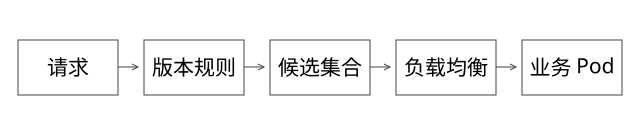

# 源码精读：容器资源、Proxy 事件循环与版本路由

本篇回答：把共享运行时变成独立 Pod 后，隔离和请求落点具体由哪些机制提供，为什么增加一个异步 Proxy 仍可能造成公共故障？源码基线为 Linux 6.6、Kubernetes 1.29.0、Netty 4.1.108.Final、Dubbo 3.2.12，commit 均见[源码锁](sources/source-lock.json)。

## 1. 先拆三个边界

namespace 决定进程所见的部分系统视图；cgroup 组织资源约束与统计；独立语言进程避免共享同一个堆、类元数据与线程运行时。容器并没有因此变成独占宿主机内核的虚拟机。

业务版本是一组 Pod；Pod 内 worker 由业务运行时管理；Proxy 自己是一组独立实例。入口选 Proxy、Proxy 选版本、版本内选实例是不同层次。平台可以限定版本候选集合，将实例选择交给已有客户端或代理。

## 2. namespace 与 cgroup：从内核入口进入

[nsproxy.c](https://github.com/torvalds/linux/blob/ffc253263a1375a65fa6c9f62a893e9767fbebfa/kernel/nsproxy.c)的 copy_namespaces 根据创建标志复制或共享相应 namespace 对象。mount、PID、network、UTS、IPC、user 等有不同职责，不能统称“给容器一个新根目录”。改变根目录也不自动等于完整安全隔离。

[cgroup.c](https://github.com/torvalds/linux/blob/ffc253263a1375a65fa6c9f62a893e9767fbebfa/kernel/cgroup/cgroup.c)中的 cgroup_attach_task 等处理任务归属；具体控制器分别管理相应资源。CPU quota 的消耗和 throttle 可沿[fair.c](https://github.com/torvalds/linux/blob/ffc253263a1375a65fa6c9f62a893e9767fbebfa/kernel/sched/fair.c)的 throttle_cfs_rq 等路径读。

### 完整推导：0.5 核为什么仍可能把延迟打高

cgroup v2 的 cpu.max 用 quota 与 period 表示预算，例如 50000/100000 表示每周期可用约 50ms CPU 时间。它不是绑定半个物理核心。多个可运行线程可较快耗尽预算，随后被限制到周期补充；宿主机总 CPU 看起来不满，容器仍可能被 throttle。

因此排障既看应用线程，也看配额、throttled 时间/次数、节点争用与请求排队。只增加线程可能让预算更快耗尽。参见固定版本[cgroup v2 文档](https://github.com/torvalds/linux/blob/ffc253263a1375a65fa6c9f62a893e9767fbebfa/Documentation/admin-guide/cgroup-v2.rst)。

内存限制、节点压力与共享依赖同样要分别讨论。独立进程能缩小某些故障范围，不保证某版本异常绝不影响同节点或共享网关。

## 3. 多版本 Deployment 与服务发现

长期并行版本可分别用不重叠标签管理 Deployment 与 Service。更新同一 Deployment 的镜像是在做该对象的滚动更新，不自动建立长期独立寻址的多个业务版本。

Kubernetes 的[Deployment sync.go](https://github.com/kubernetes/kubernetes/blob/3f7a50f38688eb332e2a1b013678c6435d539ae6/pkg/controller/deployment/sync.go)更新相应副本与状态；[EndpointSlice controller](https://github.com/kubernetes/kubernetes/blob/3f7a50f38688eb332e2a1b013678c6435d539ae6/pkg/controller/endpointslice/endpointslice_controller.go)的 syncService 处理端点对象同步。控制器维护期望状态与发现信息，不在每次业务请求里代替客户端转发。

标签 selector 若只选 app，会混入多个发布版本；按 app+release 分组才限定到版本。标签分组是寻址条件，不替代权限边界。

HPA 在[horizontal.go](https://github.com/kubernetes/kubernetes/blob/3f7a50f38688eb332e2a1b013678c6435d539ae6/pkg/controller/podautoscaler/horizontal.go) reconcileAutoscaler 等入口处理指标与副本目标。它是反馈控制，不保证新 Pod 即时可用；镜像、启动、就绪和注册传播都引入延迟。

## 4. Netty：异步不等于没有队列

[NioEventLoop.java](https://github.com/netty/netty/blob/3a3f9d13b129555802de5652667ca0af662f554e/transport/src/main/java/io/netty/channel/nio/NioEventLoop.java)的 run 包含选择策略、processSelectedKeys 和 runAllTasks。ioRatio 影响 I/O 与排队任务的执行预算，不是后端容量扩展参数。

同一 EventLoop 通常服务多个 Channel。若 handler 中同步等待模型、调用阻塞 RPC 或执行重 CPU 逻辑，其他连接的 I/O 和任务也会延迟。把结果包装为 Future 并不自动把计算挪到别的线程；要看代码真正在哪执行、监听回调在哪调度。

继续读[DefaultPromise.java](https://github.com/netty/netty/blob/3a3f9d13b129555802de5652667ca0af662f554e/common/src/main/java/io/netty/util/concurrent/DefaultPromise.java)的 notifyListeners：是否已经处于关联 executor 的 EventLoop、监听递归深度等条件，决定直接通知或再提交。不能因为注册的是“异步回调”，就默认回调在独立业务线程池执行。

[SingleThreadEventExecutor.java](https://github.com/netty/netty/blob/3a3f9d13b129555802de5652667ca0af662f554e/common/src/main/java/io/netty/util/concurrent/SingleThreadEventExecutor.java)的 execute 与队列/唤醒路径说明跨线程提交最终仍要被消费。队列无限增长会把线程占用问题转成等待和内存问题。

Linux [eventpoll.c](https://github.com/torvalds/linux/blob/ffc253263a1375a65fa6c9f62a893e9767fbebfa/fs/eventpoll.c)的 ep_poll 等处理事件等待/就绪，事件通知本身不替应用完成协议解析、业务处理或背压。epoll 高效不等于应用没有阻塞。

## 5. 出站背压与长请求

[ChannelOutboundBuffer.java](https://github.com/netty/netty/blob/3a3f9d13b129555802de5652667ca0af662f554e/transport/src/main/java/io/netty/channel/ChannelOutboundBuffer.java)记录待发送大小，用高低水位改变 writable 状态并通知。水位是信号，不是自动禁止所有后续 write；应用忽略信号仍可能继续堆积。

慢客户端、后端慢响应与大量长连接会占据在途资源。需要配合限制请求并发、排队、连接和响应缓冲，定义超时、取消与清理语义。调用方断开连接不保证后端任务已终止。

估算稳定负载下在途请求数可用吞吐×平均停留时间。例如 100 QPS、平均 20 秒，约 2000 个在途任务；还未算突发、尾部与重试。异步化避免为每个等待独占平台线程，却不消除这 2000 份上下文、连接与结果状态。

## 6. Dubbo：从调用入口到候选实例

源码入口为[AbstractClusterInvoker.java](https://github.com/apache/dubbo/blob/1dd6a4aaa8816cf3f1585769dfff4f325e4ecd15/dubbo-cluster/src/main/java/org/apache/dubbo/rpc/cluster/support/AbstractClusterInvoker.java)：invoke 先 list(invocation)，取得目录候选，再初始化负载均衡等，并进入具体 doInvoke。list 委托 Directory，不应把所有路由归到一个 LoadBalance 方法。

[RegistryDirectory.java](https://github.com/apache/dubbo/blob/1dd6a4aaa8816cf3f1585769dfff4f325e4ecd15/dubbo-registry/dubbo-registry-api/src/main/java/org/apache/dubbo/registry/integration/RegistryDirectory.java)的 refreshInvoker 把发现变化转为可调用对象；[RouterChain.java](https://github.com/apache/dubbo/blob/1dd6a4aaa8816cf3f1585769dfff4f325e4ecd15/dubbo-cluster/src/main/java/org/apache/dubbo/rpc/cluster/RouterChain.java)在此版本还衔接单路由链等抽象，不能用其他版本一张类图代替。

按接口/group/version 取得服务引用，是限定逻辑服务身份的一种方式；按发布元数据过滤是另一种。API 兼容版本与业务发布版本并非天然相等。注册中心使用应用级还是接口级模型，也影响地址与元数据如何汇合。

Proxy 每请求改共享 ReferenceConfig.version 或重新创建引用都不合适；应按正确作用域管理引用、缓存与回收。Java RPC 方案接 Python 还要验证协议、序列化、服务标识和 SDK 能力，不能仅凭名字相同就推导互通。

## 7. 重试为什么可能破坏写操作

[FailoverClusterInvoker.java](https://github.com/apache/dubbo/blob/1dd6a4aaa8816cf3f1585769dfff4f325e4ecd15/dubbo-cluster/src/main/java/org/apache/dubbo/rpc/cluster/support/FailoverClusterInvoker.java)的 doInvoke 与 calculateInvokeTimes 展示 retries+1、重复取候选和选择实例等行为。网络异常后，对端可能已经产生副作用，切换实例再调可能重复执行。

retries=0 在该路径表示一次尝试，不提供端到端唯一执行。浏览器、上游 Proxy 和任务恢复仍可能重发，业务幂等键与结果查询仍需要由业务接口保证。

## 8. 排空、配置传播与验证

摘流、停止新请求、等待在途完成、释放引用、终止实例是不同动作。发现传播与长连接可能延迟，新请求可能仍落到已在退出的实例；应考虑实例拒绝新任务、Proxy 状态与退出窗口共同配合。

规则先到而地址后到、目标版本零实例时，必须有明确失败或获准回退语义，不能静默调用旧版。控制面不可用时缓存可帮助短暂继续服务，但过旧地址也有风险。

本地可用模型验证选择集合、配额与在途估算；未启动 K8s、Dubbo、Netty 集成集群，因此不声称已验证线上无损下线、调度时延或吞吐上限。

## 自测

容器限额、EventLoop、出站缓冲和 RPC 重试分别保护什么？增加 Pod 后为何长连接流量仍可能不均？回答时沿请求与状态路径拆开，而不是统一说“框架负责”。
