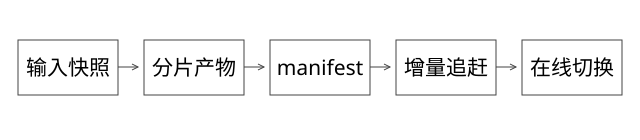

# 源码精读：分片构建、Kafka 消费与恢复协议

本篇回答：全量任务失败后怎样复用产物、和增量衔接，为什么有锁、有 offset、有副本仍不能单独保证数据正确？参照 Kafka 3.7.0、ZooKeeper 3.9.2 与本地协议模型；内部引擎加载协议不能从这些开源项目推断。

## 1. 先画清输入、输出与提交点

DUMP 将一致定义的源数据转换为构建输入；Build 按 schema、索引与模型配置生成可加载产物；分发将产物交付目标实例；在线验证确认实例已经加载并能服务。每步成功条件不同。

分片身份应关联输入快照、转换/构建定义、分片规则和产物校验。只知道“第 3 片昨天成功过”不足以复用；输入或构建配置变化，旧片可能不能拼进新版本。

## 2. 完整推导：三片任务在第二片失败

输入快照 S1 按固定规则分成 P0/P1/P2。P0 与 P2 已输出校验完整的临时产物，P1 失败。若所有定义未变，可重跑 P1，再汇总 manifest；若换成 S2 或更改字段语义，旧 P0/P2 即使文件存在也不能当然复用。

产物写入与“完成”记录之间有窗口。推荐按尝试写隔离路径，先验证内容，再提交可追溯 manifest，发布端只使用完整且身份匹配的 manifest。单靠目录存在或文件大小大于零不能证明完整。

并行度受源读取、计算、存储、分发与调度共同限制。分片记录数相等不代表字节和计算量相等；尾片可能决定总完成时间。固定预留 CPU、峰值 CPU 和核时还要分别统计。

## 3. ZooKeeper 锁：看前驱并不等于防止旧写入

参考[WriteLock.java](https://github.com/apache/zookeeper/blob/e454e8c7283100c7caec6dcae2bc82aaecb63023/zookeeper-recipes/zookeeper-recipes-lock/src/main/java/org/apache/zookeeper/recipes/lock/WriteLock.java)中的临时顺序节点创建、排序与前驱监听：不是最小节点就关注相应前驱，降低所有竞争者同时监听同一热点的惊群。

若前驱在设置 watch 前已消失，exists 返回结果与再次判断要衔接；会话失效后，临时节点状态也会改变。[PrepRequestProcessor.java](https://github.com/apache/zookeeper/blob/e454e8c7283100c7caec6dcae2bc82aaecb63023/zookeeper-server/src/main/java/org/apache/zookeeper/server/PrepRequestProcessor.java)的事务准备是服务端研究入口，但客户端“认为持锁”的时间不能直接扩大成下游写入的安全区间。

A 获得锁后暂停，B 接手并发布新版本，A 恢复后仍可能尝试发布旧产物。fencing 的关键是下游验证单调 token 或版本条件；仅有顺序节点却不在写入端检查，不会自动拒绝 A。续约、锁协调和防旧执行写入分别解决不同问题。

## 4. Kafka 手动 assign 的真正路径

在本版本[KafkaConsumer.java](https://github.com/apache/kafka/blob/2ae524ed625438c5fee89e78648bd73e64a3ada0/clients/src/main/java/org/apache/kafka/clients/consumer/KafkaConsumer.java)是委托入口，不能读到 delegate.assign 就结束。继续到[LegacyKafkaConsumer.java](https://github.com/apache/kafka/blob/2ae524ed625438c5fee89e78648bd73e64a3ada0/clients/src/main/java/org/apache/kafka/clients/consumer/internals/LegacyKafkaConsumer.java)与[SubscriptionState.java](https://github.com/apache/kafka/blob/2ae524ed625438c5fee89e78648bd73e64a3ada0/clients/src/main/java/org/apache/kafka/clients/consumer/internals/SubscriptionState.java)的 assignFromUser，理解手动分区集合与状态。

[ConsumerCoordinator.java](https://github.com/apache/kafka/blob/2ae524ed625438c5fee89e78648bd73e64a3ada0/clients/src/main/java/org/apache/kafka/clients/consumer/internals/ConsumerCoordinator.java)的 poll 对 hasAutoAssignedPartitions 分支做组管理，而手动分配走另一条路径。手动 assign 不参与自动分区分配，但 offset 提交仍可使用 group.id 的协调机制。

所以 assign 不是“同组内依旧只能一个实例读某分区”的 subscribe 分配模型；多个手动消费者可以读同一分区。若共享同一个 group.id 又都提交相同分区 offset，它们会共享并覆盖同一提交身份，恢复进度可能互相干扰。

## 5. 分片内每个副本独立消费，身份怎么设计

一个引擎分片 S 读取确定的 Kafka 分区集合；S 的多个副本都要获得对应更新。可以让每个副本拥有独立消费位点身份，或使用本地持久化检查点加手动 assign/seek。选择取决于位点存储和恢复协议。

group.id 如果使用，应关联逻辑分片副本生命周期，而不只是每次变动的 Pod 名。重建副本是继承可验证的索引检查点，还是从新快照启动，也必须明确。Kafka 分区与引擎分片是应用定义映射，不能默认编号永远相等。

1000 个 group 不会仅因一个数字就必然不支持；也不能只数 group 就断言无压力。控制面看活跃成员、组变化和提交频率；数据面看每份副本重复 fetch 的总吞吐、连接与服务端资源。manual assign 可改变组管理负担，但不消除拉取与位点存储成本。

源码再向 broker 读[GroupMetadataManager.scala](https://github.com/apache/kafka/blob/2ae524ed625438c5fee89e78648bd73e64a3ada0/core/src/main/scala/kafka/coordinator/group/GroupMetadataManager.scala)的 partitionFor：groupId 哈希参与组元数据分区定位。组分布与 coordinator 负载要看实际映射。[GroupCoordinator.scala](https://github.com/apache/kafka/blob/2ae524ed625438c5fee89e78648bd73e64a3ada0/core/src/main/scala/kafka/coordinator/group/GroupCoordinator.scala)的 groupMaxSize 条件针对组内成员，不能把它读成整个集群允许的 group 总数。

## 6. poll、索引写入与提交 offset

[Fetcher.java](https://github.com/apache/kafka/blob/2ae524ed625438c5fee89e78648bd73e64a3ada0/clients/src/main/java/org/apache/kafka/clients/consumer/internals/Fetcher.java)和 SubscriptionState 衔接消费位置与拉取；ConsumerCoordinator 的 commitOffsetsSync 提交位点、处理请求与重试。提交位点表示下次读取位置，不是这条记录所产生的任意外部副作用已经事务提交。

时序：读 offset 10，索引写成功，提交 11 前崩溃，重放会再看到 10。反向先提交 11 再写索引，崩溃则可能跳过未落地更新。Kafka 自身不能替外部索引提供原子事务。

可将索引可恢复状态与每分区检查点一起持久化，恢复时据此 seek；否则通过实体版本幂等处理重复。必须区分内存已应用、可查询、已经持久化与 offset 已提交，尤其不能把 NRT 可见当成磁盘恢复点。

并发处理同分区记录时，已完成的最大 offset 不等于可提交 offset。若已交付 10、11、12，10 完成、11 未完成、12 完成，只能越过已交付记录的完成前缀，不能直接提交 13。实际 offset 数字可能有空洞，不能永远等待从未交付的整数；应跟踪实际交付和在途记录，详见[位点恢复详解](实现详解_26_Kafka位点与外部索引恢复.md)。多个分区各自保存向量位置。

## 7. 重复、乱序和幂等

按实体保存业务版本，应用新事件时比较版本，可以拒绝迟到旧值。offset 只在其分区范围内有意义；跨分区更新同实体时，需要自己的序列或冲突协议。

删除也需要版本或 tombstone 语义：删掉实体后若忘了删除版本，迟到的旧更新可能让它复活。简单“查不到就插入”不足以处理乱序删除。

生产端[Sender.java](https://github.com/apache/kafka/blob/2ae524ed625438c5fee89e78648bd73e64a3ada0/clients/src/main/java/org/apache/kafka/clients/producer/internals/Sender.java)的 runOnce 与重试、请求发送相关；[ProducerStateManager.java](https://github.com/apache/kafka/blob/2ae524ed625438c5fee89e78648bd73e64a3ada0/storage/src/main/java/org/apache/kafka/storage/internals/log/ProducerStateManager.java)管理生产者状态与序列。生产端幂等不自动去重两个业务请求，也不自动覆盖消费侧外部索引写入。

## 8. 全量与增量到底怎样对齐

假设快照包含到每个分区边界之前的数据，记录其向量 P；新索引从 P 继续追增量，达到某个一致定义的目标水位并通过加载验证，再切换服务。快照与 P 必须有可解释的一致关系；随手记下当时的 Kafka 最新 offset，不能证明快照恰好覆盖相应事件。

保留与数据删除策略还要足够支持构建时长。若从快照对应位置开始的增量已过保留期，需要重新取快照或补数，不能通过 auto.offset.reset 静默跳过后声称无丢失。

分发成功后要确认目标实例加载了预期 manifest/索引版本，并通过必要的可用性或数据检查。HTTP 上传成功、文件存在、引擎已加载和请求正确，是四种不同证据。

## 9. 副本高可用与确认边界

[Partition.scala](https://github.com/apache/kafka/blob/2ae524ed625438c5fee89e78648bd73e64a3ada0/core/src/main/scala/kafka/cluster/Partition.scala)的 appendRecordsToLeader 与[ReplicaFetcherThread.scala](https://github.com/apache/kafka/blob/2ae524ed625438c5fee89e78648bd73e64a3ada0/core/src/main/scala/kafka/server/ReplicaFetcherThread.scala)的 processPartitionData 可用于追踪 leader 追加和副本拉取。

Kafka 日志副本与引擎索引副本是两套高可用机制。前者保存消息不代表后者已追上、已加载或能正确响应。故障切换还要看副本进度、leader epoch/截断处理、确认策略、min ISR 与选举策略等条件，不能只报副本数。

## 10. 验证与自测

本地[协议模型](examples/source-level/expert_models.py)检查完整分片、旧执行 fencing、实体版本和连续完成前缀。已有[Kafka Java 示例](Kafka_分片副本独立消费与Java实现.md)帮助理解消费者骨架；本轮不将模型结果视为真实 broker 或内部引擎故障注入结果。

## 自测

锁、消息位点和副本分别证明什么？快照边界缺失时能否保证全增量无缝衔接？提交最大已完成 offset 能否保证不漏？答案要落到明确身份、持久化状态和失败窗口。
