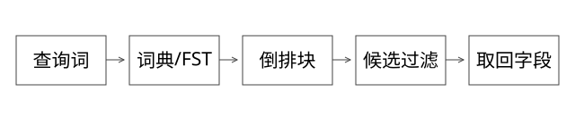

# 源码精读：Lucene 写入、词典、压缩与检索执行

本篇回答：一份文档怎样变成可检索结构，词典怎样定位倒排，查询怎样跳过候选，NRT 可见与持久化提交有什么区别？固定 Lucene 9.9.2，commit a2939784c4ca60bc28bf488b5479c02fc2e5e22c。具体 codec 随版本变化，本版 postings/压缩重点读 lucene99，BlockTree 类仍位于 lucene90 包，不能从包名直接推断整个索引版本。

## 1. 从 IndexWriter 到 Segment

[IndexWriter.java](https://github.com/apache/lucene/blob/a2939784c4ca60bc28bf488b5479c02fc2e5e22c/lucene/core/src/java/org/apache/lucene/index/IndexWriter.java)的 addDocument/updateDocument、flush、prepareCommit 等入口衔接文档索引、删除/更新序列和提交。进入[DocumentsWriterPerThread.java](https://github.com/apache/lucene/blob/a2939784c4ca60bc28bf488b5479c02fc2e5e22c/lucene/core/src/java/org/apache/lucene/index/DocumentsWriterPerThread.java)看线程局部写入与 flush。

文档经字段处理生成不同结构：倒排支持按词找文档；stored fields 用于取回存储内容；DocValues 支持部分列式访问/排序聚合；point/vector 等有各自格式。“正排”是较宽泛的教学分类，不能把所有按文档访问的结构都当作同一种文件。

docID 是段内定位，不是稳定业务 ID。合并可能改变 docID；业务更新通常按稳定业务主键对应的项组织删除与新增，不是到倒排文件里原地替换一行。

## 2. refresh、flush、commit 与 merge

flush 将内存索引状态转成段相关产物，但不等于形成新的持久化提交点。NRT reader 可以从写入器观察到未 commit 的更新，是否应用相应删除也受打开选项影响。

[StandardDirectoryReader.java](https://github.com/apache/lucene/blob/a2939784c4ca60bc28bf488b5479c02fc2e5e22c/lucene/core/src/java/org/apache/lucene/index/StandardDirectoryReader.java)的不同 open 路径分别面对提交与写入器状态。原 reader 是自己的快照，不会因为 IndexWriter 收到新文档就自动变化。

[SegmentInfos.java](https://github.com/apache/lucene/blob/a2939784c4ca60bc28bf488b5479c02fc2e5e22c/lucene/core/src/java/org/apache/lucene/index/SegmentInfos.java)的 prepareCommit/finishCommit 衔接 pending segments、rename 与元数据同步。commit 点标识一组一致的段引用，并依赖 Directory 的相应同步语义。

merge 合并段并处理相应删除等状态，会消耗读写带宽与 CPU；它不是每次 refresh 的必要前置，也不能被描述成“合并完才可搜索”。吞吐、段数、尾延迟、恢复点需要联合考虑。

## 3. BlockTree 与 FST：索引词典不是倒排正文

从[SegmentTermsEnum.java](https://github.com/apache/lucene/blob/a2939784c4ca60bc28bf488b5479c02fc2e5e22c/lucene/core/src/java/org/apache/lucene/codecs/lucene90/blocktree/SegmentTermsEnum.java)的 seekExact/seekCeil 读：先处理字段范围、已有 seek 状态与公共前缀，再使用词项索引导航相应块，读取块内信息并判断目标词。

FST 为 BlockTree 的前缀/块导航提供紧凑索引；不能说“每个完整词都在 FST 里直接存全部倒排地址”。块中的后缀、floor block 与词项元数据共同完成定位。

[FST.java](https://github.com/apache/lucene/blob/a2939784c4ca60bc28bf488b5479c02fc2e5e22c/lucene/core/src/java/org/apache/lucene/util/fst/FST.java)的 findTargetArc 涉及目标 label 的转移查找，不只是把字符串放进普通 Java Map。不同节点编码/出边组织影响查找和压缩方式，路径输出还需要按所选 Outputs 语义累计。

### 完整推导：为什么“共享前缀”还不够

Trie 可以共享前缀；有限状态转换器还可在构建条件下合并等价后续状态，并把输出组织到路径。输入顺序、输出语义和构建器约束共同影响能否共享。已有[FST 图解](索引结构进阶_FST与整数压缩.md)用小字典手算；本篇将它接回真实 seek 路径。

查询相近词可复用公共前缀 seek 状态。这个优化不意味着任何 seek 都从头线性遍历整个词典，也不意味着 FST 中不存在某条前缀就能脱离 BlockTree 布局随意解释所有结果。

## 4. Postings：nextDoc 与 advance 的差别

[Lucene99PostingsReader.java](https://github.com/apache/lucene/blob/a2939784c4ca60bc28bf488b5479c02fc2e5e22c/lucene/core/src/java/org/apache/lucene/codecs/lucene99/Lucene99PostingsReader.java)的枚举器缓冲文档、频次等数据；advance(target) 可结合 skip 信息跳到接近目标的块，再解码并定位。

例如词 A 出现于 {3,7,18}，词 B 出现于 {7,20}。求交时短列表推进到 7，长列表可 advance(7)，而不是为每个候选从头遍历。advance 要遵守迭代器单调推进的使用契约。

[ConjunctionDISI.java](https://github.com/apache/lucene/blob/a2939784c4ca60bc28bf488b5479c02fc2e5e22c/lucene/core/src/java/org/apache/lucene/search/ConjunctionDISI.java)按代价组织迭代器、通过 doNext 对齐候选，并对适用 BitSet 走相应路径。过滤既可能影响候选生成，也可能以候选成员判断执行；不能一概说“全部先召回到内存再过滤”。

## 5. 压缩：差分、位打包与异常值

将 docID 3、7、18 化为差分 3、4、11，可以利用小整数分布。实际格式还区分块、尾部、频次等信息，并非所有字段都统一编码为 VInt。

[ForUtil.java](https://github.com/apache/lucene/blob/a2939784c4ca60bc28bf488b5479c02fc2e5e22c/lucene/core/src/java/org/apache/lucene/codecs/lucene99/ForUtil.java)处理固定块的位打包与解码；[PForUtil.java](https://github.com/apache/lucene/blob/a2939784c4ca60bc28bf488b5479c02fc2e5e22c/lucene/core/src/java/org/apache/lucene/codecs/lucene99/PForUtil.java)的 token 编码基准位宽与异常数，再恢复异常高位。本版相关块大小为 128，不能套用其他 codec 或版本的块大小。

位打包小例子：[1,2,3,1000] 若所有值都按 10 bit 存为 40 bit；若小值用 2 bit、异常单独存，需比较本体、异常位置/高位和头部总成本，不能只算前三个数节省了多少。本版异常编码有可表达范围与数量限制，需要按实际分支评估。

压缩降低磁盘与内存传输，也增加解码工作；批量解码、缓存局部性和跳块共同影响速度。不能把压缩比直接换算为等比例 QPS 提升。

## 6. BM25：公式与实际实现要对照

[BM25Similarity.java](https://github.com/apache/lucene/blob/a2939784c4ca60bc28bf488b5479c02fc2e5e22c/lucene/core/src/java/org/apache/lucene/search/similarities/BM25Similarity.java)的 idf、scorer 与 score 处理文档频率、长度归一化和饱和项。这个版本用缓存的 normInverse，并把 tf 部分改写成有利于浮点单调性与执行的形式。

常见教科书公式中的 (k1+1) 常数因子，在本实现得分归一形式中不以同样方式保留。对固定参数的一些排序比较可能只差常数，但数值、跨实现融合和参数解释不能直接当作完全相同。

词频增加会饱和，文档长短影响归一化；字段长度由索引选项、分析与 norm 编码等条件决定。不能把原文字符数当作 Lucene 实际评分长度。

## 7. 向量检索与过滤：为什么不能只背 HNSW

[KnnFloatVectorQuery.java](https://github.com/apache/lucene/blob/a2939784c4ca60bc28bf488b5479c02fc2e5e22c/lucene/core/src/java/org/apache/lucene/search/KnnFloatVectorQuery.java)向 reader 传入向量、k、acceptDocs 和访问预算；上层[AbstractKnnVectorQuery.java](https://github.com/apache/lucene/blob/a2939784c4ca60bc28bf488b5479c02fc2e5e22c/lucene/core/src/java/org/apache/lucene/search/AbstractKnnVectorQuery.java)负责叶子查询、过滤成本与精确/近似路径选择等机制。

[HnswGraphSearcher.java](https://github.com/apache/lucene/blob/a2939784c4ca60bc28bf488b5479c02fc2e5e22c/lucene/core/src/java/org/apache/lucene/util/hnsw/HnswGraphSearcher.java)的 searchLevel 管理已访问集合、候选与结果收集器。节点可能参与导航而不被 acceptOrds 接受为结果；因此“被过滤的节点完全不访问”不符合这条实现路径。

过滤很严格时，近似搜索能否填满 k、访问预算是否耗尽以及是否选择精确回退，都要结合上层策略。k 是结果目标，不等于固定访问 k 个向量。相似度函数、归一化、量化与数据分布共同影响召回和成本。

IVF/PQ 与 HNSW 是不同结构或压缩设计，具体实现不能从本篇 HNSW 源文件推导。本组已有向量基础讲解；需要某个其他库的源码时应另行固定其版本，不能冒充 Lucene 同时使用所有结构。

## 8. 工程验证与边界

已有正倒排/FST/压缩实验可以验证小数据结构，但不是 Lucene codec 二进制兼容测试。本轮核验固定源文件与分支，未构建 Lucene 全项目，也未声称完成真实 ANN 召回率基准。

真正评估索引方案，应固定文档、分析器、查询集和硬件，分别测构建、refresh、commit、merge、查询与恢复；向量近似结果对照精确搜索，记录过滤后的召回与访问成本。

## 自测

FST 索引是否等于完整倒排？reader 看见数据是否证明已 commit？向量结果 k 是否等于访问节点数？三者都不是。用词典块、提交文件与图搜索收集器说明区别。
