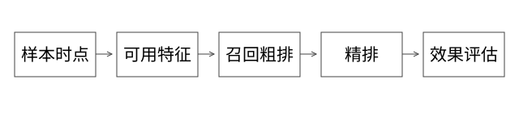

# 源码精读：特征时间、候选排序与评估实现

本篇回答：为什么一个离线指标很好的搜索/推荐系统，上线可能变差？业务特征与排序没有一个通用内核可替代所有公司实现，因此这里以[可执行模型 expert_models.py](examples/source-level/expert_models.py)为参考源码，并与 Lucene 检索实现和已有基础文章连接。没有模型训练、线上实验数据的部分不声称已经验证效果。

## 1. 从三个阶段拆损失

召回从大集合取候选，粗排用较轻的成本筛选，精排在较小集合上做更细预测。延迟预算、特征成本、候选覆盖和分布都影响分层，不能只归因于“机器算不动”。

召回丢掉的目标，精排通常无从恢复；粗排应在计算预算内尽量保留后续有价值候选。扩大召回不保证最终更好：噪声、特征请求、排序误差与系统延迟也可能上升。

## 2. 完整推导：特征穿越需要看两个时间

样本发生于 10:00。特征 F1 的业务事件时间为 09:55，但 10:05 才到平台；F2 事件时间 09:50，09:52 已可用。按“event_time≤10:00”取最新会拿到 F1，然而线上当时看不到它。

参考实现 point_in_time 同时要求 event_time 和 available_time 不晚于样本时间，再按约定选择版本。还需考虑数据源修正、有效区间与过期规则。仅 SQL join 到历史表，不足以证明没有穿越。

曝光、点击、购买也有时间顺序。把事后购买统计写回早先曝光样本，即使技术上 join 成功，仍可能泄漏标签相关信息。离线高分不能据此推导线上价值。

## 3. 线上线下一致性：比较的是同一函数吗

至少对齐实体 ID、特征计算窗口、缺省值、编码/归一化、更新延迟和模型版本。离线读到最新值、线上读到缓存旧值，也属于可见数据差异。

可记录采样请求的线上特征，再在相同时间条件下重算比对，区分数据差异和处理逻辑差异。全部字段都逐字节相同未必是业务唯一目标，但偏差要能解释与控制。

## 4. 双塔得分与 Top K 的成本

用户向量 u 与物品向量 v 可用点积形成一种匹配分。是否归一化决定它与余弦相似度的关系；向量范数变化可能改变点积排序，不能混同两个量。

将 M 个候选送入轻量打分再取 K，可用堆等方式组织 O(M log K) 的选择；如果实际在 ANN 索引中检索，路径与精确枚举不同，见[Lucene 向量检索](源码精读_07_Lucene索引与检索.md)。模型结构、损失、训练负样本与在线分布也不能由一个点积公式全部代表。

## 5. 粗排如何对齐精排

一种可用指标是：在同一候选集合与条件下，精排的 Top K 中有多少被粗排保留到后续。若精排 Top2={A,B}，粗排保留 {A,C}，保留率为 1/2。

这只衡量对指定 teacher/精排的保留，不是对真实用户价值的完美 ground truth。teacher 也会错，离线打分集合还可能有曝光选择偏差。不同召回集合下比较，需要说明分母和覆盖范围。

## 6. 指标源码中的四个边界

参考 recall_at_k 对 relevant 集与预测 Top K 求交；空 relevant 时约定返回未定义，不能混成“系统召回失败”或随意当 100%。

precision 与 recall 使用不同分母。重复返回同一 ID 不应人为增加命中数，同时重复可能是需要单独惩罚的质量错误。

NDCG 将相关性映射为增益，按排名折扣，再与同一目标集合的理想排序比较。标签、增益函数、截断 K、并列顺序和全零标签约定都会改变值。

参考函数默认只评价传入标签的排列；若存在漏召回目标，应显式传入完整评价集合的 ideal_labels，而不是把自己的返回项重排后当唯一理想分母。计算例子见[指标契约详解](实现详解_37_Recall与NDCG及RRF的计算契约.md)。

RRF 融合名次而非原始分数。参考实现使用从 1 开始的 rank 与固定常数；它能缓解不同检索分数量纲问题，但不能自动消除重复文档、权限和过期证据。相关数据流可对照已有[搜推特征与效果文章](搜推系统_特征时间与效果评估.md)。

## 7. 分流与 A/B 的边界

按用户稳定分桶只是实验执行的一部分。还需要实验单元、分层/互斥、曝光日志、指标归因、样本比例检查、实验时长和护栏。多处联动变更还要保证一个用户命中一致实验上下文。

“新版本用户购买更多”可能受到人群、活动和时间差异影响。需要按设计比较，并注意同商家、同家庭或社交关系等干扰。显著性方法与假设要依据实验单位和指标分布，不能凭一次波动宣布提升。

## 8. 从效果异常定位到实现

请求是否命中预期版本？使用了哪份模型和特征？召回数量与分布是否变化？粗排是否丢了关键候选？精排输出是否异常？后置干预有没有覆盖结果？展示层有没有正确补全？

这条排障顺序把效果与工程连起来。只看最终 CTR 变化，不足以定位是数据、模型、候选、路由还是展示问题。

## 9. 实验与自测

运行 expert_models.py，观察 event_time 单条件会选到晚到特征，双时间条件保留当时真实可见值；同时核对 recall、NDCG 与 teacher 保留率。程序是小规模确定性实现，不是在线训练或因果实验。

## 自测

事件时间早于样本就一定能用于训练吗？粗排复现 teacher 就等于业务最优吗？分了 50% 流量就完成实验了吗？分别从可用时间、teacher 偏差和实验设计回答。
