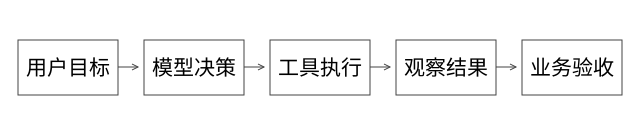

# 源码精读：Agent 循环、工具派发、恢复与评测

本篇回答：Agent 运行框架究竟替应用做了什么，为什么工具调用成功、checkpoint 和没有更多 tool call 都不能单独证明任务完成？参考 Eino v0.7.0，commit 18427c201b3315586802260f8b20a97f6b008e8b；它用于机制研究，不代表某个 Codex 集成项目使用 Eino。

## 1. 把应用边界分开

已有用户在编码 Agent 中使用 Skill，意味着操作知识与平台工具被接入该执行环境。它不要求另外新建一个 Agent 产品或自研全部运行时。

模型生成决策；Skill 提供工作方法；工具执行真实程序；框架管理部分调度、消息与恢复；业务服务保证自己的约束与结果。知识检索和业务评测又是独立能力。

## 2. ReAct 源码：不是一句无限 while

参考[flow/agent/react/react.go](https://github.com/cloudwego/eino/blob/18427c201b3315586802260f8b20a97f6b008e8b/flow/agent/react/react.go)的 NewAgent、modelPostBranchCondition、toolsNodePreHandle 与图编译。消息状态衔接模型和工具节点；输出包含工具调用时走工具，否则进入 END；还支持特定工具直接返回和最大运行步数等行为。

流式输出的工具检测同样有前提。本版本的默认检查器与首块行为有关，代码明确提示部分模型流式行为需要自定义检查。不能先读到一块普通文本就无条件认定整次生成没有工具调用。

这套 flow agent 与 ADK ChatModelAgent 是相关但不同入口。读[adk/chatmodel.go](https://github.com/cloudwego/eino/blob/18427c201b3315586802260f8b20a97f6b008e8b/adk/chatmodel.go)的 Run → buildRunFunc → newReact，再进入[adk/react.go](https://github.com/cloudwego/eino/blob/18427c201b3315586802260f8b20a97f6b008e8b/adk/react.go)。ADK 的 maxIterations 与图层最大步数不应直接混为一谈；本版相关图编译还显式处理更大的运行步数以容纳迭代语义。

## 3. ToolsNode：参数、并行和结果关联

[compose/tool_node.go](https://github.com/cloudwego/eino/blob/18427c201b3315586802260f8b20a97f6b008e8b/compose/tool_node.go)包含工具信息索引、调用任务准备、InvokableRun/StreamableRun 派发与输出消息关联。模型给出的 Arguments 是待解析的输入，不等于权限和业务条件已经通过。

本版工具节点有顺序/并行执行配置。多个工具出现在同一模型输出里，并不证明它们可以安全并行。两个只读查询或许适合并行，“发布目标版本”和“评测该版本”存在依赖，金额操作还涉及业务状态。

工具结果需按 tool call ID 关联；框架中的已执行工具记录可以帮助某些恢复路径复用结果，但不能推导外部平台与这些记录之间存在原子提交。tool call ID 也不必然是稳定业务幂等键。

## 4. Runner 中断：保存点在哪里

[adk/runner.go](https://github.com/cloudwego/eino/blob/18427c201b3315586802260f8b20a97f6b008e8b/adk/runner.go)的 Run、handleIter、resume、ResumeWithParams 管理事件、中断信息和检查点。中断路径尝试在向使用者发送中断事件前保存状态，保存错误也会形成错误事件。**但本版 `handleIter` 的保存错误分支没有立即退出，后面仍可能发送中断事件；收到中断不能证明 checkpoint 已可靠保存。** [独立细讲](实现详解_41_Checkpoint与外部副作用恢复.md)展开了这个源码分支及恢复检查。

恢复要取得状态、定位相应组件并继续执行；不是简单把“同意”追加到一段聊天文本。组件地址、序列化结构、工具与工作流版本兼容都会影响恢复。应用持久化存储还需具备相应可靠性与隔离。

[compose/checkpoint.go](https://github.com/cloudwego/eino/blob/18427c201b3315586802260f8b20a97f6b008e8b/compose/checkpoint.go)提供相应存储与选项衔接。框架接口说明能保存什么，不等于任何存储实现都已经提供持久、强一致或多实例互斥。

## 5. 完整推导：发布成功、检查点没记下

保存稳定操作意图 → 平台发布成功 → 返回或 checkpoint 前崩溃。恢复若只依据旧编排状态重跑，仍可能重复发布。正确衔接需要平台幂等操作 ID、内容摘要与状态查询，或者其他可证明的副作用协议。

这与 Kafka 外部写入窗口相同。工具调用序列、框架进度和外部业务事实是三种状态，需有明确的核对办法。[已有本地实验](examples/agent_delivery_eval_demo.py)在 SQLite 单事务域演示提交后丢响应与同键重试，不把它当分布式事务证明。

## 6. 没有 tool call 不等于目标达成

框架的 END 表示一条执行路径终止，用户任务还要验收。模型可能自认为完成、提前结束、缺少工具或无法继续。需要检查目标版本、实际业务状态、评测报告等外部条件。

“完成验证并报告回归”可以是一个成功任务；“修复所有问题并通过门槛”则未必已经完成。先定义任务成功标准，再统计完成率，避免把框架正常返回都算成功。

## 7. RAG：召回与生成增加了哪些正确性条件

文档解析与切分保留来源、版本、权限和必要上下文；查询时按合法范围检索，稀疏/稠密召回、融合与重排后生成。底层关键词与向量路径可对应[Lucene 源码篇](源码精读_07_Lucene索引与检索.md)，但业务证据选择与引用仍由上层设计。

chunk 检索分高说明相关性，不自动说明内容有效或答案由它支持。过期文档、相互冲突条款、切分丢失条件、未授权内容，都可能让“成功召回”变成错误回答。调用实时日志接口属于工具取事实，不自动等同文档 RAG。

跨组件应记录关键输入、证据引用、选择的工具、操作结果和最终判定。无需记录模型内部隐藏推理；需要的是可验证的决策与动作事实。

## 8. 上下文与权限不能靠一段提示词完成

长历史和大日志可摘要/裁剪，但应用、环境、版本、操作 ID 和已确认约束应保留结构化状态。日志或文档中的命令是数据，不自动获得用户授权。

工具执行前检查身份、目标资源与允许动作；人工确认绑定具体目标和变更，内容改变应重新判断确认是否有效。沙箱和模型指令各有边界，凭据、网络与共享文件访问仍需具体配置。

## 9. 评测要同时覆盖结果与轨迹

业务 badcase 集检查目标行为，正常样本检查回归；执行轨迹检查工具、参数和依赖顺序。不应强制只有一个完全固定调用序列：轮询与事件通知可能都是合法路径，但“目标核验前宣告评测通过”违反必要条件。

固定用例、制品、环境、评测器和必要模型配置，保存逐条改善/退化/无效对比。开放输出用规则、人工与辅助判分结合；LLM 裁判需要校准，不能自己一句“完成了”就判成功。

详见[badcase 原理](Agent工程_02_badcase评测与持续迭代.md)，其中已有精确结果与生成型任务两类例子。

## 10. 验证与边界

本轮直接阅读并锁定 Eino 相关源文件，未运行 Go/Eino 模型服务集成。Java/Python 的本地协议实验只验证指定状态与判定逻辑，不代表已验证框架所有中断、流式、多 Agent 或跨进程恢复场景。

继续学习时可围绕一个只读工具、一个有副作用工具、一次人工中断和一次提交后故障做最小集成，并记录框架状态与外部操作的对应关系。

## 自测

END、工具成功、checkpoint 和业务目标达成分别表示什么？若你能给出四者不一致的一个故障时序，才真正区分运行框架与业务正确性。
